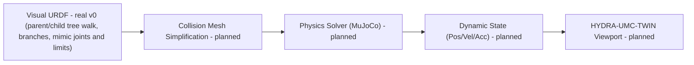

<p align="center">
  
</p>

# 🏗️ HYDRA-UMC-PHYSICS-REPLICA

<p align="center">🇺🇸 <b>English</b> | <a href="README_spa.md">🇪🇸 Español</a> | <a href="README_fra.md">🇫🇷 Français</a> | <a href="README_ita.md">🇮🇹 Italiano</a> | <a href="README_deu.md">🇩🇪 Deutsch</a> | <a href="README_zho.md">🇨🇳 简体中文</a> | <a href="README_jpn.md">🇯🇵 日本語</a> | <a href="README_por.md">🇵🇹 Português</a></p>

### 📐 URDF Forward Kinematics & Joint-Limit Validation

<p align="center">
  
  
  
  
</p>

---

> **Safety and security status:** this ecosystem is not a certified safety system. There is no hardware E-STOP path, no firmware-enforced limits or interlocks and no verified motion command yet; firmware images are checked with CRC32 and a shared-key HMAC-SHA256, not with an asymmetric signature; TLS and mutual TLS are optional and off by default; no custom board has been populated or tested yet. Read the [security baseline](https://github.com/JuanenRac/HYDRA-UMC-DOCS/blob/main/docs/SECURITY_BASELINE.md) and the [threat model](https://github.com/JuanenRac/HYDRA-UMC-DOCS/blob/main/docs/THREAT_MODEL.md) before relying on any statement here for the safety of a person.

## 📋 At a glance

| | |
|---|---|
| Version | `0.0.9` |
| Maturity | Functional |
| Stack | Rust / roxmltree / URDF forward kinematics |
| On real hardware | Not yet: no run on real hardware is recorded for this version |

## 1. 🛠️ TECHNICAL OVERVIEW

**HYDRA-UMC-PHYSICS-REPLICA** is the kinematics module of the Digital Twin: it reads a URDF kinematic tree (serial arms and branching ones such as a gripper), computes the pose of every joint (forward kinematics) and checks joint positions against their limits. It does not simulate dynamics: there is no rigid-body, contact or friction model and no MuJoCo or PhysX; those are the roadmap.

Units are those of URDF (metres and radians). `fk` prints the position of each joint; with `--json` it prints the position and the rotation as a unit quaternion.

### Key Features:
* 📐 **Kinematic Validation (v0):** real forward kinematics and joint-limit checking over a (documented-partial) URDF subset - see "Honesty check" below for exactly what runs today.
* 🔒 **Real v0 - Limit-Aware FK:** `fk-checked` refuses to compute a world-frame pose for a joint position outside its declared URDF limit, backed by a real, reusable joint-limits corpus and regression tests for both boundaries and wildly out-of-range inputs - closing the gap where plain `fk` would silently report a physically-unreachable pose.
* 🏗️ **URDF to Physics (v0, partial):** reads real `<joint>` elements (type/origin/axis/limit) and walks each joint's real `parent`/`child` link names from the document's own real root link into a chain, in genuine root-to-leaf order regardless of `<joint>` element order in the file. *Not yet real:* collision mesh generation - that's still the "physics" half of this feature.
* ⚡ **Real-Time Performance (planned):** parallelized solving for multi-robot workspaces - depends on a real physics-engine integration existing first.
* 🌡️ **Thermal Simulation (planned):** experimental support for emulating heat dissipation in tool heads (T12/Laser).
* 📋 **What the URDF reader does and does not do (real today):** only `<joint>` elements directly under `<robot>` are read (the joints inside `<transmission>` are ignored), so ros_control files parse; a revolute or prismatic joint needs an `<axis>` of non-zero length and a `<limit>` (without one, `fk-checked` and `validate-limits` refuse to check it); a continuous joint's `<limit>` gives effort and velocity only, and a fixed joint has none; duplicate joint names, a link with two parents and links that no `<link>` declares are errors; `<mimic>`, `<safety_controller>` and floating or planar joints are not supported; a name in `--joints` that the URDF does not have, or one given twice, is an error, and `validate-limits` needs a position for every limited joint unless `--allow-partial` is given (a check that was not made is never reported as "No limit violations").

**Honesty check - what actually runs today:** `fk --urdf PATH --joints "j1=0.5,..."` computes real per-joint world-frame positions by chaining URDF joint transforms, regardless of whether a position is within its declared limit; `fk-checked` runs the same computation but checks every position against `validate-limits`'s real limit check FIRST, refusing to compute (or report) a pose at all if anything is out of range; `validate-limits --urdf PATH --joints "..."` reports real out-of-range joints on its own. All three are pure kinematics - no rigid-body dynamics, no contact forces, no MuJoCo/PhysX solver is wired in yet, and the URDF reader walks the real `parent`/`child` link tree, branches included (every joint is placed from the joint that carries its parent link), works out the joints that follow another one (`<mimic>`) and, when asked, also checks the soft limits of a `<safety_controller>` and the velocity and effort limits (`validate-limits --soft --velocities ... --efforts ...`). See [`CHANGELOG.md`](CHANGELOG.md) for exactly what shipped, and the Roadmap below for what's still ahead.

---

## 2. 🔄 PHYSICS PIPELINE

`URDF` (parsing) and a real, standalone kinematics step (`fk`/`validate-limits`,
not shown as its own box below since it replaces `SOLVE`'s role for v0) are
real today. `MESH`, the real `SOLVE` step (an actual MuJoCo/PhysX solver),
`DYN`, and `TWIN` remain future work.



---

## 3. 🧱 ARCHITECTURE & DESIGN DECISIONS

* **Why this simulation has no `hardware/`/`firmware/`/`os/` folders.** Pure software - no board of its own, so those folders were pruned rather than left empty.
* **Why it's a sibling, not a submodule, of HYDRA-UMC-TWIN.** The physics solver runs on its own tick rate, independent from rendering - keeping it a separate process means a slow physics step doesn't stall HYDRA-UMC-TWIN's own frame rate, and either can be swapped/upgraded (e.g. MuJoCo vs PhysX) without touching the other.
* **How this fits the rest of the ecosystem.** A child of HYDRA-UMC-TWIN by design. Today HYDRA-UMC-TWIN does not call it: the physical plausibility check behind "if it works in the Twin, it works on the floor" is planned, not built.
* **Why a branching URDF is read as a `Model` and `parse_urdf` still refuses it.** v0 used to parse `<joint>` elements in raw document order and treat that order as the chain, which is wrong for any spec-valid URDF that declares its joints out of tree order; every joint's real `parent`/`child` link names are now walked from the document's real root link. `parse_urdf_model` keeps the whole tree: the joints in parent-before-child order, the index of each joint's parent joint (a gripper's two fingers are both placed from the palm, not one after the other), the followers of `<mimic>` (`multiplier * master + offset`; a position given for a follower is refused, a circle of followers is refused) and the effort, velocity and soft limits. `parse_urdf` keeps its original contract, a flat serial `Chain`, and refuses a branch with a real error instead of silently keeping one branch and dropping the other. Not done: a Jacobian, inverse kinematics, and `<mimic>` on a continuous joint beyond the position it derives (see `urdf.rs`).
* **Why `roxmltree` is the only dependency, not a full physics-engine binding yet.** Real forward kinematics and limit checking need nothing beyond reading XML attributes and doing matrix math by hand (`transform.rs`) - adding a MuJoCo/PhysX FFI binding for that would be dependency weight with no real payoff until actual rigid-body/contact simulation is being built.
* **Why `fk-checked` is a new subcommand instead of changing `fk` in place.** `fk` is the existing low-level pure-math utility - some callers (e.g. tuning a limit itself) genuinely want the unchecked pose for an out-of-range value. `fk-checked` adds the fail-safe, limit-gated entry point real callers should use, without silently changing what `fk` has always meant.
* **Why the joint-limits corpus (`corpus.rs`) is test-only.** It exists purely to give `limits.rs`'s and `kinematics.rs`'s regression tests one shared, real set of fixtures instead of duplicated ad hoc literals - it has no reason to ship in the release binary, so it's gated behind `#[cfg(test)]`.

---

## 📂 DIRECTORY STRUCTURE

Pure software simulation engine, with no hardware design of its own; source
folders are included only when their implementation requires them, so this
project carries no `hardware/`, `firmware/` or `os/` folders.

```text
HYDRA-UMC-PHYSICS-REPLICA/
├── src/
│   ├── transform.rs      # Real Vec3/Mat4 math (translation, axis-angle rotation, rpy)
│   ├── urdf.rs           # Real, partial URDF reader (parent/child tree walk, branches, mimic and the limits)
│   ├── kinematics.rs     # Real forward_kinematics() + forward_kinematics_checked()
│   ├── limits.rs         # Real validate_limits()
│   ├── corpus.rs         # Test-only reusable joint-limit fixture corpus
│   └── main.rs           # Entry point + real `fk`/`fk-checked`/`validate-limits` subcommands
├── docs/
│   └── CLI_REFERENCE.md # Full command-line reference, every exit code and error case
├── build/               # Build notes/artifacts (cargo's own output lives in target/, gitignored)
├── images/              # Media and diagrams
├── tools/
│   ├── build_test.py    # Non-versioning build/compile check
│   └── ci_validate.py   # Manifest/CHANGELOG/docs validation used by CI
├── Cargo.toml           # Package metadata, dependencies (roxmltree), odometer version
├── bump_version.py      # Odometer-style version bump (run only by the explicit `bump` command)
├── bump_manifest_version.py # Syncs hydra-umc.project.json's version to the native one (--sync)
├── build.sh / build.bat # Validate and build (building never changes the version)
├── build-test.sh / build-test.bat # Non-versioning build check (no CHANGELOG/version bump)
└── run.sh / run.bat     # Runs the compiled release binary (forwards arguments)
```

---

## 🏗️ BUILD AND RUN GUIDE

Requires the Rust toolchain (`cargo`/`rustc`, install via [rustup](https://rustup.rs)) and Python 3.10+ (only for `bump_version.py`).

```bash
# Linux / macOS
./build.sh   # `cargo test` (64 tests), then `cargo build --release`
./run.sh     # runs target/release/hydra-umc-physics-replica, prints name + version + role
```

```bat
:: Windows
build.bat
run.bat
```

`build.sh`/`build.bat` never change the version (only `python tools/hydra_project_tool.py bump` raises it), run the real test suite, then build a release binary.

The real `fk` and `validate-limits` subcommands need a URDF file:

```bash
./run.sh fk --urdf arm.urdf --joints "shoulder=0,elbow=0"
# shoulder: x=0.000000 y=0.000000 z=0.200000
# elbow: x=0.300000 y=0.000000 z=0.200000

./run.sh validate-limits --urdf arm.urdf --joints "shoulder=3.0,elbow=0.2"
# LIMIT VIOLATION: joint 'shoulder' = 3.000000 (allowed [-1.570000, 1.570000])
```

The real `fk-checked` subcommand refuses to compute a pose at all when a joint is out of range - unlike plain `fk`, which computes it anyway:

```bash
./run.sh fk-checked --urdf arm.urdf --joints "shoulder=0.5,elbow=0.2"
# shoulder: x=0.000000 y=0.000000 z=0.200000
# elbow: x=0.263275 y=0.143828 z=0.200000

./run.sh fk-checked --urdf arm.urdf --joints "shoulder=0.5,elbow=5.0"
# LIMIT VIOLATION: joint 'elbow' = 5.000000 (allowed [-2.000000, 2.000000]) - refusing to compute an unreachable pose

./run.sh fk --urdf arm.urdf --joints "shoulder=0.5,elbow=5.0"
# elbow: x=0.263275 y=0.143828 z=0.200000   <- computed anyway; this is the gap fk-checked closes
```

`fk` exits `0` on success, `2` on a bad `--urdf`/`--joints` value. `fk-checked` exits `0` (real pose), `1` (limit violation), or `2` (bad input). `validate-limits` exits `0` (no violations), `1` (violations found), or `2` (bad input).

See [`docs/CLI_REFERENCE.md`](docs/CLI_REFERENCE.md) for the full command reference, including every real error case (missing/malformed arguments, an unreadable URDF file) captured from an actual release-binary run.

---

## 🚀 ROADMAP
* **Phase 1:** Digital Twin synchronization with real-time hardware telemetry and sub-10ms latency.
* **Phase 2:** Physics Replica integration with industrial-grade simulators (Isaac Sim) and deformable body support.
* **Phase 3:** Node Healing automated recovery patterns for decentralized failover and early sensor degradation detection.
* **Phase 4:** Support for deformable body simulation (cables and vacuum tubes) and photorealistic synthetic data generation.

---

## 🔗 Related Projects

This project is part of the HYDRA-UMC robotics ecosystem by the same author (JuanenRac / Electro Hobby 3D). Worth knowing about, since a request might actually be about one of these rather than this repository.

**Parent Project**
- **[HYDRA-UMC-TWIN](https://github.com/JuanenRac/HYDRA-UMC-TWIN)** — integration hub for the digital-twin engine, with a real version-compatibility sync contract; the parent this repo is one specific simulation service of, within its own digital-twin engine.

**Sibling Projects** — the other simulation services of HYDRA-UMC-TWIN's own digital-twin engine
- **[HYDRA-UMC-HIL-BRIDGE](https://github.com/JuanenRac/HYDRA-UMC-HIL-BRIDGE)** — hardware-in-the-loop router with a software collision interlock between simulation and real hardware (tested without real hardware).
- **[HYDRA-UMC-SYNTHETIC-DATA-GEN](https://github.com/JuanenRac/HYDRA-UMC-SYNTHETIC-DATA-GEN)** — real procedural 2D scene generator with YOLO/COCO annotation export.

**Directly Related**
- **[HYDRA-UMC-EDITOR-URDF](https://github.com/JuanenRac/HYDRA-UMC-EDITOR-URDF)** — desktop graphical URDF creator/editor that pushes finished models into STUDIO's own catalog — the tool the URDF models this project reads (`fk`/`validate-limits`) are authored with.
- **[HYDRA-UMC-EDITOR-STL](https://github.com/JuanenRac/HYDRA-UMC-EDITOR-STL)** — desktop STL model editor, transforming/replacing/removing/adding real parts in the same model catalog HYDRA-UMC-EDITOR-URDF also edits.

**Also Part of the Ecosystem**

*Core Hardware & Platform*
- **[HYDRA-UMC](https://github.com/JuanenRac/HYDRA-UMC)** — the robot-arm motherboard design: CM5 host + dual-core STM32H745, meant to orchestrate up to 8 tool arms over CAN-OTA/SPI-OTA (firmware at an early stage; no populated board yet).
- **[HYDRA-UMC-OS](https://github.com/JuanenRac/HYDRA-UMC-OS)** — reproducible Raspberry Pi OS product layer for the CM5: read-only agent, validated config/profiles, WiFi first-contact provisioning.
- **[HYDRA-UMC-SDK](https://github.com/JuanenRac/HYDRA-UMC-SDK)** — the shared JSON-Schema contract and software job-gate boundary every bridge validates its commands against (not a certified safety function).
- **[HYDRA-UMC-CONNECTOR-HUB](https://github.com/JuanenRac/HYDRA-UMC-CONNECTOR-HUB)** — declarative adapter-manifest registry and validator for external-machine connectors; extends the SDK's own contract idea to external machines without replacing the industrial-gateway projects.

*Core Backend & Clients*
- **[HYDRA-UMC-SERVER](https://github.com/JuanenRac/HYDRA-UMC-SERVER)** — the real headless backend (REST/WebSocket) every control client actually talks to.
- **[HYDRA-UMC-STUDIO](https://github.com/JuanenRac/HYDRA-UMC-STUDIO)** — web control dashboard with real-time multi-robot 3D visualization.
- **[HYDRA-UMC-SUITE](https://github.com/JuanenRac/HYDRA-UMC-SUITE)** — desktop (PySide6) swarm command center for multiple servers at once, packaged as a standalone executable.
- **[HYDRA-UMC-ANDROID-CONTROL](https://github.com/JuanenRac/HYDRA-UMC-ANDROID-CONTROL)** — native Android control app with biometric login and a paired Wear OS companion.
- **[HYDRA-UMC-IOS-CONTROL](https://github.com/JuanenRac/HYDRA-UMC-IOS-CONTROL)** — iOS/iPadOS control app (Flutter) with real-time WebSocket sync.
- **[HYDRA-UMC-DSI](https://github.com/JuanenRac/HYDRA-UMC-DSI)** — native touch UI for the onboard 7" DSI touchscreen, embedded on the CM5 itself.
- **[HYDRA-UMC-BRIDGE-AMR](https://github.com/JuanenRac/HYDRA-UMC-BRIDGE-AMR)** — coordination boundary for AGV/AMR fleets via a VDA 5050 MQTT publisher (tested against an emulated fleet only).
- **[HYDRA-UMC-BRIDGE-CNC](https://github.com/JuanenRac/HYDRA-UMC-BRIDGE-CNC)** — high-level CNC-cell coordinator with GRBL status/control-byte access (tested against an emulator only).
- **[HYDRA-UMC-BRIDGE-DROIDS](https://github.com/JuanenRac/HYDRA-UMC-BRIDGE-DROIDS)** — coordination boundary for legged/humanoid droids, with a Boston Dynamics Spot command sender (tested against an emulator only).
- **[HYDRA-UMC-BRIDGE-LASER](https://github.com/JuanenRac/HYDRA-UMC-BRIDGE-LASER)** — laser-cell coordinator reading 3 key/enclosure/interlock GPIO signals (tested against a fake chip only; it cannot arm or fire a laser).
- **[HYDRA-UMC-BRIDGE-OPENPNP](https://github.com/JuanenRac/HYDRA-UMC-BRIDGE-OPENPNP)** — safe high-level board-flow coordinator for OpenPnP pick-and-place.
- **[HYDRA-UMC-BRIDGE-PRINTER3D](https://github.com/JuanenRac/HYDRA-UMC-BRIDGE-PRINTER3D)** — safe coordination boundary for Moonraker/Klipper 3D printers, with real gated job commands.
- **[HYDRA-UMC-BRIDGE-ROS2](https://github.com/JuanenRac/HYDRA-UMC-BRIDGE-ROS2)** — coordinator with a lazily imported rclpy ROS 2 transport (not yet run against a ROS 2 installation).
- **[HYDRA-UMC-BRIDGE-UAV](https://github.com/JuanenRac/HYDRA-UMC-BRIDGE-UAV)** — coordination boundary for camera-equipped UAVs, with a MAVLink command sender (tested against an emulator only).

*URTC Tool Platform*
- **[URTC](https://github.com/JuanenRac/URTC)** — firmware for the physical Universal Robot Tool Controller PCB, 25+ tool profiles over CAN bus.
- **[URTC-FLASHER](https://github.com/JuanenRac/URTC-FLASHER)** — desktop GUI flashing tool for URTC boards, CAN-OTA plus full-chip SWD/JTAG.
- **[URTC-TESTER](https://github.com/JuanenRac/URTC-TESTER)** — desktop live CAN-bus diagnostic tool for URTC boards, one panel per tool profile.
- **[URTC-WEB-STUDIO](https://github.com/JuanenRac/URTC-WEB-STUDIO)** — browser-based alternative to URTC-TESTER via the Web Serial API, no local install needed.
- **[URTC-GATEWAY](https://github.com/JuanenRac/URTC-GATEWAY)** — gateway in front of the URTC CAN bus: an allowed list of identifiers, a rate limit and a session key; software tested on a computer, not yet on a real bus.

*Vision AI Node (Hailo-8)*
- **[HYDRA-UMC-VISION-NODE](https://github.com/JuanenRac/HYDRA-UMC-VISION-NODE)** — integration hub for the Hailo-8 vision pipeline, with a real per-stage hardware-readiness check.
- **[HYDRA-UMC-DETECTION-HEF](https://github.com/JuanenRac/HYDRA-UMC-DETECTION-HEF)** — real compiled-model registry with Hailo-architecture/checksum safe-load verification.
- **[HYDRA-UMC-VISION-STREAMER](https://github.com/JuanenRac/HYDRA-UMC-VISION-STREAMER)** — real GStreamer pipeline + MediaMTX config generator with a real HailoRT integration boundary.
- **[HYDRA-UMC-VISUAL-SERVOING-API](https://github.com/JuanenRac/HYDRA-UMC-VISUAL-SERVOING-API)** — Position-Based Visual Servoing correction law with authorisation gated on the zone state; no camera pose estimation yet.
- **[HYDRA-UMC-SAFETY-ZONES](https://github.com/JuanenRac/HYDRA-UMC-SAFETY-ZONES)** — v0 zone-breach, calibration-freshness and E-STOP-request logic that takes object positions from a file; no detector feeds it and no physical E-STOP is wired to it yet.

*Cognitive AI Node (Hailo-10)*
- **[HYDRA-UMC-COGNITIVE-NODE](https://github.com/JuanenRac/HYDRA-UMC-COGNITIVE-NODE)** — integration hub for the Hailo-10 cognitive pipeline (LLM/VLA/voice orchestration).
- **[HYDRA-UMC-VLA-ENGINE](https://github.com/JuanenRac/HYDRA-UMC-VLA-ENGINE)** — real action-token encoding/decoding and trajectory generation for a Vision-Language-Action model.
- **[HYDRA-UMC-VOICE-UI](https://github.com/JuanenRac/HYDRA-UMC-VOICE-UI)** — real voice front-end (VAD + intent parser) with a bounded, confirmation-gated Watch relay.
- **[HYDRA-UMC-SEMANTIC-PLANNER](https://github.com/JuanenRac/HYDRA-UMC-SEMANTIC-PLANNER)** — real rule-based task decomposition and semantic error recovery over MCU error codes.
- **[HYDRA-UMC-DOCS-QA](https://github.com/JuanenRac/HYDRA-UMC-DOCS-QA)** — real stdlib-only TF-IDF document search over this ecosystem's own Markdown docs.
- **[HYDRA-UMC-LOCAL-TECHNICIAN](https://github.com/JuanenRac/HYDRA-UMC-LOCAL-TECHNICIAN)** — local, policy-gated AI maintenance technician for the ecosystem itself - observes, diagnoses and proposes fixes; the two highest risk levels are deliberately not implemented yet.

*Orchestration & Swarm*
- **[HYDRA-UMC-ORCHESTRATOR](https://github.com/JuanenRac/HYDRA-UMC-ORCHESTRATOR)** — integration hub with a real gRPC/Protobuf health-report contract and mission state machine.
- **[HYDRA-UMC-JOB-DISPATCHER](https://github.com/JuanenRac/HYDRA-UMC-JOB-DISPATCHER)** — real priority-based job queue with deduplication, over a real HTTP API.
- **[HYDRA-UMC-NODE-HEALING](https://github.com/JuanenRac/HYDRA-UMC-NODE-HEALING)** — real gRPC-based fleet health watchdog with retry/backoff and identity-mismatch detection.
- **[HYDRA-UMC-PATH-PLANNER-3D](https://github.com/JuanenRac/HYDRA-UMC-PATH-PLANNER-3D)** — real RRT-based 3D path planner with real obstacle/workspace collision validation.
- **[HYDRA-UMC-SWARM-SYNC](https://github.com/JuanenRac/HYDRA-UMC-SWARM-SYNC)** — real CRDT LWW-Element-Map state sync, property-tested for multi-cell convergence.

*Data & Analytics*
- **[HYDRA-UMC-DATALAKE](https://github.com/JuanenRac/HYDRA-UMC-DATALAKE)** — real sqlite3-backed time-series store with a real ingest/query HTTP API.
- **[HYDRA-UMC-ANOMALY-DETECTOR](https://github.com/JuanenRac/HYDRA-UMC-ANOMALY-DETECTOR)** — real FFT + statistical baseline anomaly detector with drift monitoring.
- **[HYDRA-UMC-PRODUCTION-REPORTS](https://github.com/JuanenRac/HYDRA-UMC-PRODUCTION-REPORTS)** — real OEE/availability calculation over DATALAKE history, with reproducible CSV export.
- **[HYDRA-UMC-TELEMETRY-COLLECTOR](https://github.com/JuanenRac/HYDRA-UMC-TELEMETRY-COLLECTOR)** — real CAN/WebSocket ingestion pipeline into DATALAKE, with sequence deduplication.

*Industrial Gateway*
- **[HYDRA-UMC-GATEWAY-INDUSTRIAL](https://github.com/JuanenRac/HYDRA-UMC-GATEWAY-INDUSTRIAL)** — integration hub relaying to industrial protocols, with a real command allowlist/backpressure layer.
- **[HYDRA-UMC-OPCUA-SERVER](https://github.com/JuanenRac/HYDRA-UMC-OPCUA-SERVER)** — real OPC-UA address space, verified with a real binary-protocol client session.
- **[HYDRA-UMC-MQTT-BROKER](https://github.com/JuanenRac/HYDRA-UMC-MQTT-BROKER)** — real MQTT broker with optional per-client authentication and topic ACLs.
- **[HYDRA-UMC-MTCONNECT-ADAPTER](https://github.com/JuanenRac/HYDRA-UMC-MTCONNECT-ADAPTER)** — real MTConnect `/probe` and `/current` XML endpoints with degraded-mode output.

*Complementary Tools & Ecosystem Operations*
- **[HYDRA-UMC-DASHBOARD-AI](https://github.com/JuanenRac/HYDRA-UMC-DASHBOARD-AI)** — Smart Summaries and Anomaly Highlighting panels over DATALAKE/ANOMALY-DETECTOR, with an honest statistical fallback.
- **[HYDRA-UMC-TOOL-CLI](https://github.com/JuanenRac/HYDRA-UMC-TOOL-CLI)** — fleet CLI with a real, stable exit-code contract, a genuine live client of HYDRA-UMC-SERVER's own API.
- **[HYDRA-UMC-WATCH](https://github.com/JuanenRac/HYDRA-UMC-WATCH)** — WearOS companion app with haptic alert patterns and a paired-phone voice relay (not yet run on a physical watch).
- **[URTC-SMART-RACK](https://github.com/JuanenRac/URTC-SMART-RACK)** — firmware for a board-mounting rack with real tool-ID decoding and Smart Idle pre-heating logic.
- **[URTC-VISION-TOOL](https://github.com/JuanenRac/URTC-VISION-TOOL)** — firmware plus a real Python vision companion for a thermal/RGB inspection tool head.
- **[HYDRA-UMC-UPDATER](https://github.com/JuanenRac/HYDRA-UMC-UPDATER)** — administrative desktop tool that discovers, clones and updates every repo in this ecosystem.
- **[HYDRA-UMC-OS-REBUILDER](https://github.com/JuanenRac/HYDRA-UMC-OS-REBUILDER)** — Windows/Linux desktop tool that builds a ready-to-flash CM5 image pre-loaded with the ecosystem's most current versions, with Raspberry-Pi-Imager-style first-boot Wi-Fi/user/SSH configuration.
- **[HYDRA-UMC-OPS-AGENT](https://github.com/JuanenRac/HYDRA-UMC-OPS-AGENT)** — maintenance-incident coordinator: a low-privilege edge role collects a sanitized inventory/health snapshot, a control-plane role renders it read-only and asks an AI provider to suggest a diagnosis - never applies a patch or deploys anything.
- **[HYDRA-UMC-DEV-SERVER](https://github.com/JuanenRac/HYDRA-UMC-DEV-SERVER)** — reproducible development host (Raspberry Pi 5 / CM5) that stores the ecosystem's source and runs bounded build/test tasks under a durable queue; a dedicated dev role, explicitly not an operational CM5.


---

## 📚 Documentation & Community

- **[CONTRIBUTING.md](CONTRIBUTING.md)** — tech stack and coding guidelines for a pull request.
- **[CODE_OF_CONDUCT.md](CODE_OF_CONDUCT.md)** — the standards of behavior expected in this community.
- **[SECURITY.md](SECURITY.md)** — how to report a vulnerability, and this project's own real security focus areas.
- **[SUPPORT.md](SUPPORT.md)** — where to ask questions and report bugs.
- **[LICENSE.md](LICENSE.md)** — this project's own license.

## 👤 AUTHOR
**JuanenRac** (Electro Hobby 3D)
📧 electrohobby3d@gmail.com
📺 [youtube.com/@electrohobby3d](https://youtube.com/@electrohobby3d)

## 📜 LICENSE
GPL-3.0 - See LICENSE for details.
