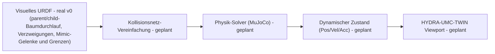

<p align="center">
  
</p>

# 🏗️ HYDRA-UMC-PHYSICS-REPLICA

<p align="center"><a href="README.md">🇺🇸 English</a> | <a href="README_spa.md">🇪🇸 Español</a> | <a href="README_fra.md">🇫🇷 Français</a> | <a href="README_ita.md">🇮🇹 Italiano</a> | 🇩🇪 <b>Deutsch</b> | <a href="README_zho.md">🇨🇳 简体中文</a> | <a href="README_jpn.md">🇯🇵 日本語</a> | <a href="README_por.md">🇵🇹 Português</a></p>

### 📐 URDF-Vorwärtskinematik & Gelenkgrenzen-Validierung

<p align="center">
  
  
  
  
</p>

---

> **Stand von Sicherheit (Safety) und Security:** Dieses Ökosystem ist kein zertifiziertes Sicherheitssystem. Es gibt noch keinen Hardware-E-STOP-Pfad, keine von der Firmware durchgesetzten Grenzen oder Verriegelungen und keinen verifizierten Bewegungsbefehl; Firmware-Images werden mit CRC32 und einem HMAC-SHA256 mit gemeinsamem Schlüssel geprüft, nicht mit einer asymmetrischen Signatur; TLS und gegenseitiges TLS sind optional und standardmäßig aus; noch keine eigene Platine wurde bestückt oder getestet. Lesen Sie die [Sicherheitsbasis](https://github.com/JuanenRac/HYDRA-UMC-DOCS/blob/main/docs/SECURITY_BASELINE.md) und das [Bedrohungsmodell](https://github.com/JuanenRac/HYDRA-UMC-DOCS/blob/main/docs/THREAT_MODEL.md), bevor Sie sich für die Sicherheit einer Person auf eine Aussage hier verlassen.

## 📋 Auf einen Blick

| | |
|---|---|
| Version | `0.0.9` |
| Reifegrad | Funktionsfähig |
| Technik | Rust / roxmltree / URDF forward kinematics |
| Auf echter Hardware | Noch nicht: für diese Version ist kein Lauf auf echter Hardware vermerkt |

## 🚦 Projektstatus

Jede Zeile ist ein Teil dieses Repositorys, und die Ampel sagt, wie weit er heute ist. Sie beruht auf dem, was das Repository zeigen kann (Tests, Builds, Läufe), nicht auf dem, was geplant ist.

🟢 Fertig und überprüft · 🟡 Funktioniert, mit bekannten Grenzen · 🟠 Teilweise fertig oder noch nicht überprüft · 🔴 Nicht gemacht oder funktioniert nicht

| Bereich | Stand | Was das hier bedeutet |
|---|---|---|
| Software | 🟡 | Funktioniert für seinen Hauptzweck; die Ehrlichkeitsprüfung oben nennt, was noch fehlt |
| Tests | 🟠 | Für dieses Repository ist noch keine Testanzahl vermerkt |
| Echte Hardware | 🔴 | Noch nicht: für diese Version ist kein Lauf auf echter Hardware vermerkt |
| Dokumentation | 🟢 | README in acht Sprachen, bei jeder Änderung gegen das Manifest geprüft |

## 1. 🛠️ TECHNISCHER ÜBERBLICK

**HYDRA-UMC-PHYSICS-REPLICA** ist das Kinematik-Modul des Digitalen Zwillings: Es liest einen kinematischen URDF-Baum (serielle Arme und verzweigte wie einen Greifer), berechnet die Pose jedes Gelenks (Vorwärtskinematik) und prüft Gelenkpositionen gegen ihre Grenzen. Es simuliert keine Dynamik: Es gibt kein Starrkörper-, Kontakt- oder Reibungsmodell und weder MuJoCo noch PhysX; das ist die Roadmap.

Die Einheiten sind die von URDF (Meter und Radiant). `fk` gibt die Position jedes Gelenks aus; mit `--json` gibt es die Position und die Rotation als Einheitsquaternion aus.

### Hauptmerkmale:
* 📐 **Kinematische Validierung (v0):** echte Vorwärtskinematik und echte Gelenkgrenzenprüfung über eine (dokumentiert-partielle) URDF-Teilmenge - siehe "Ehrlichkeitscheck" unten für das, was heute genau läuft.
* 🔒 **Echtes v0 - Grenzen-bewusste FK:** `fk-checked` verweigert die Berechnung einer Weltraum-Pose für eine Gelenkposition außerhalb ihrer deklarierten URDF-Grenze, gestützt auf einen echten, wiederverwendbaren Gelenkgrenzen-Korpus und Regressionstests für beide Grenzen sowie stark außerhalb liegende Eingaben - schließt die Lücke, in der reines `fk` still eine physikalisch unerreichbare Pose melden würde.
* 🏗️ **URDF zu Physik (v0, teilweise):** liest echte `<joint>`-Elemente (Typ/Ursprung/Achse/Grenze) und durchläuft die echten `parent`/`child`-Linknamen jedes Gelenks vom eigenen echten Wurzel-Link des Dokuments aus in eine Kette, in echter Wurzel-zu-Blatt-Reihenfolge, unabhängig von der Reihenfolge der `<joint>`-Elemente in der Datei. *Noch nicht real:* die Erzeugung von Kollisionsnetzen - das bleibt die "physikalische" Hälfte dieses Features.
* ⚡ **Echtzeit-Performance (geplant):** parallelisierte Berechnung für Multi-Roboter-Arbeitsbereiche - setzt voraus, dass zuerst eine echte Physik-Engine-Integration existiert.
* 🌡️ **Thermische Simulation (geplant):** experimentelle Unterstützung für die Emulation der Wärmeableitung in Werkzeugköpfen (T12/Laser).
* 📋 **Was der URDF-Leser tut und nicht tut (heute real):** Es werden nur `<joint>`-Elemente direkt unter `<robot>` gelesen (die Gelenke in `<transmission>` werden ignoriert), sodass ros_control-Dateien lesbar sind; ein revolute- oder prismatic-Gelenk braucht eine `<axis>` mit Länge ungleich null und ein `<limit>` (ohne es verweigern `fk-checked` und `validate-limits` die Prüfung); das `<limit>` eines continuous-Gelenks liefert nur Kraft und Geschwindigkeit, ein fixed-Gelenk hat keines; doppelte Gelenknamen, ein Link mit zwei Eltern und Links, die kein `<link>` deklariert, sind Fehler; `<mimic>`, `<safety_controller>` sowie floating- oder planar-Gelenke werden nicht unterstützt; ein Name in `--joints`, den das URDF nicht hat, oder ein doppelt angegebener ist ein Fehler, und `validate-limits` braucht für jedes begrenzte Gelenk eine Position, außer `--allow-partial` ist gesetzt (eine nicht durchgeführte Prüfung wird nie als "No limit violations" gemeldet).

**Ehrlichkeitscheck - was heute wirklich läuft:** `fk --urdf PFAD --joints "j1=0.5,..."` berechnet echte Weltraum-Positionen pro Gelenk durch Verketten der URDF-Gelenktransformationen, unabhängig davon, ob eine Position innerhalb ihrer deklarierten Grenze liegt; `fk-checked` führt dieselbe Berechnung durch, prüft aber zuerst jede Position gegen die echte Prüfung von `validate-limits` und verweigert die Berechnung (oder Meldung) jeglicher Pose, falls etwas außerhalb des Bereichs liegt; `validate-limits --urdf PFAD --joints "..."` meldet echte Gelenke außerhalb ihres Bereichs eigenständig. Alle drei sind reine Kinematik - keine Starrkörperdynamik, keine Kontaktkräfte, noch kein MuJoCo/PhysX-Solver angebunden, und der URDF-Reader durchläuft den echten `parent`/`child`-Link-Baum samt Verzweigungen (jedes Gelenk wird von dem Gelenk aus platziert, das seinen Eltern-Link trägt), berechnet die Gelenke, die einem anderen folgen (`<mimic>`), und prüft auf Wunsch auch die Soft-Grenzen eines `<safety_controller>` sowie Geschwindigkeits- und Kraftgrenzen (`validate-limits --soft --velocities ... --efforts ...`). Siehe [`CHANGELOG.md`](CHANGELOG.md) für genau das, was geliefert wurde, und die Roadmap unten für das, was noch aussteht.

---

## 2. 🔄 PHYSIK-PIPELINE

`URDF` (Parsing) und ein echter, eigenständiger Kinematik-Schritt
(`fk`/`validate-limits`, unten nicht als eigene Box dargestellt, da er
für v0 die Rolle von `SOLVE` übernimmt) sind heute real. `MESH`, der
echte `SOLVE`-Schritt (ein echter MuJoCo/PhysX-Solver), `DYN` und `TWIN`
bleiben zukünftige Arbeit.



---

## 3. 🧱 ARCHITEKTUR & DESIGNENTSCHEIDUNGEN

* **Warum diese Simulation keine `hardware/`/`firmware/`/`os/`-Ordner hat.** Reine Software - keine eigene Platine, daher wurden diese Ordner entfernt statt leer gelassen.
* **Warum sie Geschwister, kein Submodul, von HYDRA-UMC-TWIN ist.** Der Physik-Solver läuft mit eigener Tick-Rate, unabhängig vom Rendering - ihn als separaten Prozess zu halten bedeutet, dass ein langsamer Physikschritt nicht die eigene Framerate von HYDRA-UMC-TWIN blockiert, und beide können ausgetauscht/aktualisiert werden (z. B. MuJoCo gegen PhysX), ohne den anderen zu berühren.
* **Wie sich das ins restliche Ökosystem einfügt.** Von Entwurf her ein Kind von HYDRA-UMC-TWIN. Heute ruft HYDRA-UMC-TWIN es nicht auf: Die Prüfung der physikalischen Plausibilität hinter "funktioniert es im Twin, funktioniert es in der Halle" ist geplant, nicht gebaut.
* **Warum eine verzweigte URDF als `Model` gelesen wird und `parse_urdf` sie weiter ablehnt.** v0 parste früher `<joint>`-Elemente in roher Dokumentreihenfolge und behandelte diese Reihenfolge als die Kette - das ist falsch für jede spec-konforme URDF, die ihre Gelenke außerhalb der Baumreihenfolge deklariert; die echten `parent`/`child`-Linknamen jedes Gelenks werden jetzt vom echten Wurzel-Link des Dokuments aus durchlaufen. `parse_urdf_model` behält den ganzen Baum: die Gelenke in Reihenfolge Eltern vor Kind, den Index des Eltern-Gelenks jedes Gelenks (die zwei Finger eines Greifers werden beide von der Handfläche aus platziert, nicht nacheinander), die Folger von `<mimic>` (`multiplier * master + offset`; eine für einen Folger angegebene Position wird abgelehnt, ebenso ein Kreis von Folgern) sowie die Kraft-, Geschwindigkeits- und Soft-Grenzen. `parse_urdf` behält seinen ursprünglichen Vertrag, eine flache serielle `Chain`, und lehnt einen Zweig mit einem echten Fehler ab, statt still einen Zweig zu behalten und den anderen zu verwerfen. Nicht umgesetzt: Jacobi-Matrix, inverse Kinematik (siehe `urdf.rs`).
* **Warum `roxmltree` die einzige Abhängigkeit ist, noch kein vollständiges Physik-Engine-Binding.** Echte Vorwärtskinematik und echte Grenzenprüfung brauchen nichts weiter als das Lesen von XML-Attributen und handgeschriebene Matrixalgebra (`transform.rs`) - ein MuJoCo/PhysX-FFI-Binding dafür hinzuzufügen wäre Abhängigkeitsgewicht ohne echten Nutzen, bis tatsächlich eine echte Starrkörper-/Kontaktsimulation gebaut wird.
* **Warum `fk-checked` ein neuer Subbefehl ist, statt `fk` an Ort und Stelle zu ändern.** `fk` ist das bestehende Low-Level-Dienstprogramm, reine Mathematik - manche Aufrufer (z. B. das Anpassen einer Grenze selbst) wollen tatsächlich die ungeprüfte Pose für einen außerhalb liegenden Wert. `fk-checked` fügt den fehlersicheren, grenzengeprüften Einstiegspunkt hinzu, den echte Aufrufer nutzen sollten, ohne stillschweigend zu ändern, was `fk` schon immer bedeutet hat.
* **Warum der Gelenkgrenzen-Korpus (`corpus.rs`) nur für Tests ist.** Er existiert einzig, um den Regressionstests von `limits.rs` und `kinematics.rs` einen einzigen, echten, gemeinsamen Fixture-Satz zu geben, statt duplizierter Ad-hoc-Literale - er hat keinen Grund, in der Release-Binärdatei enthalten zu sein, daher ist er hinter `#[cfg(test)]` geschützt.

---

## 📂 VERZEICHNISSTRUKTUR

Reine Software-Simulations-Engine ohne eigenes Hardware-Design; Quellordner
werden nur aufgenommen, wenn ihre Implementierung sie erfordert. Daher hat
dieses Projekt keine Ordner `hardware/`, `firmware/` oder `os/`.

```text
HYDRA-UMC-PHYSICS-REPLICA/
├── src/
│   ├── transform.rs      # Echte Vec3/Mat4 (Translation, Achsen-Winkel-Rotation, rpy)
│   ├── urdf.rs           # Echter, partieller URDF-Reader (parent/child-Baumdurchlauf, Verzweigungen, Mimic und Grenzen)
│   ├── kinematics.rs     # Echtes forward_kinematics() + forward_kinematics_checked()
│   ├── limits.rs         # Echtes validate_limits()
│   ├── corpus.rs         # Fixture-Korpus für Gelenkgrenzen, nur für Tests
│   └── main.rs           # Einstiegspunkt + echte `fk`/`fk-checked`/`validate-limits`-Subbefehle
├── docs/
│   └── CLI_REFERENCE.md # Vollständige Kommandozeilenreferenz, jeder Exit-Code und Fehlerfall
├── build/               # Build-Notizen/Artefakte (die eigentliche cargo-Ausgabe liegt in target/, per .gitignore ausgeschlossen)
├── images/              # Medien und Diagramme
├── tools/
│   ├── build_test.py    # Nicht-versionierender Build-Check
│   └── ci_validate.py   # Manifest/CHANGELOG/Docs-Validierung, von CI genutzt
├── Cargo.toml           # Paket-Metadaten, Abhängigkeiten (roxmltree), Kilometerzähler-Version
├── bump_version.py      # Versionserhöhung im Kilometerzähler-Stil (nur vom expliziten `bump`-Befehl ausgeführt)
├── bump_manifest_version.py # Synchronisiert die Version von hydra-umc.project.json mit der nativen (--sync)
├── build.sh / build.bat # Validiert und baut (Bauen ändert nie die Version)
├── build-test.sh / build-test.bat # Nicht-versionierender Build-Check
└── run.sh / run.bat     # Führt die kompilierte Release-Binärdatei aus (leitet Argumente weiter)
```

---

## 🏗️ BUILD UND RUN

Erfordert die Rust-Toolchain (`cargo`/`rustc`, Installation via [rustup](https://rustup.rs)) und Python 3.10+ (nur für `bump_version.py`).

```bash
# Linux / macOS
./build.sh   # `cargo test` (64 Tests), dann `cargo build --release`
./run.sh     # führt target/release/hydra-umc-physics-replica aus, gibt Name + Version + Rolle aus
```

```bat
:: Windows
build.bat
run.bat
```

`build.sh`/`build.bat` ändern die Version nie (nur `python tools/hydra_project_tool.py bump` erhöht sie), führen die echte Testsuite aus und bauen dann eine Release-Binärdatei.

Die echten Subbefehle `fk` und `validate-limits` benötigen eine URDF-Datei:

```bash
./run.sh fk --urdf arm.urdf --joints "shoulder=0,elbow=0"
# shoulder: x=0.000000 y=0.000000 z=0.200000
# elbow: x=0.300000 y=0.000000 z=0.200000

./run.sh validate-limits --urdf arm.urdf --joints "shoulder=3.0,elbow=0.2"
# LIMIT VIOLATION: joint 'shoulder' = 3.000000 (allowed [-1.570000, 1.570000])
```

Der echte Subbefehl `fk-checked` verweigert die Berechnung einer Pose, wenn ein Gelenk außerhalb des Bereichs liegt - anders als reines `fk`, das sie trotzdem berechnet:

```bash
./run.sh fk-checked --urdf arm.urdf --joints "shoulder=0.5,elbow=0.2"
# shoulder: x=0.000000 y=0.000000 z=0.200000
# elbow: x=0.263275 y=0.143828 z=0.200000

./run.sh fk-checked --urdf arm.urdf --joints "shoulder=0.5,elbow=5.0"
# LIMIT VIOLATION: joint 'elbow' = 5.000000 (allowed [-2.000000, 2.000000]) - refusing to compute an unreachable pose

./run.sh fk --urdf arm.urdf --joints "shoulder=0.5,elbow=5.0"
# elbow: x=0.263275 y=0.143828 z=0.200000   <- wird trotzdem berechnet; das ist die Lücke, die fk-checked schließt
```

`fk` beendet sich mit `0` bei Erfolg, `2` bei ungültigem `--urdf`/`--joints`-Wert. `fk-checked` beendet sich mit `0` (echte Pose), `1` (Grenzverletzung) oder `2` (ungültige Eingabe). `validate-limits` beendet sich mit `0` (keine Verletzungen), `1` (Verletzungen gefunden) oder `2` (ungültige Eingabe).

Die vollständige Kommandozeilenreferenz - mit jedem echten Fehlerfall (fehlende/ungültige Argumente, eine nicht lesbare URDF-Datei), aufgezeichnet von einem tatsächlichen Release-Binary-Lauf - steht in [`docs/CLI_REFERENCE.md`](docs/CLI_REFERENCE.md).

---

## 🚀 FAHRPLAN
* **Phase 1:** Digital-Twin-Synchronisation mit Echtzeit-Hardware-Telemetrie und Sub-10ms-Latenz.
* **Phase 2:** Physics Replica-Integration mit industriellen Simulatoren (Isaac Sim) und Unterstützung für verformbare Körper.
* **Phase 3:** Automatisierte Wiederherstellungsmuster von Node Healing für dezentrales Failover und frühzeitige Erkennung von Sensordegradation.
* **Phase 4:** Unterstützung für die Simulation deformierbarer Körper (Kabel und Vakuumschläuche) und fotorealistische Erzeugung synthetischer Daten.

---

## 🔗 Verwandte Projekte

Dieses Projekt ist Teil des HYDRA-UMC-Robotik-Ökosystems desselben Autors (JuanenRac / Electro Hobby 3D). Gut zu wissen, da eine Anfrage eigentlich eines dieser Projekte betreffen könnte statt dieses Repositorys.

**Übergeordnetes Projekt**
- **[HYDRA-UMC-TWIN](https://github.com/JuanenRac/HYDRA-UMC-TWIN)** — Integrationsknoten für die Digital-Twin-Engine, mit einem echten Versionskompatibilitäts-Sync-Vertrag; das übergeordnete Projekt, dessen spezifischer Simulationsdienst dieses Repository innerhalb seiner eigenen Digital-Twin-Engine ist.

**Geschwisterprojekte** — die übrigen Simulationsdienste der eigenen Digital-Twin-Engine von HYDRA-UMC-TWIN
- **[HYDRA-UMC-HIL-BRIDGE](https://github.com/JuanenRac/HYDRA-UMC-HIL-BRIDGE)** — Hardware-in-the-Loop-Router mit einer Software-Kollisionsverriegelung zwischen Simulation und echter Hardware (ohne echte Hardware getestet).
- **[HYDRA-UMC-SYNTHETIC-DATA-GEN](https://github.com/JuanenRac/HYDRA-UMC-SYNTHETIC-DATA-GEN)** — echter prozeduraler 2D-Szenengenerator mit YOLO/COCO-Annotationsexport.

**Direkt verwandt**
- **[HYDRA-UMC-EDITOR-URDF](https://github.com/JuanenRac/HYDRA-UMC-EDITOR-URDF)** — grafischer Desktop-URDF-Ersteller/-Editor, der fertige Modelle in STUDIOs eigenen Katalog überträgt — das Werkzeug, mit dem die URDF-Modelle erstellt werden, die dieses Projekt liest (`fk`/`validate-limits`).
- **[HYDRA-UMC-EDITOR-STL](https://github.com/JuanenRac/HYDRA-UMC-EDITOR-STL)** — Desktop-STL-Modelleditor, der echte Teile im selben Modellkatalog transformiert/ersetzt/entfernt/hinzufügt, den auch HYDRA-UMC-EDITOR-URDF bearbeitet.

**Ebenfalls Teil des Ökosystems**

*Kern-Hardware & Plattform*
- **[HYDRA-UMC](https://github.com/JuanenRac/HYDRA-UMC)** — der Entwurf des Motherboards des Roboterarms: CM5-Host + Dual-Core-STM32H745, gedacht zur Koordination von bis zu 8 Werkzeugarmen über CAN-OTA/SPI-OTA (Firmware in einer frühen Phase; noch keine bestückte Platine).
- **[HYDRA-UMC-OS](https://github.com/JuanenRac/HYDRA-UMC-OS)** — reproduzierbare Raspberry-Pi-OS-Produktschicht für den CM5: schreibgeschützter Agent, validierte Konfiguration/Profile, WiFi-Ersteinrichtung.
- **[HYDRA-UMC-SDK](https://github.com/JuanenRac/HYDRA-UMC-SDK)** — der gemeinsame JSON-Schema-Vertrag und die Software-Auftragsschranke, gegen die jede Bridge ihre Befehle validiert (keine zertifizierte Sicherheitsfunktion).
- **[HYDRA-UMC-CONNECTOR-HUB](https://github.com/JuanenRac/HYDRA-UMC-CONNECTOR-HUB)** — deklaratives Adapter-Manifest-Register und Validator für Konnektoren externer Maschinen; erweitert die eigene Vertragsidee des SDK auf externe Maschinen, ohne die Industrie-Gateway-Projekte zu ersetzen.

*Kern-Backend & Clients*
- **[HYDRA-UMC-SERVER](https://github.com/JuanenRac/HYDRA-UMC-SERVER)** — das reale Headless-Backend (REST/WebSocket), mit dem jeder Steuerungsclient tatsächlich spricht.
- **[HYDRA-UMC-STUDIO](https://github.com/JuanenRac/HYDRA-UMC-STUDIO)** — Web-Steuerungs-Dashboard mit Echtzeit-3D-Visualisierung mehrerer Roboter.
- **[HYDRA-UMC-SUITE](https://github.com/JuanenRac/HYDRA-UMC-SUITE)** — Desktop-Schwarmleitstand (PySide6) für mehrere Server gleichzeitig, verpackt als eigenständige ausführbare Datei.
- **[HYDRA-UMC-ANDROID-CONTROL](https://github.com/JuanenRac/HYDRA-UMC-ANDROID-CONTROL)** — native Android-Steuerungs-App mit biometrischem Login und einer gekoppelten Wear-OS-Begleit-App.
- **[HYDRA-UMC-IOS-CONTROL](https://github.com/JuanenRac/HYDRA-UMC-IOS-CONTROL)** — iOS/iPadOS-Steuerungs-App (Flutter) mit Echtzeit-WebSocket-Synchronisierung.
- **[HYDRA-UMC-DSI](https://github.com/JuanenRac/HYDRA-UMC-DSI)** — native Touch-UI für das eingebaute 7"-DSI-Touchscreen, direkt auf dem CM5 eingebettet.
- **[HYDRA-UMC-BRIDGE-AMR](https://github.com/JuanenRac/HYDRA-UMC-BRIDGE-AMR)** — Koordinationsschranke für AGV-/AMR-Flotten über einen VDA-5050-MQTT-Publisher (nur gegen eine emulierte Flotte getestet).
- **[HYDRA-UMC-BRIDGE-CNC](https://github.com/JuanenRac/HYDRA-UMC-BRIDGE-CNC)** — High-Level-Koordinator für CNC-Zellen mit GRBL-Status-/Steuerbyte-Zugriff (nur gegen einen Emulator getestet).
- **[HYDRA-UMC-BRIDGE-DROIDS](https://github.com/JuanenRac/HYDRA-UMC-BRIDGE-DROIDS)** — Koordinationsschranke für laufende/humanoide Droiden, mit einem Boston-Dynamics-Spot-Befehlssender (nur gegen einen Emulator getestet).
- **[HYDRA-UMC-BRIDGE-LASER](https://github.com/JuanenRac/HYDRA-UMC-BRIDGE-LASER)** — Koordinator für Laserzellen, liest 3 Schlüssel-/Gehäuse-/Verriegelungs-GPIO-Signale (nur gegen einen simulierten Chip getestet; kann keinen Laser scharfschalten oder auslösen).
- **[HYDRA-UMC-BRIDGE-OPENPNP](https://github.com/JuanenRac/HYDRA-UMC-BRIDGE-OPENPNP)** — sicherer High-Level-Koordinator für den Leiterplattenfluss von OpenPnP Pick-and-Place.
- **[HYDRA-UMC-BRIDGE-PRINTER3D](https://github.com/JuanenRac/HYDRA-UMC-BRIDGE-PRINTER3D)** — sichere Koordinationsschranke für Moonraker/Klipper-3D-Drucker, mit echten gesicherten Job-Befehlen.
- **[HYDRA-UMC-BRIDGE-ROS2](https://github.com/JuanenRac/HYDRA-UMC-BRIDGE-ROS2)** — Koordinator mit einem träge importierten rclpy-ROS-2-Transport (noch nicht gegen eine ROS-2-Installation ausgeführt).
- **[HYDRA-UMC-BRIDGE-UAV](https://github.com/JuanenRac/HYDRA-UMC-BRIDGE-UAV)** — Koordinationsschranke für kameraausgestattete UAVs, mit einem MAVLink-Befehlssender (nur gegen einen Emulator getestet).

*URTC-Werkzeugplattform*
- **[URTC](https://github.com/JuanenRac/URTC)** — Firmware für die physische Universal-Robot-Tool-Controller-Platine, 25+ Werkzeugprofile über CAN-Bus.
- **[URTC-FLASHER](https://github.com/JuanenRac/URTC-FLASHER)** — Desktop-GUI-Flash-Tool für URTC-Platinen, CAN-OTA plus Full-Chip-SWD/JTAG.
- **[URTC-TESTER](https://github.com/JuanenRac/URTC-TESTER)** — Desktop-Live-CAN-Bus-Diagnosetool für URTC-Platinen, ein Panel pro Werkzeugprofil.
- **[URTC-WEB-STUDIO](https://github.com/JuanenRac/URTC-WEB-STUDIO)** — browserbasierte Alternative zu URTC-TESTER über die Web-Serial-API, ohne lokale Installation.
- **[URTC-GATEWAY](https://github.com/JuanenRac/URTC-GATEWAY)** — Gateway vor dem CAN-Bus von URTC: Liste erlaubter Kennungen, Ratenbegrenzung und Sitzungsschlüssel; Software auf dem Computer getestet, noch nicht an einem echten Bus.

*Vision-KI-Knoten (Hailo-8)*
- **[HYDRA-UMC-VISION-NODE](https://github.com/JuanenRac/HYDRA-UMC-VISION-NODE)** — Integrationsknoten für die Hailo-8-Vision-Pipeline, mit einer echten stufenweisen Hardware-Bereitschaftsprüfung.
- **[HYDRA-UMC-DETECTION-HEF](https://github.com/JuanenRac/HYDRA-UMC-DETECTION-HEF)** — echte Registry für kompilierte Modelle mit Hailo-Architektur-/Prüfsummen-Safe-Load-Verifizierung.
- **[HYDRA-UMC-VISION-STREAMER](https://github.com/JuanenRac/HYDRA-UMC-VISION-STREAMER)** — echter GStreamer-Pipeline- + MediaMTX-Konfigurationsgenerator mit einer echten HailoRT-Integrationsschranke.
- **[HYDRA-UMC-VISUAL-SERVOING-API](https://github.com/JuanenRac/HYDRA-UMC-VISUAL-SERVOING-API)** — Position-Based-Visual-Servoing-Korrekturgesetz mit Freigabe abhängig vom Zonenstatus; noch keine Posenschätzung per Kamera.
- **[HYDRA-UMC-SAFETY-ZONES](https://github.com/JuanenRac/HYDRA-UMC-SAFETY-ZONES)** — v0-Logik für Zonenverletzung, Kalibrierungsaktualität und E-STOP-Anforderung, die Objektpositionen aus einer Datei nimmt; kein Detektor speist sie, und noch kein physischer E-STOP ist angeschlossen.

*Kognitiver KI-Knoten (Hailo-10)*
- **[HYDRA-UMC-COGNITIVE-NODE](https://github.com/JuanenRac/HYDRA-UMC-COGNITIVE-NODE)** — Integrationsknoten für die Hailo-10-Cognitive-Pipeline (LLM-/VLA-/Sprach-Orchestrierung).
- **[HYDRA-UMC-VLA-ENGINE](https://github.com/JuanenRac/HYDRA-UMC-VLA-ENGINE)** — echte Aktions-Token-Kodierung/-Dekodierung und Trajektoriengenerierung für ein Vision-Language-Action-Modell.
- **[HYDRA-UMC-VOICE-UI](https://github.com/JuanenRac/HYDRA-UMC-VOICE-UI)** — echtes Sprach-Frontend (VAD + Intent-Parser) mit einem begrenzten, bestätigungsgesicherten Watch-Relay.
- **[HYDRA-UMC-SEMANTIC-PLANNER](https://github.com/JuanenRac/HYDRA-UMC-SEMANTIC-PLANNER)** — echte regelbasierte Aufgabenzerlegung und semantische Fehlerbehebung über MCU-Fehlercodes.
- **[HYDRA-UMC-DOCS-QA](https://github.com/JuanenRac/HYDRA-UMC-DOCS-QA)** — echte, nur auf der Standardbibliothek basierende TF-IDF-Dokumentensuche über die eigenen Markdown-Dokumente dieses Ökosystems.
- **[HYDRA-UMC-LOCAL-TECHNICIAN](https://github.com/JuanenRac/HYDRA-UMC-LOCAL-TECHNICIAN)** — lokaler, richtlinien-gesteuerter KI-Wartungstechniker für das Ökosystem selbst - beobachtet, diagnostiziert und schlägt Korrekturen vor; die zwei höchsten Risikostufen sind absichtlich noch nicht implementiert.

*Orchestrierung & Schwarm*
- **[HYDRA-UMC-ORCHESTRATOR](https://github.com/JuanenRac/HYDRA-UMC-ORCHESTRATOR)** — Integrationsknoten mit einem echten gRPC/Protobuf-Health-Report-Vertrag und einer Missions-Zustandsmaschine.
- **[HYDRA-UMC-JOB-DISPATCHER](https://github.com/JuanenRac/HYDRA-UMC-JOB-DISPATCHER)** — echte prioritätsbasierte Job-Queue mit Deduplizierung, über eine echte HTTP-API.
- **[HYDRA-UMC-NODE-HEALING](https://github.com/JuanenRac/HYDRA-UMC-NODE-HEALING)** — echter gRPC-basierter Flotten-Health-Watchdog mit Retry/Backoff und Identitäts-Mismatch-Erkennung.
- **[HYDRA-UMC-PATH-PLANNER-3D](https://github.com/JuanenRac/HYDRA-UMC-PATH-PLANNER-3D)** — echter RRT-basierter 3D-Pfadplaner mit echter Hindernis-/Arbeitsraum-Kollisionsvalidierung.
- **[HYDRA-UMC-SWARM-SYNC](https://github.com/JuanenRac/HYDRA-UMC-SWARM-SYNC)** — echte CRDT-LWW-Element-Map-Zustandssynchronisation, eigenschaftsgetestet auf Multi-Zellen-Konvergenz.

*Daten & Analytik*
- **[HYDRA-UMC-DATALAKE](https://github.com/JuanenRac/HYDRA-UMC-DATALAKE)** — echter sqlite3-gestützter Zeitreihenspeicher mit einer echten Ingest-/Abfrage-HTTP-API.
- **[HYDRA-UMC-ANOMALY-DETECTOR](https://github.com/JuanenRac/HYDRA-UMC-ANOMALY-DETECTOR)** — echter FFT- + statistischer Basislinien-Anomaliedetektor mit Drift-Überwachung.
- **[HYDRA-UMC-PRODUCTION-REPORTS](https://github.com/JuanenRac/HYDRA-UMC-PRODUCTION-REPORTS)** — echte OEE-/Verfügbarkeitsberechnung über den DATALAKE-Verlauf, mit reproduzierbarem CSV-Export.
- **[HYDRA-UMC-TELEMETRY-COLLECTOR](https://github.com/JuanenRac/HYDRA-UMC-TELEMETRY-COLLECTOR)** — echte CAN/WebSocket-Ingestion-Pipeline in DATALAKE, mit Sequenz-Deduplizierung.

*Industrie-Gateway*
- **[HYDRA-UMC-GATEWAY-INDUSTRIAL](https://github.com/JuanenRac/HYDRA-UMC-GATEWAY-INDUSTRIAL)** — Integrationsknoten, der zu Industrieprotokollen weiterleitet, mit einer echten Befehls-Allowlist-/Backpressure-Schicht.
- **[HYDRA-UMC-OPCUA-SERVER](https://github.com/JuanenRac/HYDRA-UMC-OPCUA-SERVER)** — echter OPC-UA-Adressraum, verifiziert mit einer echten Binärprotokoll-Client-Session.
- **[HYDRA-UMC-MQTT-BROKER](https://github.com/JuanenRac/HYDRA-UMC-MQTT-BROKER)** — echter MQTT-Broker mit optionaler Pro-Client-Authentifizierung und Topic-ACLs.
- **[HYDRA-UMC-MTCONNECT-ADAPTER](https://github.com/JuanenRac/HYDRA-UMC-MTCONNECT-ADAPTER)** — echte MTConnect-`/probe`- und `/current`-XML-Endpunkte mit Degraded-Mode-Ausgabe.

*Ergänzende Tools & Ökosystembetrieb*
- **[HYDRA-UMC-DASHBOARD-AI](https://github.com/JuanenRac/HYDRA-UMC-DASHBOARD-AI)** — Smart-Summaries- und Anomaly-Highlighting-Panels über DATALAKE/ANOMALY-DETECTOR, mit einem ehrlichen statistischen Fallback.
- **[HYDRA-UMC-TOOL-CLI](https://github.com/JuanenRac/HYDRA-UMC-TOOL-CLI)** — Flotten-CLI mit einem echten, stabilen Exit-Code-Vertrag, ein echter Live-Client der eigenen API von HYDRA-UMC-SERVER.
- **[HYDRA-UMC-WATCH](https://github.com/JuanenRac/HYDRA-UMC-WATCH)** — WearOS-Begleit-App mit haptischen Alarmmustern und einem Sprach-Relay zum gekoppelten Telefon (noch nicht auf einer physischen Uhr ausgeführt).
- **[URTC-SMART-RACK](https://github.com/JuanenRac/URTC-SMART-RACK)** — Firmware für ein Platinenmontagegestell mit echter Werkzeug-ID-Dekodierung und Smart-Idle-Vorheizlogik.
- **[URTC-VISION-TOOL](https://github.com/JuanenRac/URTC-VISION-TOOL)** — Firmware plus ein echter Python-Vision-Begleiter für einen Thermal-/RGB-Inspektionswerkzeugkopf.
- **[HYDRA-UMC-UPDATER](https://github.com/JuanenRac/HYDRA-UMC-UPDATER)** — administratives Desktop-Tool, das jedes Repository in diesem Ökosystem entdeckt, klont und aktualisiert.
- **[HYDRA-UMC-OS-REBUILDER](https://github.com/JuanenRac/HYDRA-UMC-OS-REBUILDER)** — Windows/Linux-Desktop-Tool, das ein flashbereites CM5-Image baut, vorgeladen mit den aktuellsten Versionen des Ökosystems, mit Ersteinrichtungs-Konfiguration für WLAN/Benutzer/SSH im Stil von Raspberry Pi Imager.
- **[HYDRA-UMC-OPS-AGENT](https://github.com/JuanenRac/HYDRA-UMC-OPS-AGENT)** — Wartungsvorfall-Koordinator: eine Edge-Rolle mit niedrigem Privileg sammelt einen bereinigten Inventar-/Gesundheits-Snapshot, eine Control-Plane-Rolle rendert ihn schreibgeschützt und bittet einen KI-Anbieter um einen Diagnosevorschlag - wendet nie einen Patch an und stellt nie etwas bereit.
- **[HYDRA-UMC-DEV-SERVER](https://github.com/JuanenRac/HYDRA-UMC-DEV-SERVER)** — reproduzierbarer Entwicklungshost (Raspberry Pi 5 / CM5), der den Quellcode des Ökosystems vorhält und begrenzte Build-/Test-Aufgaben über eine dauerhafte Warteschlange ausführt; eine dedizierte Entwicklerrolle, ausdrücklich kein operativer CM5.


---

## 📚 Dokumentation & Community

- **[CONTRIBUTING.md](CONTRIBUTING.md)** — Technologie-Stack und Coding-Richtlinien für einen Pull Request.
- **[CODE_OF_CONDUCT.md](CODE_OF_CONDUCT.md)** — die in dieser Community erwarteten Verhaltensstandards.
- **[SECURITY.md](SECURITY.md)** — wie man eine Schwachstelle meldet, und die echten Sicherheitsschwerpunkte dieses Projekts.
- **[SUPPORT.md](SUPPORT.md)** — wo man Fragen stellt und Fehler meldet.
- **[LICENSE.md](LICENSE.md)** — die eigene Lizenz dieses Projekts.

## 👤 AUTOR
**JuanenRac** (Electro Hobby 3D)
📧 electrohobby3d@gmail.com
📺 [youtube.com/@electrohobby3d](https://youtube.com/@electrohobby3d)

## 📜 LIZENZ
GPL-3.0 - Siehe LICENSE für Details.
