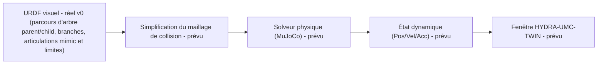

<!-- =============================================================================
HYDRA-UMC-PHYSICS-REPLICA - Digital twin module
Copyright (C) JuanenRac (Electro Hobby 3D) <electrohobby3d@gmail.com>
GPL-3.0-or-later - see LICENSE
============================================================================= -->

<p align="center">
  
</p>

# 📐 HYDRA-UMC-PHYSICS-REPLICA

<p align="center"><a href="README.md">🇺🇸 English</a> | <a href="README_spa.md">🇪🇸 Español</a> | 🇫🇷 <b>Français</b> | <a href="README_ita.md">🇮🇹 Italiano</a> | <a href="README_deu.md">🇩🇪 Deutsch</a> | <a href="README_zho.md">🇨🇳 简体中文</a> | <a href="README_jpn.md">🇯🇵 日本語</a> | <a href="README_por.md">🇵🇹 Português</a></p>

### 📐 Cinématique directe URDF et validation des limites articulaires

<p align="center">
  
  
  
  
  
  
  
</p>

---

> **État de la sûreté et de la cybersécurité :** cet écosystème n'est pas un système de sécurité certifié. Il n'existe pas encore de chaîne d'E-STOP matérielle, ni de limites ou de verrouillages imposés par le firmware, ni de commande de mouvement vérifiée ; les images de firmware sont contrôlées par CRC-32 et une signature Ed25519, et une compilation de version refuse les clés de développement publiées (les têtes d'outil et les cartes d'extension derrière le relais utilisent encore les chargeurs d'URTC, qui prennent un HMAC-SHA256 à clé partagée au lieu d'une signature) ; TLS et TLS mutuel sont optionnels et désactivés par défaut ; aucune carte propre n'a encore été assemblée ni testée. Lisez la [base de sécurité](https://github.com/JuanenRac/HYDRA-UMC-DOCS/blob/main/docs/SECURITY_BASELINE.md) et le [modèle de menaces](https://github.com/JuanenRac/HYDRA-UMC-DOCS/blob/main/docs/THREAT_MODEL.md) avant de vous fier à une affirmation d'ici pour la sécurité d'une personne.

---

## 📋 En un coup d'œil

| | |
|---|---|
| Version | `0.1.0` |
| Maturité | Fonctionnel |
| Tests | 86 (`cargo test`) |
| Technologie | Rust / roxmltree / URDF forward kinematics |
| Sur matériel réel | Pas encore : aucune exécution sur du matériel réel n'est consignée pour cette version |

**Aller à :** [Présentation](#-présentation) · [Architecture](#-architecture) · [Démarrage rapide](#-démarrage-rapide) · [Tests](#-tests) · [Structure du dépôt](#-structure-du-dépôt) · [Projets liés](#-projets-liés)

## 🚦 État du projet

Chaque ligne est une partie de ce dépôt et le feu dit où elle en est aujourd'hui. Elle est écrite d'après ce que le dépôt peut montrer (tests, compilations, exécutions), pas d'après ce qui est prévu.

🟢 Fait et vérifié · 🟡 Fonctionne, avec des limites connues · 🟠 À moitié fait ou pas encore vérifié · 🔴 Pas fait ou ne fonctionne pas

| Domaine | État | Ce que cela veut dire ici |
|---|---|---|
| Logiciel | 🟡 | Fonctionne pour son usage principal ; la vérification d'honnêteté ci-dessus liste ce qui manque encore |
| Tests | 🟢 | 86 tests automatiques, exécutés à chaque modification |
| Matériel réel | 🔴 | Pas encore : aucune exécution sur du matériel réel n'est consignée pour cette version |
| Documentation | 🟢 | README en huit langues, vérifié par rapport au manifeste à chaque modification |

## 🎯 Présentation

**HYDRA-UMC-PHYSICS-REPLICA** est le module de cinématique du Jumeau Numérique : il lit un arbre cinématique URDF (bras série et arbres ramifiés comme une pince), calcule la pose de chaque articulation (cinématique directe) et vérifie les positions articulaires par rapport à leurs limites. Il ne simule pas la dynamique : il n'y a ni modèle de corps rigide, de contact ou de frottement, ni MuJoCo ni PhysX ; c'est la feuille de route.

Les unités sont celles d'URDF (mètres et radians). `fk` affiche la position de chaque articulation ; avec `--json` il affiche la position et la rotation sous forme de quaternion unitaire.

### Caractéristiques principales :
* 📐 **Validation cinématique (v0) :** cinématique directe réelle et vérification réelle des limites d'articulation sur un sous-ensemble URDF (documenté et partiel) - voir « Vérification d'honnêteté » ci-dessous pour ce qui fonctionne exactement aujourd'hui.
* 🔒 **Réel v0 - FK avec vérification de limites :** `fk-checked` refuse de calculer une pose dans le monde pour une position d'articulation en dehors de sa limite déclarée dans l'URDF, appuyé par un vrai corpus réutilisable de limites d'articulation et des tests de régression pour les deux limites et des entrées largement hors limites - comblant l'écart où `fk` seul rapporterait silencieusement une pose physiquement inatteignable.
* 🏗️ **URDF vers Physique (v0, partiel) :** lit de vrais éléments `<joint>` (type/origine/axe/limite) d'un fichier URDF dans une chaîne. *Pas encore réel :* la génération de maillages de collision - cela reste la moitié « physique » de cette fonctionnalité.
* ⚡ **Performance en temps réel (prévu) :** résolution parallélisée pour les espaces de travail multi-robots - dépend qu'une véritable intégration de moteur physique existe d'abord.
* 🌡️ **Simulation thermique (prévu) :** prise en charge expérimentale de l'émulation de la dissipation thermique dans les têtes d'outils (T12/Laser).
* 📋 **Ce que fait et ne fait pas le lecteur URDF (réel aujourd'hui) :** seuls les éléments `<joint>` directement sous `<robot>` sont lus (ceux de `<transmission>` sont ignorés), donc les fichiers ros_control se lisent ; une articulation revolute ou prismatic exige un `<axis>` de longueur non nulle et un `<limit>` (sans lui, `fk-checked` et `validate-limits` refusent de la vérifier) ; le `<limit>` d'une continuous ne donne que l'effort et la vitesse, et une fixed n'en a pas ; des noms d'articulation en double, un lien à deux parents et des liens qu'aucun `<link>` ne déclare sont des erreurs ; `<mimic>`, `<safety_controller>` et les articulations floating ou planar ne sont pas pris en charge ; un nom de `--joints` que l'URDF n'a pas, ou donné deux fois, est une erreur, et `validate-limits` exige une position pour chaque articulation limitée sauf si `--allow-partial` est donné (une vérification non faite n'est jamais rapportée comme "No limit violations").

**Vérification d'honnêteté - ce qui fonctionne réellement aujourd'hui :** `fk --urdf CHEMIN --joints "j1=0.5,..."` calcule de vraies positions monde par articulation en chaînant les transformations d'articulation du URDF, peu importe qu'une position soit dans sa limite déclarée ; `fk-checked` effectue le même calcul mais vérifie d'abord chaque position par rapport à la vraie vérification de `validate-limits`, refusant de calculer (ou de signaler) une quelconque pose si quelque chose est hors limites ; `validate-limits --urdf CHEMIN --joints "..."` signale de vraies articulations hors limites de son côté. Les trois sont de la cinématique pure - pas de dynamique de corps rigide, pas de forces de contact, aucun solveur MuJoCo/PhysX encore branché, et le lecteur URDF parcourt le vrai arbre de liaisons `parent`/`child`, branches comprises (chaque articulation est placée à partir de l'articulation qui porte sa liaison parente), calcule les articulations qui en suivent une autre (`<mimic>`) et, sur demande, vérifie aussi les limites souples d'un `<safety_controller>` ainsi que les limites de vitesse et d'effort (`validate-limits --soft --velocities ... --efforts ...`). Voir [`CHANGELOG.md`](CHANGELOG.md) pour ce qui a été livré exactement, et la Roadmap ci-dessous pour ce qui reste à venir.

* 🧮 **Jacobienne et cinématique inverse (réelles, cinématique pure) :** `jacobian --urdf PATH --target JOINT --joints "..."` affiche la jacobienne géométrique 6 x N du repère d'une articulation dans le repère monde (texte ou `--json` ; une articulation qui en suit une autre par `<mimic>` ajoute sa part à la colonne de sa maîtresse), et `ik --urdf PATH --target JOINT --goal X,Y,Z` résout la position par moindres carrés amortis avec des pas limités et des positions gardées dans les limites des articulations (`--tolerance`, `--damping`, `--max-step` et `--max-iterations` ont des valeurs par défaut). La jacobienne est testée contre des différences finies de la cinématique directe ; un objectif hors d'atteinte est une erreur, pas une pose. Un UR5e et un Franka Emika Panda, construits à partir des paramètres de Denavit-Hartenberg publiés, vérifient la cinématique directe. Voir `docs/CLI_REFERENCE.md`.

## 🧩 Rôle dans HYDRA-UMC

**HYDRA-UMC-PHYSICS-REPLICA** est le module de cinématique du jumeau numérique : il lit un arbre URDF, calcule la pose de chaque articulation (cinématique directe) et vérifie les positions des articulations par rapport à leurs limites. Il ne simule pas la dynamique : il n'y a ni modèle de contact, ni de frottement, ni de corps rigide.

## 🏛️ Architecture

<p align="center">
  
</p>

<details>
<summary>Version texte du diagramme (Mermaid)</summary>



</details>

### FLUX DE PHYSIQUE (PIPELINE)

`URDF` (analyse) et une étape réelle et autonome de cinématique
(`fk`/`validate-limits`, non montrée comme case propre ci-dessous car
elle remplace le rôle de `SOLVE` pour v0) sont réelles aujourd'hui.
`MESH`, la vraie étape `SOLVE` (un vrai solveur MuJoCo/PhysX), `DYN` et
`TWIN` restent du travail futur.

### ARCHITECTURE & DÉCISIONS DE CONCEPTION

* **Pourquoi cette simulation n'a pas de dossiers `hardware/`/`firmware/`/`os/`.** Logiciel pur - aucune carte propre, donc ces dossiers ont été supprimés plutôt que laissés vides.
* **Pourquoi c'est une sœur, pas un sous-module, de HYDRA-UMC-TWIN.** Le solveur physique tourne à sa propre fréquence de tick, indépendamment du rendu - le garder comme processus séparé signifie qu'un pas physique lent ne bloque pas le propre framerate de HYDRA-UMC-TWIN, et l'un ou l'autre peut être remplacé/mis à niveau (ex. MuJoCo contre PhysX) sans toucher à l'autre.
* **Comment cela s'intègre dans le reste de l'écosystème.** Enfant de HYDRA-UMC-TWIN par conception. Aujourd'hui HYDRA-UMC-TWIN ne l'appelle pas : le contrôle de plausibilité physique derrière « si ça marche dans le Twin, ça marche sur le terrain » est prévu, pas construit.
* **Pourquoi un URDF ramifié est lu comme un `Model` et `parse_urdf` le refuse toujours.** v0 analysait auparavant les éléments `<joint>` dans l'ordre brut du document et traitait cet ordre comme la chaîne, ce qui est incorrect pour tout URDF conforme déclarant ses articulations hors de l'ordre de l'arbre ; les vrais noms de liaison `parent`/`child` de chaque articulation sont désormais parcourus depuis la vraie liaison racine du document. `parse_urdf_model` garde tout l'arbre : les articulations dans l'ordre parent avant enfant, l'indice de l'articulation parente de chacune (les deux doigts d'une pince sont tous deux placés depuis la paume, pas l'un après l'autre), les suiveuses de `<mimic>` (`multiplier * maître + offset` ; une position donnée à une suiveuse est refusée, de même qu'un cercle de suiveuses) et les limites d'effort, de vitesse et souples. `parse_urdf` garde son contrat d'origine, une `Chain` sérielle plate, et refuse une ramification avec une vraie erreur au lieu de garder en silence une branche et d'abandonner l'autre. Non fait : jacobienne, cinématique inverse (voir `urdf.rs`).
* **Pourquoi `roxmltree` est la seule dépendance, pas encore un binding complet de moteur physique.** La cinématique directe et la vérification de limites réelles n'ont besoin de rien de plus que lire des attributs XML et faire de l'algèbre matricielle à la main (`transform.rs`) - ajouter un binding FFI MuJoCo/PhysX pour cela serait du poids de dépendance sans réel bénéfice avant qu'une vraie simulation de corps rigides/contacts ne soit en cours de construction.
* **Pourquoi `fk-checked` est une nouvelle sous-commande plutôt qu'une modification de `fk` sur place.** `fk` est l'utilitaire de bas niveau existant, mathématique pur - certains appelants (ex. ajuster une limite elle-même) veulent vraiment la pose non vérifiée pour une valeur hors limites. `fk-checked` ajoute le point d'entrée sécurisé, avec vérification de limites, que les appelants réels devraient utiliser, sans changer silencieusement ce que `fk` a toujours signifié.
* **Pourquoi le corpus de limites d'articulation (`corpus.rs`) est réservé aux tests.** Il existe uniquement pour donner aux tests de régression de `limits.rs` et `kinematics.rs` un seul ensemble de fixtures réel et partagé au lieu de littéraux ad hoc dupliqués - il n'a aucune raison d'être livré dans le binaire de release, donc il est protégé derrière `#[cfg(test)]`.

**Testé sur deux vrais bras.** Les tests construisent l'URDF d'un UR5e et d'un Franka Emika Panda à partir des paramètres de Denavit-Hartenberg que publient les fabricants (aucun de leurs fichiers n'est copié) et comparent la position de l'outil calculée par le binaire à celle que donne la chaîne DH en multipliant directement les matrices 4x4, aux positions en pose zéro documentées par les fabricants, à la borne de portée des segments et aux limites d'articulation publiées.

## 🚀 Démarrage rapide

Nécessite la chaîne d'outils Rust stable (édition 2021) avec `cargo`.

```bash
./build.sh  # Linux, macOS (build.bat on Windows)
./run.sh fk --urdf arm.urdf --joints "shoulder=0,elbow=0"
./run.sh validate-limits --urdf arm.urdf --joints "shoulder=3.0,elbow=0.2"
cargo test
```

## 🧪 Tests

86 tests automatiques s'exécutent avec `cargo test`. Ils n'ont besoin ni de matériel ni de rien en dehors de cette machine.

La CI exécute `HYDRA_UMC_CI=1 python tools/ci_validate.py`, qui vérifie le manifeste, les documents, les huit README et les images.

## 🏗️ Compilation et publication

Nécessite la chaîne d'outils Rust (`cargo`/`rustc`, à installer via [rustup](https://rustup.rs)) et Python 3.10+ (uniquement pour `bump_version.py`).

```bash
# Linux / macOS
./build.sh   # `cargo test` (86 tests), puis `cargo build --release`
./run.sh     # exécute target/release/hydra-umc-physics-replica, affiche nom + version + rôle
```

```bat
:: Windows
build.bat
run.bat
```

`build.sh`/`build.bat` ne changent jamais la version (seule `python tools/hydra_project_tool.py bump` la fait monter), exécutent la vraie suite de tests, puis construisent un binaire release.

Les vraies sous-commandes `fk` et `validate-limits` ont besoin d'un fichier URDF :

```bash
./run.sh fk --urdf arm.urdf --joints "shoulder=0,elbow=0"
# shoulder: x=0.000000 y=0.000000 z=0.200000
# elbow: x=0.300000 y=0.000000 z=0.200000

./run.sh validate-limits --urdf arm.urdf --joints "shoulder=3.0,elbow=0.2"
# LIMIT VIOLATION: joint 'shoulder' = 3.000000 (allowed [-1.570000, 1.570000])
```

La vraie sous-commande `fk-checked` refuse de calculer une pose lorsqu'une articulation est hors limites - contrairement à `fk` seul, qui la calcule quand même :

```bash
./run.sh fk-checked --urdf arm.urdf --joints "shoulder=0.5,elbow=0.2"
# shoulder: x=0.000000 y=0.000000 z=0.200000
# elbow: x=0.263275 y=0.143828 z=0.200000

./run.sh fk-checked --urdf arm.urdf --joints "shoulder=0.5,elbow=5.0"
# LIMIT VIOLATION: joint 'elbow' = 5.000000 (allowed [-2.000000, 2.000000]) - refusing to compute an unreachable pose

./run.sh fk --urdf arm.urdf --joints "shoulder=0.5,elbow=5.0"
# elbow: x=0.263275 y=0.143828 z=0.200000   <- calculé quand même ; c'est l'écart que fk-checked comble
```

`fk` se termine avec `0` en cas de succès, `2` si `--urdf`/`--joints` est invalide. `fk-checked` se termine avec `0` (vraie pose), `1` (violation de limite), ou `2` (entrée invalide). `validate-limits` se termine avec `0` (aucune violation), `1` (violations trouvées), ou `2` (entrée invalide).

Voir [`docs/CLI_REFERENCE.md`](docs/CLI_REFERENCE.md) pour la référence complète de la ligne de commande, avec chaque cas d'erreur réel (arguments manquants/malformés, un fichier URDF illisible) capturé lors d'une exécution réelle du binaire de release.

## 📂 Structure du dépôt

<p align="center">
  
</p>

<details>
<summary>Version texte de l'arborescence</summary>

```text
HYDRA-UMC-PHYSICS-REPLICA/
├── src/                             code source
│   ├── transform.rs                 Vec3/Mat4 réels (translation, rotation axe-angle, rpy)
│   ├── urdf.rs                      Lecteur URDF réel et partiel (parcours d'arbre parent/child, branches, mimic et limites)
│   ├── kinematics.rs                forward_kinematics() réel + forward_kinematics_checked()
│   ├── limits.rs                    validate_limits() réel
│   ├── corpus.rs                    Corpus de fixtures de limites, réservé aux tests
│   └── main.rs                      Point d'entrée + sous-commandes réelles `fk`/`fk-checked`/`validate-limits`
├── tests/                           cli_contract.rs et tree_contract.rs : les erreurs de la ligne de commande (articulations mal orthographiées, répétées ou manquantes) et le placement des branches et des articulations mimic
├── docs/                            documents du projet
├── images/                          Médias et diagrammes
├── tools/                           outils du projet et vérifications de la CI
├── .github/                         workflow de CI et modèles de tickets
├── Cargo.toml                       Métadonnées du paquet, dépendances (roxmltree), version compteur kilométrique
├── bump_version.py                  Incrément de version type compteur kilométrique (exécuté seulement par la commande `bump` explicite)
├── bump_manifest_version.py         Synchronise la version de hydra-umc.project.json avec la version native (--sync)
├── build.sh / build.bat             Valide et compile (compiler ne change jamais la version)
├── build-test.sh / build-test.bat   Vérification de build sans versionnage
├── run.sh / run.bat                 Exécute le binaire release compilé (relaie les arguments)
├── CHANGELOG.md                     ce qui a changé à chaque version
├── hydra-umc.project.json           manifeste : version, maturité, famille
└── test.sh                          lance les tests
```

</details>

## 🗺️ Feuille de route et limites connues

**Limites connues aujourd'hui**

* **Phase 1 :** Synchronisation du jumeau numérique avec la télémétrie matérielle en temps réel et latence inférieure à 10 ms.
* **Phase 2 :** Intégration de Physics Replica avec des simulateurs de classe industrielle (Isaac Sim) et prise en charge des corps déformables.
* **Phase 3 :** Modèles de récupération automatisés de Node Healing pour un basculement décentralisé et détection précoce de la dégradation des capteurs.
* **Phase 4 :** Prise en charge de la simulation de corps déformables (câbles et tubes à vide) et génération de données synthétiques photoréalistes.

## 🌍 Langues

Ce README et les documents du dépôt existent en huit langues : anglais, espagnol, allemand, français, italien, japonais, chinois et portugais (Portugal). Ils sont écrits ensemble et la CI vérifie que les huit fichiers ont les mêmes sections et les mêmes liens. Ce dépôt n'a ni écran ni catalogue de messages propre, il n'y a donc aucune chaîne d'interface à traduire.

## 🔗 Projets liés

Ce projet fait partie de l'écosystème robotique HYDRA-UMC du même auteur (JuanenRac / Electro Hobby 3D). Bon à savoir, car une demande pourrait en réalité concerner l'un de ceux-ci plutôt que ce dépôt.

**Projet Parent**
- **[HYDRA-UMC-TWIN](https://github.com/JuanenRac/HYDRA-UMC-TWIN)** — hub d'intégration pour le moteur de jumeau numérique, avec un vrai contrat de synchronisation par compatibilité de version ; le parent dont ce dépôt est un service de simulation spécifique, au sein de son propre moteur de jumeau numérique.

**Projets Frères** — les autres services de simulation du propre moteur de jumeau numérique de HYDRA-UMC-TWIN
- **[HYDRA-UMC-HIL-BRIDGE](https://github.com/JuanenRac/HYDRA-UMC-HIL-BRIDGE)** — routeur hardware-in-the-loop avec un verrouillage logiciel de collision entre simulation et matériel réel (testé sans matériel réel).
- **[HYDRA-UMC-SYNTHETIC-DATA-GEN](https://github.com/JuanenRac/HYDRA-UMC-SYNTHETIC-DATA-GEN)** — vrai générateur procédural de scènes 2D avec export d'annotations YOLO/COCO.

**Directement Liés**
- **[HYDRA-UMC-EDITOR-URDF](https://github.com/JuanenRac/HYDRA-UMC-EDITOR-URDF)** — créateur/éditeur graphique de bureau pour URDF qui envoie les modèles terminés vers le propre catalogue de STUDIO — l'outil avec lequel sont créés les modèles URDF que ce projet lit (`fk`/`validate-limits`).
- **[HYDRA-UMC-EDITOR-STL](https://github.com/JuanenRac/HYDRA-UMC-EDITOR-STL)** — éditeur de bureau de modèles STL, transformant/remplaçant/retirant/ajoutant de vraies pièces dans le même catalogue de modèles qu'édite aussi HYDRA-UMC-EDITOR-URDF.

**Fait Également Partie de l'Écosystème**

*Matériel & Plateforme de Base*
- **[HYDRA-UMC](https://github.com/JuanenRac/HYDRA-UMC)** — la conception de la carte mère du bras robotique : hôte CM5 + coprocesseur STM32H745 double cœur, destinée à coordonner jusqu'à 8 bras-outils via CAN-OTA/SPI-OTA (firmware à un stade précoce ; aucune carte assemblée pour l'instant).
- **[HYDRA-UMC-OS](https://github.com/JuanenRac/HYDRA-UMC-OS)** — couche produit reproductible sur Raspberry Pi OS pour le CM5 : agent en lecture seule, config/profils validés, provisionnement WiFi de premier contact.
- **[HYDRA-UMC-SDK](https://github.com/JuanenRac/HYDRA-UMC-SDK)** — le contrat JSON-Schema partagé et la barrière logicielle de contrôle des jobs contre laquelle chaque bridge valide ses commandes (pas une fonction de sécurité certifiée).
- **[HYDRA-UMC-CONNECTOR-HUB](https://github.com/JuanenRac/HYDRA-UMC-CONNECTOR-HUB)** — registre déclaratif et validateur de manifestes d'adaptateur pour les connecteurs de machines externes ; étend la propre idée de contrat du SDK aux machines externes sans remplacer les projets de passerelle industrielle.

*Backend Central & Clients*
- **[HYDRA-UMC-SERVER](https://github.com/JuanenRac/HYDRA-UMC-SERVER)** — le vrai backend headless (REST/WebSocket) auquel parle réellement chaque client de contrôle.
- **[HYDRA-UMC-STUDIO](https://github.com/JuanenRac/HYDRA-UMC-STUDIO)** — tableau de bord de contrôle web avec visualisation 3D multi-robot en temps réel.
- **[HYDRA-UMC-SUITE](https://github.com/JuanenRac/HYDRA-UMC-SUITE)** — centre de commande d'essaim de bureau (PySide6) pour plusieurs serveurs à la fois, empaqueté en exécutable autonome.
- **[HYDRA-UMC-ANDROID-CONTROL](https://github.com/JuanenRac/HYDRA-UMC-ANDROID-CONTROL)** — application de contrôle Android native avec connexion biométrique et un compagnon Wear OS jumelé.
- **[HYDRA-UMC-IOS-CONTROL](https://github.com/JuanenRac/HYDRA-UMC-IOS-CONTROL)** — application de contrôle iOS/iPadOS (Flutter) avec synchronisation WebSocket en temps réel.
- **[HYDRA-UMC-DSI](https://github.com/JuanenRac/HYDRA-UMC-DSI)** — interface tactile native pour l'écran tactile DSI 7" embarqué, intégrée directement sur le CM5.
- **[HYDRA-UMC-BRIDGE-AMR](https://github.com/JuanenRac/HYDRA-UMC-BRIDGE-AMR)** — frontière de coordination pour les flottes AGV/AMR via un éditeur MQTT VDA 5050 (testé uniquement contre une flotte émulée).
- **[HYDRA-UMC-BRIDGE-CNC](https://github.com/JuanenRac/HYDRA-UMC-BRIDGE-CNC)** — coordinateur haut niveau pour cellules CNC avec accès au statut/octets de contrôle GRBL (testé uniquement contre un émulateur).
- **[HYDRA-UMC-BRIDGE-DROIDS](https://github.com/JuanenRac/HYDRA-UMC-BRIDGE-DROIDS)** — frontière de coordination pour droïdes à pattes/humanoïdes, avec un émetteur de commandes Boston Dynamics Spot (testé uniquement contre un émulateur).
- **[HYDRA-UMC-BRIDGE-LASER](https://github.com/JuanenRac/HYDRA-UMC-BRIDGE-LASER)** — coordinateur de cellules laser lisant 3 signaux GPIO de clé/enceinte/verrouillage (testé uniquement contre une puce simulée ; il ne peut ni armer ni tirer un laser).
- **[HYDRA-UMC-BRIDGE-OPENPNP](https://github.com/JuanenRac/HYDRA-UMC-BRIDGE-OPENPNP)** — coordinateur haut niveau sûr pour le flux de cartes du pick-and-place OpenPnP.
- **[HYDRA-UMC-BRIDGE-PRINTER3D](https://github.com/JuanenRac/HYDRA-UMC-BRIDGE-PRINTER3D)** — frontière de coordination sûre pour imprimantes 3D Moonraker/Klipper, avec de vraies commandes de tâche contrôlées.
- **[HYDRA-UMC-BRIDGE-ROS2](https://github.com/JuanenRac/HYDRA-UMC-BRIDGE-ROS2)** — coordinateur avec un transport ROS 2 rclpy à importation paresseuse (pas encore exécuté contre une installation ROS 2).
- **[HYDRA-UMC-BRIDGE-UAV](https://github.com/JuanenRac/HYDRA-UMC-BRIDGE-UAV)** — frontière de coordination pour UAV équipés de caméra, avec un émetteur de commandes MAVLink (testé uniquement contre un émulateur).

*Plateforme d'Outils URTC*
- **[URTC](https://github.com/JuanenRac/URTC)** — firmware pour la carte physique Universal Robot Tool Controller, plus de 25 profils d'outil sur bus CAN.
- **[URTC-FLASHER](https://github.com/JuanenRac/URTC-FLASHER)** — outil de bureau à interface graphique pour flasher les cartes URTC, CAN-OTA plus SWD/JTAG puce complète.
- **[URTC-TESTER](https://github.com/JuanenRac/URTC-TESTER)** — outil de bureau de diagnostic CAN-bus en direct pour cartes URTC, un panneau par profil d'outil.
- **[URTC-WEB-STUDIO](https://github.com/JuanenRac/URTC-WEB-STUDIO)** — alternative basée navigateur à URTC-TESTER via la Web Serial API, sans installation locale.
- **[URTC-GATEWAY](https://github.com/JuanenRac/URTC-GATEWAY)** — passerelle devant le bus CAN d'URTC : liste d'identifiants autorisés, limite de débit et clé de session ; logiciel testé sur ordinateur, pas encore sur un bus réel.

*Nœud IA de Vision (Hailo-8)*
- **[HYDRA-UMC-VISION-NODE](https://github.com/JuanenRac/HYDRA-UMC-VISION-NODE)** — hub d'intégration pour le pipeline de vision Hailo-8, avec une vraie vérification de disponibilité matérielle par étape.
- **[HYDRA-UMC-DETECTION-HEF](https://github.com/JuanenRac/HYDRA-UMC-DETECTION-HEF)** — registre réel de modèles compilés avec vérification de chargement sécurisé par architecture Hailo/checksum.
- **[HYDRA-UMC-VISION-STREAMER](https://github.com/JuanenRac/HYDRA-UMC-VISION-STREAMER)** — générateur réel de pipeline GStreamer + config MediaMTX, avec une vraie frontière d'intégration HailoRT.
- **[HYDRA-UMC-VISUAL-SERVOING-API](https://github.com/JuanenRac/HYDRA-UMC-VISUAL-SERVOING-API)** — loi de correction Position-Based Visual Servoing avec autorisation conditionnée à l'état de zone ; pas encore d'estimation de pose par caméra.
- **[HYDRA-UMC-SAFETY-ZONES](https://github.com/JuanenRac/HYDRA-UMC-SAFETY-ZONES)** — logique v0 de violation de zone, de fraîcheur de calibration et de demande d'E-STOP qui lit les positions d'objets dans un fichier ; aucun détecteur ne l'alimente et aucun E-STOP physique n'y est encore relié.

*Nœud IA Cognitif (Hailo-10)*
- **[HYDRA-UMC-COGNITIVE-NODE](https://github.com/JuanenRac/HYDRA-UMC-COGNITIVE-NODE)** — hub d'intégration pour le pipeline cognitif Hailo-10 (orchestration LLM/VLA/voix).
- **[HYDRA-UMC-VLA-ENGINE](https://github.com/JuanenRac/HYDRA-UMC-VLA-ENGINE)** — vrai encodage/décodage de jetons d'action et génération de trajectoire pour un modèle Vision-Language-Action.
- **[HYDRA-UMC-VOICE-UI](https://github.com/JuanenRac/HYDRA-UMC-VOICE-UI)** — vrai front-end vocal (VAD + analyseur d'intention) avec un relais Watch borné et soumis à confirmation.
- **[HYDRA-UMC-SEMANTIC-PLANNER](https://github.com/JuanenRac/HYDRA-UMC-SEMANTIC-PLANNER)** — vraie décomposition de tâches basée sur des règles et récupération sémantique d'erreurs sur les codes d'erreur MCU.
- **[HYDRA-UMC-DOCS-QA](https://github.com/JuanenRac/HYDRA-UMC-DOCS-QA)** — vraie recherche documentaire TF-IDF (bibliothèque standard uniquement) sur les propres documents Markdown de cet écosystème.
- **[HYDRA-UMC-LOCAL-TECHNICIAN](https://github.com/JuanenRac/HYDRA-UMC-LOCAL-TECHNICIAN)** — technicien de maintenance IA local et à portes de politique pour l'écosystème lui-même - observe, diagnostique et propose des corrections ; les deux niveaux de risque les plus élevés ne sont délibérément pas encore implémentés.

*Orchestration & Essaim*
- **[HYDRA-UMC-ORCHESTRATOR](https://github.com/JuanenRac/HYDRA-UMC-ORCHESTRATOR)** — hub d'intégration avec un vrai contrat de rapport de santé gRPC/Protobuf et une machine à états de mission.
- **[HYDRA-UMC-JOB-DISPATCHER](https://github.com/JuanenRac/HYDRA-UMC-JOB-DISPATCHER)** — vraie file de tâches basée sur la priorité avec déduplication, via une vraie API HTTP.
- **[HYDRA-UMC-NODE-HEALING](https://github.com/JuanenRac/HYDRA-UMC-NODE-HEALING)** — vrai chien de garde de santé de flotte basé sur gRPC, avec retry/backoff et détection d'incohérence d'identité.
- **[HYDRA-UMC-PATH-PLANNER-3D](https://github.com/JuanenRac/HYDRA-UMC-PATH-PLANNER-3D)** — vrai planificateur de trajectoire 3D basé sur RRT, avec vraie validation des collisions obstacle/espace de travail.
- **[HYDRA-UMC-SWARM-SYNC](https://github.com/JuanenRac/HYDRA-UMC-SWARM-SYNC)** — vraie synchronisation d'état CRDT LWW-Element-Map, testée par propriétés pour la convergence multi-cellule.

*Données & Analytique*
- **[HYDRA-UMC-DATALAKE](https://github.com/JuanenRac/HYDRA-UMC-DATALAKE)** — vrai magasin de séries temporelles basé sur sqlite3, avec une vraie API HTTP d'ingestion/requête.
- **[HYDRA-UMC-ANOMALY-DETECTOR](https://github.com/JuanenRac/HYDRA-UMC-ANOMALY-DETECTOR)** — vrai détecteur d'anomalies FFT + ligne de base statistique, avec surveillance de dérive.
- **[HYDRA-UMC-PRODUCTION-REPORTS](https://github.com/JuanenRac/HYDRA-UMC-PRODUCTION-REPORTS)** — vrai calcul OEE/disponibilité sur l'historique de DATALAKE, avec export CSV reproductible.
- **[HYDRA-UMC-TELEMETRY-COLLECTOR](https://github.com/JuanenRac/HYDRA-UMC-TELEMETRY-COLLECTOR)** — vrai pipeline d'ingestion CAN/WebSocket vers DATALAKE, avec déduplication par séquence.

*Passerelle Industrielle*
- **[HYDRA-UMC-GATEWAY-INDUSTRIAL](https://github.com/JuanenRac/HYDRA-UMC-GATEWAY-INDUSTRIAL)** — hub d'intégration relayant vers les protocoles industriels, avec une vraie couche de liste blanche de commandes/contre-pression.
- **[HYDRA-UMC-OPCUA-SERVER](https://github.com/JuanenRac/HYDRA-UMC-OPCUA-SERVER)** — vrai espace d'adressage OPC-UA, vérifié avec une vraie session client du protocole binaire.
- **[HYDRA-UMC-MQTT-BROKER](https://github.com/JuanenRac/HYDRA-UMC-MQTT-BROKER)** — vrai broker MQTT avec authentification par client optionnelle et ACL de sujets.
- **[HYDRA-UMC-MTCONNECT-ADAPTER](https://github.com/JuanenRac/HYDRA-UMC-MTCONNECT-ADAPTER)** — vrais points de terminaison XML MTConnect `/probe` et `/current`, avec sortie en mode dégradé.

*Outils Complémentaires & Opérations de l'Écosystème*
- **[HYDRA-UMC-DASHBOARD-AI](https://github.com/JuanenRac/HYDRA-UMC-DASHBOARD-AI)** — panneaux Smart Summaries et Anomaly Highlighting sur DATALAKE/ANOMALY-DETECTOR, avec un repli statistique honnête.
- **[HYDRA-UMC-TOOL-CLI](https://github.com/JuanenRac/HYDRA-UMC-TOOL-CLI)** — CLI de flotte avec un vrai contrat de codes de sortie stable, un vrai client en direct de la propre API de HYDRA-UMC-SERVER.
- **[HYDRA-UMC-WATCH](https://github.com/JuanenRac/HYDRA-UMC-WATCH)** — application compagnon WearOS avec des motifs d'alerte haptique et un relais vocal vers le téléphone jumelé (pas encore exécutée sur une montre physique).
- **[URTC-SMART-RACK](https://github.com/JuanenRac/URTC-SMART-RACK)** — firmware pour un rack de montage de cartes avec décodage réel d'ID d'outil et logique de préchauffage Smart Idle.
- **[URTC-VISION-TOOL](https://github.com/JuanenRac/URTC-VISION-TOOL)** — firmware plus un vrai compagnon de vision Python pour une tête d'outil d'inspection thermique/RGB.
- **[HYDRA-UMC-UPDATER](https://github.com/JuanenRac/HYDRA-UMC-UPDATER)** — outil administratif de bureau qui découvre, clone et met à jour chaque dépôt de cet écosystème.
- **[HYDRA-UMC-OS-REBUILDER](https://github.com/JuanenRac/HYDRA-UMC-OS-REBUILDER)** — outil de bureau Windows/Linux qui construit une image de la CM5 prête à graver, préchargée avec les versions les plus actuelles de l'écosystème, avec une configuration de premier démarrage Wi-Fi/utilisateur/SSH façon Raspberry Pi Imager.
- **[HYDRA-UMC-OPS-AGENT](https://github.com/JuanenRac/HYDRA-UMC-OPS-AGENT)** — coordinateur d'incidents de maintenance : un rôle edge à faible privilège collecte un instantané d'inventaire/santé assaini, un rôle control-plane le rend en lecture seule et demande à un fournisseur d'IA de suggérer un diagnostic - n'applique jamais de correctif ni ne déploie rien.
- **[HYDRA-UMC-DEV-SERVER](https://github.com/JuanenRac/HYDRA-UMC-DEV-SERVER)** — hôte de développement reproductible (Raspberry Pi 5 / CM5) qui héberge le code source de l'écosystème et exécute des tâches de compilation/test délimitées via une file d'attente durable ; un rôle de développement dédié, explicitement distinct d'un CM5 opérationnel.

## 📚 Documentation

Où lire la suite :

* [Base de sécurité de l'écosystème](https://github.com/JuanenRac/HYDRA-UMC-DOCS/blob/main/docs/SECURITY_BASELINE.md)
* [Modèle de menaces de l'écosystème](https://github.com/JuanenRac/HYDRA-UMC-DOCS/blob/main/docs/THREAT_MODEL.md)
* [Journal des modifications de ce dépôt](CHANGELOG.md)
* [Licence de ce dépôt](LICENSE.md)

## 🤝 Contribuer et communauté

* Avant une pull request, exécutez `HYDRA_UMC_CI=1 py -3 tools/ci_validate.py` (ou `HYDRA_UMC_CI=1 python3 tools/ci_validate.py`) : il doit afficher `CI_VALIDATION=PASS`. N'exécutez pas `build.sh` ni `build.bat` pour cette vérification ; compiler n'est pas vérifier.
* Les huit README sont écrits à partir d'une source unique dans HYDRA-UMC-DOCS ; ne les modifiez pas à la main. Changez la source et réécrivez-les avec `tools/make_readmes.py`.
* N'affirmez pas dans un README ce qui n'a pas tourné : écrivez « simulé » ou « non essayé sur matériel » quand c'est la vérité.
* Voir [CONTRIBUTING.md](CONTRIBUTING.md), le [code de conduite](CODE_OF_CONDUCT.md), [SECURITY.md](SECURITY.md) et [SUPPORT.md](SUPPORT.md).

## 👤 AUTEUR

**JuanenRac (Electro Hobby 3D)** · electrohobby3d@gmail.com

## 📜 LICENCE

GPL-3.0-or-later - [LICENSE](LICENSE).
