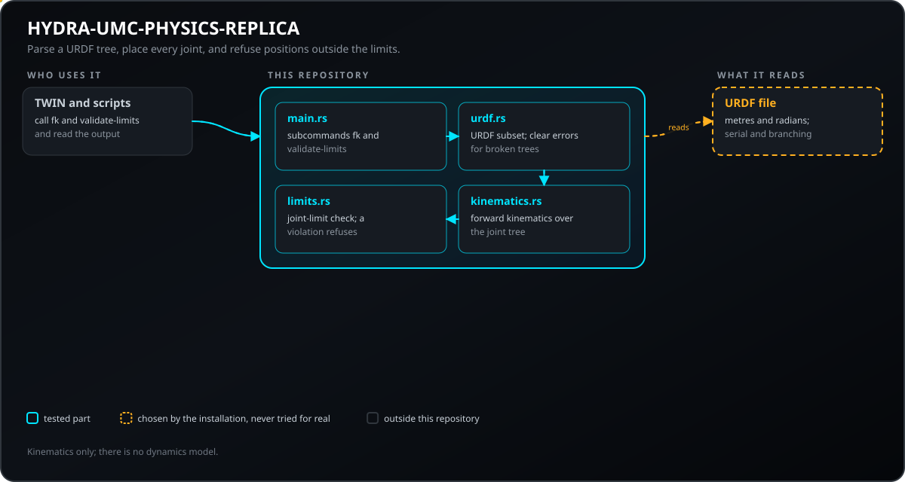
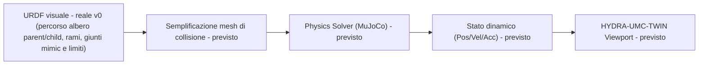
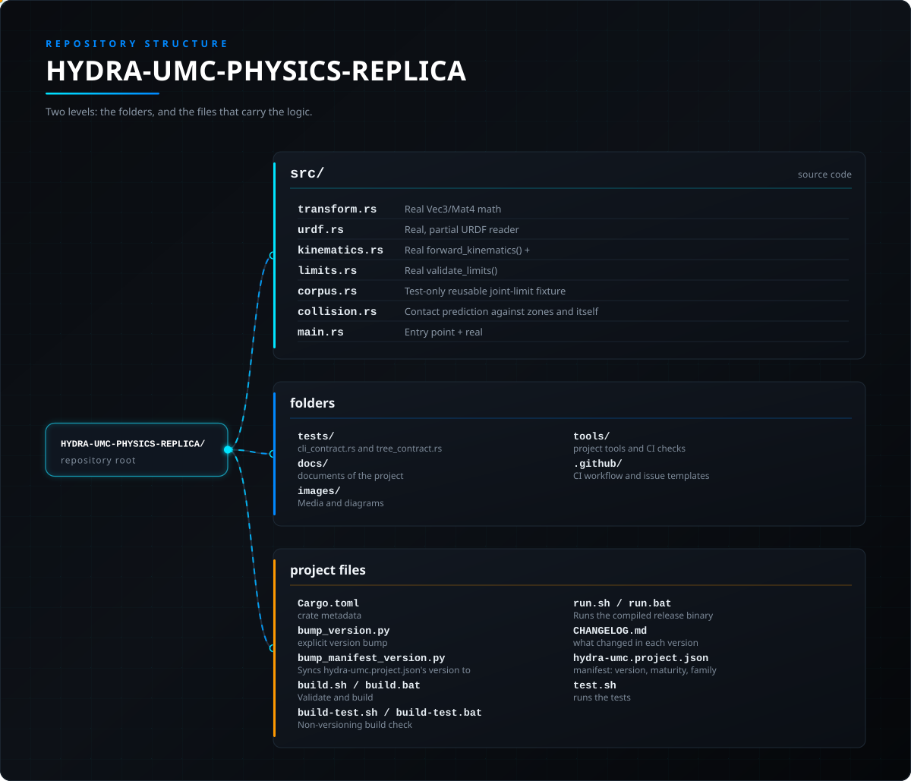

<!-- =============================================================================
HYDRA-UMC-PHYSICS-REPLICA - Digital twin module
Copyright (C) JuanenRac (Electro Hobby 3D) <electrohobby3d@gmail.com>
GPL-3.0-or-later - see LICENSE
============================================================================= -->

<p align="center">
  
</p>

# 📐 HYDRA-UMC-PHYSICS-REPLICA

<p align="center"><a href="README.md">🇺🇸 English</a> | <a href="README_spa.md">🇪🇸 Español</a> | <a href="README_fra.md">🇫🇷 Français</a> | 🇮🇹 <b>Italiano</b> | <a href="README_deu.md">🇩🇪 Deutsch</a> | <a href="README_zho.md">🇨🇳 简体中文</a> | <a href="README_jpn.md">🇯🇵 日本語</a> | <a href="README_por.md">🇵🇹 Português</a></p>

### 📐 Cinematica diretta URDF e validazione dei limiti dei giunti

<p align="center">
  
  
  
  
  
  
  
</p>

---

> **Stato di sicurezza (safety e security):** questo ecosistema non è un sistema di sicurezza certificato. Non esiste ancora un percorso E-STOP hardware, né limiti o interblocchi imposti dal firmware, né un comando di movimento verificato; le immagini firmware sono controllate con CRC-32 e una firma Ed25519, e una compilazione di rilascio rifiuta le chiavi di sviluppo pubblicate (le teste utensile e le schede di espansione dietro il relè usano ancora i bootloader di URTC, che accettano un HMAC-SHA256 a chiave condivisa invece di una firma); TLS e TLS reciproco sono opzionali e disattivati per impostazione predefinita; nessuna scheda propria è stata ancora assemblata o provata. Leggi la [base di sicurezza](https://github.com/JuanenRac/HYDRA-UMC-DOCS/blob/main/docs/SECURITY_BASELINE.md) e il [modello delle minacce](https://github.com/JuanenRac/HYDRA-UMC-DOCS/blob/main/docs/THREAT_MODEL.md) prima di fidarti di qualsiasi affermazione qui per la sicurezza di una persona.

---

## 📋 In breve

| | |
|---|---|
| Versione | `0.1.0` |
| Maturità | Funzionale |
| Test | 133 (`cargo test`) |
| Tecnologia | Rust / roxmltree / URDF forward kinematics |
| Su hardware reale | Non ancora: per questa versione non risulta alcuna esecuzione su hardware reale |

**Vai a:** [Panoramica](#-panoramica) · [Architettura](#-architettura) · [Avvio rapido](#-avvio-rapido) · [Test](#-test) · [Struttura del repository](#-struttura-del-repository) · [Progetti correlati](#-progetti-correlati)

## 🚦 Stato del progetto

Ogni riga è una parte di questo repository e il semaforo dice a che punto è oggi. È scritta in base a ciò che il repository può mostrare (test, compilazioni, esecuzioni), non a ciò che è previsto.

🟢 Fatto e verificato · 🟡 Funziona, con limiti noti · 🟠 Fatto a metà o non ancora verificato · 🔴 Non fatto o non funzionante

| Area | Stato | Cosa significa qui |
|---|---|---|
| Software | 🟡 | Funziona per il suo scopo principale; la verifica di onestà qui sopra elenca ciò che manca ancora |
| Test | 🟢 | 133 test automatici, eseguiti a ogni modifica |
| Hardware reale | 🔴 | Non ancora: per questa versione non risulta alcuna esecuzione su hardware reale |
| Documentazione | 🟢 | README in otto lingue, verificato rispetto al manifesto a ogni modifica |

## 🎯 Panoramica

**HYDRA-UMC-PHYSICS-REPLICA** è il modulo di cinematica del Gemello Digitale: legge un albero cinematico URDF (bracci seriali e ramificati come una pinza), calcola la posa di ogni giunto (cinematica diretta) e controlla le posizioni dei giunti rispetto ai loro limiti. Non simula la dinamica: non ci sono modelli di corpo rigido, contatto o attrito, né MuJoCo né PhysX; sono la roadmap.

Le unità sono quelle di URDF (metri e radianti). `fk` stampa la posizione di ogni giunto; con `--json` stampa la posizione e la rotazione come quaternione unitario.

### Caratteristiche principali:
* 📐 **Validazione cinematica (v0):** cinematica diretta reale e verifica reale dei limiti dei giunti su un sottoinsieme URDF (documentato e parziale) - vedi "Verifica di onestà" sotto per cosa funziona esattamente oggi.
* 🔒 **Reale v0 - FK con verifica dei limiti:** `fk-checked` si rifiuta di calcolare una posa nel mondo per una posizione di giunto fuori dal suo limite dichiarato nel URDF, supportato da un vero corpus riutilizzabile di limiti dei giunti e test di regressione per entrambi i confini e input largamente fuori intervallo - chiudendo il divario in cui `fk` da solo riporterebbe silenziosamente una posa fisicamente irraggiungibile.
* 🏗️ **Da URDF a fisica (v0, parziale):** legge veri elementi `<joint>` (tipo/origine/asse/limite) da un file URDF in una catena. *Non ancora reale:* la generazione di mesh di collisione - quella resta la metà "fisica" di questa funzionalità.
* ⚡ **Prestazioni in tempo reale (previsto):** risoluzione parallelizzata per spazi di lavoro multi-robot - dipende dall'esistenza preventiva di una vera integrazione di motore fisico.
* 🌡️ **Simulazione termica (previsto):** supporto sperimentale per l'emulazione della dissipazione del calore nelle testine degli strumenti (T12/Laser).
* 📋 **Cosa fa e cosa non fa il lettore URDF (reale oggi):** vengono letti solo gli elementi `<joint>` direttamente sotto `<robot>` (quelli dentro `<transmission>` sono ignorati), quindi i file ros_control si leggono; un giunto revolute o prismatic richiede un `<axis>` di lunghezza non nulla e un `<limit>` (senza, `fk-checked` e `validate-limits` si rifiutano di controllarlo); il `<limit>` di un continuous dà solo sforzo e velocità, e un fixed non ne ha; nomi di giunto duplicati, un link con due genitori e link che nessun `<link>` dichiara sono errori; `<mimic>`, `<safety_controller>` e giunti floating o planar non sono supportati; un nome in `--joints` che l'URDF non ha, o dato due volte, è un errore, e `validate-limits` richiede una posizione per ogni giunto con limite salvo `--allow-partial` (un controllo non fatto non viene mai riportato come "No limit violations").

**Verifica di onestà - cosa funziona davvero oggi:** `fk --urdf PERCORSO --joints "j1=0.5,..."` calcola vere posizioni nel mondo per ogni giunto concatenando le trasformazioni dei giunti del URDF, indipendentemente dal fatto che una posizione sia nel proprio limite dichiarato; `fk-checked` esegue lo stesso calcolo ma verifica prima ogni posizione contro la vera verifica di `validate-limits`, rifiutandosi di calcolare (o riportare) qualsiasi posa se qualcosa è fuori intervallo; `validate-limits --urdf PERCORSO --joints "..."` segnala veri giunti fuori intervallo per conto proprio. Tutti e tre sono cinematica pura - nessuna dinamica di corpo rigido, nessuna forza di contatto, nessun solutore MuJoCo/PhysX ancora collegato, e il lettore URDF percorre il vero albero di link `parent`/`child`, rami compresi (ogni giunto è posto a partire dal giunto che porta il suo link genitore), calcola i giunti che ne seguono un altro (`<mimic>`) e, su richiesta, controlla anche i limiti morbidi di un `<safety_controller>` e i limiti di velocità e sforzo (`validate-limits --soft --velocities ... --efforts ...`). Vedi [`CHANGELOG.md`](CHANGELOG.md) per ciò che è stato consegnato esattamente, e la Roadmap sotto per ciò che resta da fare.

* 🧮 **Jacobiana e cinematica inversa (reali, cinematica pura):** `jacobian --urdf PATH --target JOINT --joints "..."` stampa la jacobiana geometrica 6 x N del sistema di un giunto nel sistema mondo (testo o `--json`; un giunto che ne segue un altro tramite `<mimic>` aggiunge la sua parte alla colonna del suo principale), e `ik --urdf PATH --target JOINT --goal X,Y,Z` risolve la posizione ai minimi quadrati smorzati con passi limitati e posizioni mantenute entro i limiti dei giunti (`--tolerance`, `--damping`, `--max-step` e `--max-iterations` hanno valori predefiniti). La jacobiana è provata contro differenze finite della cinematica diretta; un obiettivo fuori portata è un errore, non una posa. Un UR5e e un Franka Emika Panda, costruiti dai parametri di Denavit-Hartenberg pubblicati, verificano la cinematica diretta. Vedi `docs/CLI_REFERENCE.md`.

* 🚧 **Previsione di collisione con la cinematica diretta (reale, cinematica pura, sovrastima per costruzione):** `predict-collision --urdf PATH --zones PATH --config PATH --trajectory PATH` dice se un breve elenco di stati dei giunti porta il robot in una zona di un file di zone di HYDRA-UMC-SAFETY-ZONES o contro sé stesso. I bracci sono i segmenti tra i sistemi di riferimento dei giunti con i raggi che dichiari (non ci sono valori predefiniti), divisi in pezzi e sostituiti da sfere che li contengono; i giunti vengono interpolati e campionati con un limite sul movimento tra i campioni, e una zona non viene mai resa più piccola. Codice di uscita `0` libero, `1` contatto previsto, `2` input errato. Due test di proprietà con seme fisso verificano che una zona attorno a un punto che sta davvero dentro un braccio non venga mai data per libera. Non provato con un robot reale. Vedi `docs/COLLISION_PREDICTION.md`.

## 🧩 Ruolo in HYDRA-UMC

**HYDRA-UMC-PHYSICS-REPLICA** è il modulo di cinematica del gemello digitale: legge un albero URDF, calcola la posa di ogni giunto (cinematica diretta) e verifica le posizioni dei giunti rispetto ai loro limiti. Non simula la dinamica: non c'è un modello di contatto, di attrito o di corpo rigido.

## 🏛️ Architettura

<p align="center">
  
</p>

<details>
<summary>Versione testuale del diagramma (Mermaid)</summary>



</details>

### PIPELINE FISICA

`URDF` (parsing) e un vero passo autonomo di cinematica
(`fk`/`validate-limits`, non mostrato come casella propria sotto poiché
sostituisce il ruolo di `SOLVE` per v0) sono reali oggi. `MESH`, il vero
passo `SOLVE` (un vero solutore MuJoCo/PhysX), `DYN` e `TWIN` restano
lavoro futuro.

### ARCHITETTURA E DECISIONI DI PROGETTAZIONE

* **Perché questa simulazione non ha cartelle `hardware/`/`firmware/`/`os/`.** Software puro - nessuna scheda propria, quindi quelle cartelle sono state rimosse invece di lasciarle vuote.
* **Perché è sorella, non un sottomodulo, di HYDRA-UMC-TWIN.** Il risolutore fisico gira alla propria frequenza di tick, indipendente dal rendering - tenerlo come processo separato significa che un passo fisico lento non blocca il framerate proprio di HYDRA-UMC-TWIN, ed entrambi possono essere sostituiti/aggiornati (es. MuJoCo contro PhysX) senza toccare l'altro.
* **Come si inserisce nel resto dell'ecosistema.** Figlio di HYDRA-UMC-TWIN per progetto. Oggi HYDRA-UMC-TWIN non lo chiama: il controllo di plausibilità fisica dietro "se funziona nel Twin, funziona in fabbrica" è pianificato, non costruito.
* **Perché un URDF ramificato si legge come `Model` e `parse_urdf` lo rifiuta ancora.** v0 analizzava prima gli elementi `<joint>` nell'ordine grezzo del documento e trattava quell'ordine come la catena, il che è sbagliato per qualsiasi URDF conforme che dichiari i giunti fuori dall'ordine dell'albero; i veri nomi di link `parent`/`child` di ogni giunto vengono ora percorsi dal vero link radice del documento. `parse_urdf_model` conserva tutto l'albero: i giunti in ordine genitore prima del figlio, l'indice del giunto genitore di ciascuno (le due dita di una pinza sono entrambe poste dal palmo, non una dopo l'altra), i seguaci di `<mimic>` (`multiplier * master + offset`; una posizione data a un seguace viene rifiutata, come un cerchio di seguaci) e i limiti di sforzo, velocità e morbidi. `parse_urdf` mantiene il suo contratto originale, una `Chain` seriale piatta, e rifiuta un ramo con un vero errore invece di tenere in silenzio un ramo e scartare l'altro. Non fatto: Jacobiano, cinematica inversa (vedi `urdf.rs`).
* **Perché `roxmltree` è l'unica dipendenza, non ancora un binding completo di motore fisico.** La cinematica diretta reale e la verifica dei limiti reali non richiedono nient'altro che leggere attributi XML e fare algebra matriciale a mano (`transform.rs`) - aggiungere un binding FFI MuJoCo/PhysX per questo sarebbe peso di dipendenza senza reale beneficio finché non si costruisce una vera simulazione di corpi rigidi/contatti.
* **Perché `fk-checked` è un nuovo sottocomando invece di modificare `fk` sul posto.** `fk` è l'utility di basso livello esistente, matematica pura - alcuni chiamanti (es. regolare un limite stesso) vogliono davvero la posa non verificata per un valore fuori intervallo. `fk-checked` aggiunge il punto di ingresso a prova di errore, con verifica dei limiti, che i chiamanti reali dovrebbero usare, senza cambiare silenziosamente ciò che `fk` ha sempre significato.
* **Perché il corpus dei limiti dei giunti (`corpus.rs`) è solo per i test.** Esiste puramente per dare ai test di regressione di `limits.rs` e `kinematics.rs` un unico insieme di fixture reale e condiviso invece di letterali ad hoc duplicati - non ha motivo di essere incluso nel binario di release, quindi è protetto dietro `#[cfg(test)]`.

**Provato su due bracci reali.** I test costruiscono l'URDF di un UR5e e di un Franka Emika Panda dai parametri di Denavit-Hartenberg pubblicati dai produttori (nessun loro file viene copiato) e confrontano la posizione dell'utensile calcolata dal binario con quella che dà la catena DH moltiplicando direttamente le matrici 4x4, con le posizioni in posa zero documentate dai produttori, con il limite di portata dei bracci e con i limiti dei giunti pubblicati.

## 🚀 Avvio rapido

Richiede la toolchain Rust stabile (edizione 2021) con `cargo`.

```bash
./build.sh  # Linux, macOS (build.bat on Windows)
./run.sh fk --urdf arm.urdf --joints "shoulder=0,elbow=0"
./run.sh validate-limits --urdf arm.urdf --joints "shoulder=3.0,elbow=0.2"
cargo test
```

## 🧪 Test

133 test automatici si eseguono con `cargo test`. Non richiedono hardware né nulla al di fuori di questa macchina.

La CI esegue `HYDRA_UMC_CI=1 python tools/ci_validate.py`, che controlla il manifesto, i documenti, gli otto README e le immagini.

## 🏗️ Compilazione e rilascio

Richiede il toolchain Rust (`cargo`/`rustc`, installabile via [rustup](https://rustup.rs)) e Python 3.10+ (solo per `bump_version.py`).

```bash
# Linux / macOS
./build.sh   # `cargo test` (133 test), poi `cargo build --release`
./run.sh     # esegue target/release/hydra-umc-physics-replica, stampa nome + version + ruolo
```

```bat
:: Windows
build.bat
run.bat
```

`build.sh`/`build.bat` non cambiano mai la versione (solo `python tools/hydra_project_tool.py bump` la alza), eseguono la vera suite di test, e poi costruiscono un binario release.

I veri sottocomandi `fk` e `validate-limits` necessitano di un file URDF:

```bash
./run.sh fk --urdf arm.urdf --joints "shoulder=0,elbow=0"
# shoulder: x=0.000000 y=0.000000 z=0.200000
# elbow: x=0.300000 y=0.000000 z=0.200000

./run.sh validate-limits --urdf arm.urdf --joints "shoulder=3.0,elbow=0.2"
# LIMIT VIOLATION: joint 'shoulder' = 3.000000 (allowed [-1.570000, 1.570000])
```

Il vero sottocomando `fk-checked` si rifiuta di calcolare una posa quando un giunto è fuori intervallo - a differenza di `fk` da solo, che la calcola comunque:

```bash
./run.sh fk-checked --urdf arm.urdf --joints "shoulder=0.5,elbow=0.2"
# shoulder: x=0.000000 y=0.000000 z=0.200000
# elbow: x=0.263275 y=0.143828 z=0.200000

./run.sh fk-checked --urdf arm.urdf --joints "shoulder=0.5,elbow=5.0"
# LIMIT VIOLATION: joint 'elbow' = 5.000000 (allowed [-2.000000, 2.000000]) - refusing to compute an unreachable pose

./run.sh fk --urdf arm.urdf --joints "shoulder=0.5,elbow=5.0"
# elbow: x=0.263275 y=0.143828 z=0.200000   <- calcolato comunque; questo è il divario che fk-checked chiude
```

`fk` esce con `0` in caso di successo, `2` se `--urdf`/`--joints` non è valido. `fk-checked` esce con `0` (posa reale), `1` (violazione di limite), o `2` (input non valido). `validate-limits` esce con `0` (nessuna violazione), `1` (violazioni trovate), o `2` (input non valido).

Vedi [`docs/CLI_REFERENCE.md`](docs/CLI_REFERENCE.md) per il riferimento completo della riga di comando, con ogni caso di errore reale (argomenti mancanti/malformati, un file URDF illeggibile) catturato da un'esecuzione reale del binario di release.

## 📂 Struttura del repository

<p align="center">
  
</p>

<details>
<summary>Versione testuale dell'albero</summary>

```text
HYDRA-UMC-PHYSICS-REPLICA/
├── src/                             codice sorgente
│   ├── transform.rs                 Vec3/Mat4 reali (traslazione, rotazione asse-angolo, rpy)
│   ├── urdf.rs                      Lettore URDF reale e parziale (percorso albero parent/child, rami, mimic e limiti)
│   ├── kinematics.rs                forward_kinematics() reale + forward_kinematics_checked()
│   ├── limits.rs                    validate_limits() reale
│   ├── corpus.rs                    Corpus di fixture di limiti, solo per i test
│   ├── collision.rs                 Previsione del contatto con zone e con sé stesso (sovrastima per costruzione): `predict-collision`
│   └── main.rs                      Entry point + sottocomandi reali `fk`/`fk-checked`/`validate-limits`
├── tests/                           cli_contract.rs e tree_contract.rs: gli errori della riga di comando (giunti scritti male, ripetuti o mancanti) e il posizionamento di rami e giunti mimic
├── docs/                            documenti del progetto
├── images/                          Media e diagrammi
├── tools/                           strumenti del progetto e controlli della CI
├── .github/                         workflow di CI e modelli di segnalazione
├── Cargo.toml                       Metadati del pacchetto, dipendenze (roxmltree), version contachilometri
├── bump_version.py                  Incremento di versione stile contachilometri (eseguito solo dal comando `bump` esplicito)
├── bump_manifest_version.py         Sincronizza la versione di hydra-umc.project.json con quella nativa (--sync)
├── build.sh / build.bat             Valida e compila (compilare non cambia mai la versione)
├── build-test.sh / build-test.bat   Controllo build senza versionamento
├── run.sh / run.bat                 Esegue il binario release compilato (inoltra gli argomenti)
├── CHANGELOG.md                     cosa è cambiato in ogni versione
├── hydra-umc.project.json           manifesto: versione, maturità, famiglia
└── test.sh                          esegue i test
```

</details>

## 🗺️ Roadmap e limiti noti

**Limiti noti oggi**

* **Fase 1:** Sincronizzazione del Digital Twin con telemetria hardware in tempo real e latenza inferiore a 10 ms.
* **Fase 2:** Integrazione di Physics Replica con simulatori di livello industriale (Isaac Sim) e supporto per corpi deformabili.
* **Fase 3:** Modelli di ripristino automatizzati di Node Healing per failover decentralizzato e rilevamento precoce del degrado dei sensori.
* **Fase 4:** Supporto per la simulazione di corpi deformabili (cavi e tubi a vuoto) e generazione di dati sintetici fotorealistici.

## 🌍 Lingue

Questo README e i documenti del repository esistono in otto lingue: inglese, spagnolo, tedesco, francese, italiano, giapponese, cinese e portoghese (Portogallo). Sono scritti insieme e la CI verifica che gli otto file abbiano le stesse sezioni e gli stessi link. Questo repository non ha uno schermo né un catalogo di messaggi propri, quindi non ci sono stringhe di interfaccia da tradurre.

## 🔗 Progetti correlati

Questo progetto fa parte dell'ecosistema robotico HYDRA-UMC dello stesso autore (JuanenRac / Electro Hobby 3D). Vale la pena conoscerlo, poiché una richiesta potrebbe in realtà riguardare uno di questi invece di questo repository.

**Progetto Padre**
- **[HYDRA-UMC-TWIN](https://github.com/JuanenRac/HYDRA-UMC-TWIN)** — hub di integrazione per il motore di gemello digitale, con un vero contratto di sincronizzazione per compatibilità di versione; il genitore di cui questo repository è un servizio di simulazione specifico, all'interno del proprio motore di gemello digitale.

**Progetti Fratelli** — gli altri servizi di simulazione del motore di gemello digitale proprio di HYDRA-UMC-TWIN
- **[HYDRA-UMC-HIL-BRIDGE](https://github.com/JuanenRac/HYDRA-UMC-HIL-BRIDGE)** — router hardware-in-the-loop con un interblocco software di collisione tra simulazione e hardware reale (testato senza hardware reale).
- **[HYDRA-UMC-SYNTHETIC-DATA-GEN](https://github.com/JuanenRac/HYDRA-UMC-SYNTHETIC-DATA-GEN)** — vero generatore procedurale di scene 2D con esportazione di annotazioni YOLO/COCO.

**Direttamente Correlati**
- **[HYDRA-UMC-EDITOR-URDF](https://github.com/JuanenRac/HYDRA-UMC-EDITOR-URDF)** — creatore/editor grafico desktop di URDF che invia i modelli finiti al catalogo di STUDIO — lo strumento con cui vengono creati i modelli URDF che questo progetto legge (`fk`/`validate-limits`).
- **[HYDRA-UMC-EDITOR-STL](https://github.com/JuanenRac/HYDRA-UMC-EDITOR-STL)** — editor desktop di modelli STL, che trasforma/sostituisce/rimuove/aggiunge veri pezzi nello stesso catalogo di modelli modificato anche da HYDRA-UMC-EDITOR-URDF.

**Fa Anche Parte dell'Ecosistema**

*Hardware e Piattaforma di Base*
- **[HYDRA-UMC](https://github.com/JuanenRac/HYDRA-UMC)** — il progetto della scheda madre del braccio robotico: host CM5 + coprocessore STM32H745 dual-core, pensato per coordinare fino a 8 bracci utensile via CAN-OTA/SPI-OTA (firmware in fase iniziale; nessuna scheda assemblata per ora).
- **[HYDRA-UMC-OS](https://github.com/JuanenRac/HYDRA-UMC-OS)** — livello prodotto riproducibile su Raspberry Pi OS per il CM5: agente in sola lettura, config/profili validati, provisioning WiFi al primo contatto.
- **[HYDRA-UMC-SDK](https://github.com/JuanenRac/HYDRA-UMC-SDK)** — il contratto JSON-Schema condiviso e la barriera software di controllo dei job contro cui ogni bridge valida i propri comandi (non è una funzione di sicurezza certificata).
- **[HYDRA-UMC-CONNECTOR-HUB](https://github.com/JuanenRac/HYDRA-UMC-CONNECTOR-HUB)** — registro dichiarativo e validatore di manifesti adattatore per connettori di macchine esterne; estende la propria idea di contratto dell'SDK alle macchine esterne senza sostituire i progetti di gateway industriale.

*Backend Centrale e Client*
- **[HYDRA-UMC-SERVER](https://github.com/JuanenRac/HYDRA-UMC-SERVER)** — il vero backend headless (REST/WebSocket) con cui parla davvero ogni client di controllo.
- **[HYDRA-UMC-STUDIO](https://github.com/JuanenRac/HYDRA-UMC-STUDIO)** — dashboard di controllo web con visualizzazione 3D multi-robot in tempo reale.
- **[HYDRA-UMC-SUITE](https://github.com/JuanenRac/HYDRA-UMC-SUITE)** — centro di comando sciame desktop (PySide6) per più server contemporaneamente, pacchettizzato come eseguibile standalone.
- **[HYDRA-UMC-ANDROID-CONTROL](https://github.com/JuanenRac/HYDRA-UMC-ANDROID-CONTROL)** — app di controllo nativa per Android con login biometrico e un companion Wear OS abbinato.
- **[HYDRA-UMC-IOS-CONTROL](https://github.com/JuanenRac/HYDRA-UMC-IOS-CONTROL)** — app di controllo per iOS/iPadOS (Flutter) con sincronizzazione WebSocket in tempo reale.
- **[HYDRA-UMC-DSI](https://github.com/JuanenRac/HYDRA-UMC-DSI)** — interfaccia touch nativa per il touchscreen DSI da 7" a bordo, incorporata direttamente nel CM5.
- **[HYDRA-UMC-BRIDGE-AMR](https://github.com/JuanenRac/HYDRA-UMC-BRIDGE-AMR)** — barriera di coordinamento per flotte AGV/AMR tramite un publisher MQTT VDA 5050 (testato solo contro una flotta emulata).
- **[HYDRA-UMC-BRIDGE-CNC](https://github.com/JuanenRac/HYDRA-UMC-BRIDGE-CNC)** — coordinatore ad alto livello per celle CNC con accesso a stato/byte di controllo GRBL (testato solo contro un emulatore).
- **[HYDRA-UMC-BRIDGE-DROIDS](https://github.com/JuanenRac/HYDRA-UMC-BRIDGE-DROIDS)** — barriera di coordinamento per droidi con zampe/umanoidi, con un mittente di comandi per Boston Dynamics Spot (testato solo contro un emulatore).
- **[HYDRA-UMC-BRIDGE-LASER](https://github.com/JuanenRac/HYDRA-UMC-BRIDGE-LASER)** — coordinatore per celle laser che legge 3 segnali GPIO di chiave/involucro/interblocco (testato solo contro un chip simulato; non può armare né far partire un laser).
- **[HYDRA-UMC-BRIDGE-OPENPNP](https://github.com/JuanenRac/HYDRA-UMC-BRIDGE-OPENPNP)** — coordinatore ad alto livello sicuro per il flusso schede del pick-and-place OpenPnP.
- **[HYDRA-UMC-BRIDGE-PRINTER3D](https://github.com/JuanenRac/HYDRA-UMC-BRIDGE-PRINTER3D)** — barriera di coordinamento sicura per stampanti 3D Moonraker/Klipper, con comandi di lavoro reali e controllati.
- **[HYDRA-UMC-BRIDGE-ROS2](https://github.com/JuanenRac/HYDRA-UMC-BRIDGE-ROS2)** — coordinatore con un trasporto ROS 2 rclpy importato in modo lazy (non ancora eseguito contro un'installazione ROS 2).
- **[HYDRA-UMC-BRIDGE-UAV](https://github.com/JuanenRac/HYDRA-UMC-BRIDGE-UAV)** — barriera di coordinamento per UAV dotati di fotocamera, con un mittente di comandi MAVLink (testato solo contro un emulatore).

*Piattaforma Strumenti URTC*
- **[URTC](https://github.com/JuanenRac/URTC)** — firmware per la scheda fisica dell'Universal Robot Tool Controller, oltre 25 profili utensile su bus CAN.
- **[URTC-FLASHER](https://github.com/JuanenRac/URTC-FLASHER)** — strumento desktop con GUI per il flashing delle schede URTC, CAN-OTA più SWD/JTAG a chip intero.
- **[URTC-TESTER](https://github.com/JuanenRac/URTC-TESTER)** — strumento desktop di diagnostica CAN-bus dal vivo per schede URTC, un pannello per profilo utensile.
- **[URTC-WEB-STUDIO](https://github.com/JuanenRac/URTC-WEB-STUDIO)** — alternativa basata su browser a URTC-TESTER tramite la Web Serial API, senza installazione locale.
- **[URTC-GATEWAY](https://github.com/JuanenRac/URTC-GATEWAY)** — gateway davanti al bus CAN di URTC: elenco di identificatori consentiti, limite di frequenza e chiave di sessione; software provato su computer, non ancora su un bus reale.

*Nodo IA Visione (Hailo-8)*
- **[HYDRA-UMC-VISION-NODE](https://github.com/JuanenRac/HYDRA-UMC-VISION-NODE)** — hub di integrazione per la pipeline di visione Hailo-8, con un vero controllo di prontezza hardware per fase.
- **[HYDRA-UMC-DETECTION-HEF](https://github.com/JuanenRac/HYDRA-UMC-DETECTION-HEF)** — registro reale di modelli compilati con verifica di caricamento sicuro per architettura Hailo/checksum.
- **[HYDRA-UMC-VISION-STREAMER](https://github.com/JuanenRac/HYDRA-UMC-VISION-STREAMER)** — generatore reale di pipeline GStreamer + config MediaMTX, con una vera barriera di integrazione HailoRT.
- **[HYDRA-UMC-VISUAL-SERVOING-API](https://github.com/JuanenRac/HYDRA-UMC-VISUAL-SERVOING-API)** — legge di correzione Position-Based Visual Servoing con autorizzazione condizionata allo stato di zona; ancora nessuna stima di posa da telecamera.
- **[HYDRA-UMC-SAFETY-ZONES](https://github.com/JuanenRac/HYDRA-UMC-SAFETY-ZONES)** — logica v0 di violazione zona, freschezza di calibrazione e richiesta E-STOP che legge le posizioni degli oggetti da un file; nessun rilevatore la alimenta e nessun E-STOP fisico è ancora collegato.

*Nodo IA Cognitivo (Hailo-10)*
- **[HYDRA-UMC-COGNITIVE-NODE](https://github.com/JuanenRac/HYDRA-UMC-COGNITIVE-NODE)** — hub di integrazione per la pipeline cognitiva Hailo-10 (orchestrazione LLM/VLA/voce).
- **[HYDRA-UMC-VLA-ENGINE](https://github.com/JuanenRac/HYDRA-UMC-VLA-ENGINE)** — vera codifica/decodifica di token d'azione e generazione di traiettoria per un modello Vision-Language-Action.
- **[HYDRA-UMC-VOICE-UI](https://github.com/JuanenRac/HYDRA-UMC-VOICE-UI)** — vero front-end vocale (VAD + parser di intenti) con un relay verso Watch limitato e soggetto a conferma.
- **[HYDRA-UMC-SEMANTIC-PLANNER](https://github.com/JuanenRac/HYDRA-UMC-SEMANTIC-PLANNER)** — vera scomposizione dei task basata su regole e recupero semantico degli errori sui codici errore MCU.
- **[HYDRA-UMC-DOCS-QA](https://github.com/JuanenRac/HYDRA-UMC-DOCS-QA)** — vera ricerca documentale TF-IDF (solo libreria standard) sui documenti Markdown di questo ecosistema.
- **[HYDRA-UMC-LOCAL-TECHNICIAN](https://github.com/JuanenRac/HYDRA-UMC-LOCAL-TECHNICIAN)** — tecnico di manutenzione IA locale e con cancelli di policy per l'ecosistema stesso - osserva, diagnostica e propone correzioni; i due livelli di rischio più alti non sono deliberatamente ancora implementati.

*Orchestrazione e Sciame*
- **[HYDRA-UMC-ORCHESTRATOR](https://github.com/JuanenRac/HYDRA-UMC-ORCHESTRATOR)** — hub di integrazione con un vero contratto di health-report gRPC/Protobuf e una macchina a stati di missione.
- **[HYDRA-UMC-JOB-DISPATCHER](https://github.com/JuanenRac/HYDRA-UMC-JOB-DISPATCHER)** — vera coda di lavori basata su priorità con deduplicazione, su una vera API HTTP.
- **[HYDRA-UMC-NODE-HEALING](https://github.com/JuanenRac/HYDRA-UMC-NODE-HEALING)** — vero watchdog di salute della flotta basato su gRPC, con retry/backoff e rilevamento di discrepanza d'identità.
- **[HYDRA-UMC-PATH-PLANNER-3D](https://github.com/JuanenRac/HYDRA-UMC-PATH-PLANNER-3D)** — vero pianificatore di percorsi 3D basato su RRT, con vera validazione delle collisioni ostacolo/spazio di lavoro.
- **[HYDRA-UMC-SWARM-SYNC](https://github.com/JuanenRac/HYDRA-UMC-SWARM-SYNC)** — vera sincronizzazione di stato CRDT LWW-Element-Map, con property test per la convergenza multi-cella.

*Dati e Analisi*
- **[HYDRA-UMC-DATALAKE](https://github.com/JuanenRac/HYDRA-UMC-DATALAKE)** — vero archivio di serie temporali basato su sqlite3, con una vera API HTTP di ingestione/query.
- **[HYDRA-UMC-ANOMALY-DETECTOR](https://github.com/JuanenRac/HYDRA-UMC-ANOMALY-DETECTOR)** — vero rilevatore di anomalie FFT + baseline statistica, con monitoraggio della deriva.
- **[HYDRA-UMC-PRODUCTION-REPORTS](https://github.com/JuanenRac/HYDRA-UMC-PRODUCTION-REPORTS)** — vero calcolo OEE/disponibilità sullo storico di DATALAKE, con esportazione CSV riproducibile.
- **[HYDRA-UMC-TELEMETRY-COLLECTOR](https://github.com/JuanenRac/HYDRA-UMC-TELEMETRY-COLLECTOR)** — vera pipeline di ingestione CAN/WebSocket verso DATALAKE, con deduplicazione per sequenza.

*Gateway Industriale*
- **[HYDRA-UMC-GATEWAY-INDUSTRIAL](https://github.com/JuanenRac/HYDRA-UMC-GATEWAY-INDUSTRIAL)** — hub di integrazione che inoltra ai protocolli industriali, con un vero livello di allowlist dei comandi/backpressure.
- **[HYDRA-UMC-OPCUA-SERVER](https://github.com/JuanenRac/HYDRA-UMC-OPCUA-SERVER)** — vero spazio di indirizzi OPC-UA, verificato con una vera sessione client del protocollo binario.
- **[HYDRA-UMC-MQTT-BROKER](https://github.com/JuanenRac/HYDRA-UMC-MQTT-BROKER)** — vero broker MQTT con autenticazione opzionale per client e ACL sui topic.
- **[HYDRA-UMC-MTCONNECT-ADAPTER](https://github.com/JuanenRac/HYDRA-UMC-MTCONNECT-ADAPTER)** — veri endpoint XML `/probe` e `/current` di MTConnect, con output in modalità degradata.

*Strumenti Complementari e Operazioni dell'Ecosistema*
- **[HYDRA-UMC-DASHBOARD-AI](https://github.com/JuanenRac/HYDRA-UMC-DASHBOARD-AI)** — pannelli Smart Summaries e Anomaly Highlighting su DATALAKE/ANOMALY-DETECTOR, con un fallback statistico onesto.
- **[HYDRA-UMC-TOOL-CLI](https://github.com/JuanenRac/HYDRA-UMC-TOOL-CLI)** — CLI di flotta con un vero e stabile contratto di exit-code, un client live reale della stessa API di HYDRA-UMC-SERVER.
- **[HYDRA-UMC-WATCH](https://github.com/JuanenRac/HYDRA-UMC-WATCH)** — app companion WearOS con schemi di avviso aptico e un relay vocale verso il telefono abbinato (non ancora eseguita su un orologio fisico).
- **[URTC-SMART-RACK](https://github.com/JuanenRac/URTC-SMART-RACK)** — firmware per un rack di montaggio schede con decodifica reale dell'ID utensile e logica di preriscaldamento Smart Idle.
- **[URTC-VISION-TOOL](https://github.com/JuanenRac/URTC-VISION-TOOL)** — firmware più un vero companion di visione Python per una testa utensile di ispezione termica/RGB.
- **[HYDRA-UMC-UPDATER](https://github.com/JuanenRac/HYDRA-UMC-UPDATER)** — strumento amministrativo desktop che scopre, clona e aggiorna ogni repository di questo ecosistema.
- **[HYDRA-UMC-OS-REBUILDER](https://github.com/JuanenRac/HYDRA-UMC-OS-REBUILDER)** — strumento desktop Windows/Linux che costruisce un'immagine della CM5 pronta da scrivere, precaricata con le versioni più aggiornate dell'ecosistema, con configurazione di primo avvio Wi-Fi/utente/SSH in stile Raspberry Pi Imager.
- **[HYDRA-UMC-OPS-AGENT](https://github.com/JuanenRac/HYDRA-UMC-OPS-AGENT)** — coordinatore di incidenti di manutenzione: un ruolo edge a basso privilegio raccoglie uno snapshot di inventario/salute sanificato, un ruolo control-plane lo rende in sola lettura e chiede a un provider di IA di suggerire una diagnosi - non applica mai una patch né distribuisce nulla.
- **[HYDRA-UMC-DEV-SERVER](https://github.com/JuanenRac/HYDRA-UMC-DEV-SERVER)** — host di sviluppo riproducibile (Raspberry Pi 5 / CM5) che conserva il codice sorgente dell'ecosistema ed esegue attività delimitate di build/test tramite una coda durevole; un ruolo di sviluppo dedicato, esplicitamente distinto da un CM5 operativo.

## 📚 Documentazione

Dove leggere di più:

* [Base di sicurezza dell'ecosistema](https://github.com/JuanenRac/HYDRA-UMC-DOCS/blob/main/docs/SECURITY_BASELINE.md)
* [Modello delle minacce dell'ecosistema](https://github.com/JuanenRac/HYDRA-UMC-DOCS/blob/main/docs/THREAT_MODEL.md)
* [Registro delle modifiche di questo repository](CHANGELOG.md)
* [Licenza di questo repository](LICENSE.md)

## 🤝 Contribuire e comunità

* Prima di una pull request esegui `HYDRA_UMC_CI=1 py -3 tools/ci_validate.py` (oppure `HYDRA_UMC_CI=1 python3 tools/ci_validate.py`): deve stampare `CI_VALIDATION=PASS`. Non eseguire `build.sh` né `build.bat` per questa verifica; compilare non è verificare.
* I otto README sono scritti da un'unica fonte in HYDRA-UMC-DOCS; non modificarli a mano. Cambia la fonte e riscrivili con `tools/make_readmes.py`.
* Non affermare in un README ciò che non è stato eseguito: scrivi «simulato» o «non provato su hardware» quando è la verità.
* Vedi [CONTRIBUTING.md](CONTRIBUTING.md), il [codice di condotta](CODE_OF_CONDUCT.md), [SECURITY.md](SECURITY.md) e [SUPPORT.md](SUPPORT.md).

## 👤 AUTORE

**JuanenRac (Electro Hobby 3D)** · electrohobby3d@gmail.com

## 📜 LICENZA

GPL-3.0-or-later - [LICENSE](LICENSE).
