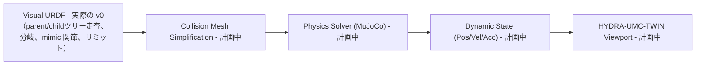

<!-- =============================================================================
HYDRA-UMC-PHYSICS-REPLICA - Digital twin module
Copyright (C) JuanenRac (Electro Hobby 3D) <electrohobby3d@gmail.com>
GPL-3.0-or-later - see LICENSE
============================================================================= -->

<p align="center">
  
</p>

# 📐 HYDRA-UMC-PHYSICS-REPLICA

<p align="center"><a href="README.md">🇺🇸 English</a> | <a href="README_spa.md">🇪🇸 Español</a> | <a href="README_fra.md">🇫🇷 Français</a> | <a href="README_ita.md">🇮🇹 Italiano</a> | <a href="README_deu.md">🇩🇪 Deutsch</a> | <a href="README_zho.md">🇨🇳 简体中文</a> | 🇯🇵 <b>日本語</b> | <a href="README_por.md">🇵🇹 Português</a></p>

### 📐 URDF の順運動学と関節リミット検証

<p align="center">
  
  
  
  
  
  
  
</p>

---

> **安全性とセキュリティの現状:** このエコシステムは認証された安全システムではありません。ハードウェアの E-STOP 経路、ファームウェアが強制する制限やインターロック、検証済みの動作コマンドはまだありません。ファームウェアイメージは CRC-32 と Ed25519 署名で検査し、リリースビルドは公開済みの開発用鍵を拒否します(リレーの先のツールヘッドと拡張ボードは引き続き URTC のブートローダーを使い、署名ではなく共有鍵の HMAC-SHA256 を使います)。TLS と相互 TLS は任意で、既定では無効です。独自基板はまだ実装も試験もされていません。ここに書かれた内容を人の安全のために頼る前に、[セキュリティベースライン](https://github.com/JuanenRac/HYDRA-UMC-DOCS/blob/main/docs/SECURITY_BASELINE.md)と[脅威モデル](https://github.com/JuanenRac/HYDRA-UMC-DOCS/blob/main/docs/THREAT_MODEL.md)をお読みください。

---

## 📋 ひと目で

| | |
|---|---|
| バージョン | `0.1.0` |
| 成熟度 | 機能する |
| テスト | 86 (`cargo test`) |
| 技術 | Rust / roxmltree / URDF forward kinematics |
| 実機での確認 | まだです：このバージョンについて実機での動作記録はありません |

**移動：** [概要](#-概要) · [アーキテクチャ](#-アーキテクチャ) · [クイックスタート](#-クイックスタート) · [テスト](#-テスト) · [リポジトリの構成](#-リポジトリの構成) · [関連プロジェクト](#-関連プロジェクト)

## 🚦 プロジェクトの状況

各行はこのリポジトリの一部分で、信号は今日どこまで進んでいるかを示します。計画ではなく、リポジトリが示せるもの（テスト、ビルド、実行）に基づいて書かれています。

🟢 完了・検証済み · 🟡 動作する（既知の制限あり） · 🟠 一部のみ、または未検証 · 🔴 未実装または動作しない

| 領域 | 状態 | ここでの意味 |
|---|---|---|
| ソフトウェア | 🟡 | 主な目的では動作します。足りない点は上の正直さの確認に書かれています |
| テスト | 🟢 | 自動テスト 86 件。変更のたびに実行されます |
| 実機 | 🔴 | まだです：このバージョンについて実機での動作記録はありません |
| ドキュメント | 🟢 | 8 言語の README。変更のたびにマニフェストと照合されます |

## 🎯 概要

**HYDRA-UMC-PHYSICS-REPLICA** はデジタルツインの運動学モジュールです。URDF の運動学ツリー（シリアルアームと、グリッパーのような分岐するもの）を読み込み、各関節の姿勢（順運動学）を計算し、関節位置をそのリミットと照合します。動力学はシミュレートしません。剛体・接触・摩擦のモデルも MuJoCo や PhysX もなく、それらはロードマップです。

単位は URDF のもの（メートルとラジアン）です。`fk` は各関節の位置を出力し、`--json` を付けると位置と単位クォータニオンの回転を出力します。

### 主な機能：
* 📐 **運動学的検証（v0）：** （文書化された部分的な）URDF サブセット上での実際の順運動学と実際の関節可動域チェック——今日実際に何が動くのかは下記「正直な現状確認」を参照してください。
* 🔒 **実装済み v0 —— 可動域を考慮した FK：** `fk-checked` は、URDF で宣言された可動域を超える関節位置に対してワールド座標のポーズを計算することを拒否します。実際の再利用可能な関節可動域コーパスと、両方の境界および大幅に範囲外の入力に対する回帰テストに裏付けられています——プレーンな `fk` が物理的に到達不能なポーズを黙って報告してしまうギャップを塞ぎます。
* 🏗️ **URDF から物理モデルへ（v0、部分的）：** 実際の `<joint>` 要素(タイプ/原点/軸/可動域)を読み取り、各関節の実際の `parent`/`child` リンク名を文書自身の実際のルートリンクからチェーンへと辿ります(ファイル内の `<joint>` 要素の順序に関わらず、真のルートからリーフへの順序になります)。*まだ実際には存在しないもの：* 衝突メッシュの生成——それはこの機能の「物理」側半分として、今も未実装のままです。
* ⚡ **リアルタイム性能（計画中）：** マルチロボットワークスペース向けの並列化された求解——まず実際の物理エンジン統合が存在することが前提です。
* 🌡️ **熱シミュレーション（計画中）：** 工具ヘッド（T12/レーザー）における放熱をエミュレートする実験的サポート。
* 📋 **URDF リーダーができることとできないこと（現在実装済み）：** `<robot>` 直下の `<joint>` 要素だけを読み込みます（`<transmission>` 内の関節は無視されるため ros_control のファイルも読めます）。revolute と prismatic の関節には長さが 0 でない `<axis>` と `<limit>` が必要です（`<limit>` がなければ `fk-checked` と `validate-limits` は検査を拒否します）。continuous 関節の `<limit>` は力と速度だけを与え、fixed 関節にはありません。関節名の重複、2 つの親を持つリンク、どの `<link>` も宣言していないリンクはエラーです。`<mimic>`、`<safety_controller>`、floating・planar 関節は未対応です。`--joints` に URDF にない名前や重複した名前があるとエラーになり、`validate-limits` は `--allow-partial` を付けない限りリミットのある全関節の位置を必要とします（行われなかった検査が "No limit violations" と報告されることはありません）。

**正直な現状確認 —— 今日実際に動くもの：** `fk --urdf パス --joints "j1=0.5,..."` は、URDF の関節変換を連鎖させることで、その位置が宣言された可動域内にあるかどうかに関わらず、各関節の実際のワールド座標位置を計算します。`fk-checked` は同じ計算を行いますが、まず各位置を `validate-limits` の実際のチェックに通し、何かが範囲外であればポーズの計算（および報告）自体を拒否します。`validate-limits --urdf パス --joints "..."` は、実際に可動域を超えた関節を単独で報告します。3 つとも純粋な運動学です——剛体力学も、接触力も、MuJoCo/PhysX ソルバーの接続もまだなく、URDF リーダーは実際の `parent`/`child` リンクツリーを分岐も含めて辿り（各関節は親リンクを持つ関節から配置されます）、他の関節に従う関節（`<mimic>`）を計算し、求められれば `<safety_controller>` のソフトリミットと速度・力のリミットも検査します（`validate-limits --soft --velocities ... --efforts ...`）。実際に出荷済みの内容は [`CHANGELOG.md`](CHANGELOG.md) を、まだ残っている作業は下記のロードマップを参照してください。

## 🧩 HYDRA-UMC での役割

**HYDRA-UMC-PHYSICS-REPLICA** はデジタルツインの運動学モジュールです。URDF のツリーを読み、各関節の姿勢を計算し（順運動学）、関節の位置を制限に照らして検証します。動力学のシミュレーションは行わず、接触、摩擦、剛体のモデルはありません。

## 🏛️ アーキテクチャ

<p align="center">
  
</p>

<details>
<summary>図のテキスト版（Mermaid）</summary>



</details>

### 物理パイプライン

`URDF`（パース）と、実際の独立した運動学ステップ（`fk`/
`validate-limits`。v0 では `SOLVE` の役割を代替するため、下図では
独立したボックスとして示していません）は今日すでに実際に動作します。
`MESH`、実際の `SOLVE` ステップ（本物の MuJoCo/PhysX ソルバー）、`DYN`、
`TWIN` はいずれも今後の課題のままです。

### アーキテクチャと設計上の決定

* **本シミュレーションに `hardware/`/`firmware/`/`os/` フォルダがない理由。** 純粋なソフトウェアであり、独自の基板を持たないため、これらのフォルダは空のまま残すのではなく意図的に省略されています。
* **HYDRA-UMC-TWIN のサブモジュールではなく兄弟プロジェクトである理由。** 物理ソルバーはレンダリングとは独立した独自のティックレートで動作します——独立したプロセスとして保つことで、遅い物理ステップが HYDRA-UMC-TWIN 自身のフレームレートを停滞させることはなく、どちらか一方を（例えば MuJoCo と PhysX の間で）入れ替え/アップグレードしても、もう一方に影響を与えません。
* **エコシステムの他の部分との関係。** 設計上は HYDRA-UMC-TWIN の子プロジェクトです。現在 HYDRA-UMC-TWIN はこれを呼び出していません。「Twin で動けば現場でも動く」の裏付けとなる物理的な妥当性チェックは計画中で、まだ作られていません。
* **分岐する URDF を `Model` として読み、`parse_urdf` は今も拒否する理由。** v0 は以前、`<joint>` 要素を生の文書順でパースし、その順序をチェーンとして扱っていましたが、これは関節をツリー順以外で宣言する仕様準拠の URDF に対しては誤りです。各関節の実際の `parent`/`child` リンク名は、文書自身の実際のルートリンクから辿られます。`parse_urdf_model` はツリー全体を保持します：親が子より先になる関節の順序、各関節の親関節の添字（グリッパーの 2 本の指はどちらも手のひらから配置され、順番に連なりません）、`<mimic>` の従動関節（`multiplier * master + offset`。従動関節に位置を与えると拒否され、従動の循環も拒否されます）、力・速度・ソフトのリミット。`parse_urdf` は元の契約である平坦な直列 `Chain` のままで、一方の枝を黙って保持してもう一方を捨てる代わりに、分岐を実際のエラーで拒否します。未実装：ヤコビアン、逆運動学（`urdf.rs` を参照）。
* **`roxmltree` が唯一の依存関係であり、まだ完全な物理エンジンバインディングではない理由。** 実際の順運動学と実際の可動域チェックに必要なのは、XML 属性の読み取りと手書きの行列演算（`transform.rs`）だけです——実際の剛体/接触シミュレーションの構築が始まるまでは、そのために MuJoCo/PhysX の FFI バインディングを追加しても、実際の見返りのない依存関係の重みが増えるだけです。
* **`fk-checked` が `fk` をその場で変更するのではなく新しいサブコマンドである理由。** `fk` は既存の低レベルな純粋数学ユーティリティです——一部の呼び出し元（例えば可動域自体を調整する場合）は、範囲外の値に対する未チェックのポーズを実際に必要とします。`fk-checked` は、`fk` がこれまで意味してきたものを黙って変更することなく、実際の呼び出し元が使うべきフェイルセーフで可動域チェック付きのエントリポイントを追加します。
* **関節可動域コーパス（`corpus.rs`）がテスト専用である理由。** これは、`limits.rs` と `kinematics.rs` の回帰テストに、重複したその場しのぎのリテラルではなく、単一の実際の共有フィクスチャセットを与えるためだけに存在します——リリースバイナリに含める理由がないため、`#[cfg(test)]` の背後で保護されています。

**2 種類の実機アームでテスト。** テストは、メーカーが公開している Denavit-Hartenberg パラメーターから UR5e と Franka Emika Panda の URDF を生成し（メーカーのファイルはコピーしません）、バイナリが計算するツール位置を、DH チェーンの 4x4 行列を直接掛け合わせた結果、メーカーが文書化したゼロ姿勢の位置、リンク長による到達範囲の上限、公開されている関節制限と比較します。

## 🚀 クイックスタート

安定版の Rust ツールチェーン（エディション 2021）と `cargo` が必要です。

```bash
./build.sh  # Linux, macOS (build.bat on Windows)
./run.sh fk --urdf arm.urdf --joints "shoulder=0,elbow=0"
./run.sh validate-limits --urdf arm.urdf --joints "shoulder=3.0,elbow=0.2"
cargo test
```

## 🧪 テスト

`cargo test` で自動テスト 86 件を実行します。 ハードウェアも、このマシンの外にあるものも必要ありません。

CI は `HYDRA_UMC_CI=1 python tools/ci_validate.py` を実行し、マニフェスト、文書、8 つの README、図を検査します。

## 🏗️ ビルドとリリース

Rust ツールチェーン（`cargo`/`rustc`、[rustup](https://rustup.rs) 経由で
インストール）と Python 3.10+（`bump_version.py` のみに使用）が必要です。

```bash
# Linux / macOS
./build.sh   # 、`cargo test`（86 件のテスト）、その後 `cargo build --release`
./run.sh     # target/release/hydra-umc-physics-replica を実行し、名前 + バージョン + 役割を表示
```

```bat
:: Windows
build.bat
run.bat
```

`build.sh`/`build.bat` はバージョンを変更せず（上げるのは `python tools/hydra_project_tool.py bump` だけです）、実際のテストスイートを
実行し、その後 release バイナリをビルドします。

実際の `fk` および `validate-limits` サブコマンドには URDF ファイルが
必要です：

```bash
./run.sh fk --urdf arm.urdf --joints "shoulder=0,elbow=0"
# shoulder: x=0.000000 y=0.000000 z=0.200000
# elbow: x=0.300000 y=0.000000 z=0.200000

./run.sh validate-limits --urdf arm.urdf --joints "shoulder=3.0,elbow=0.2"
# LIMIT VIOLATION: joint 'shoulder' = 3.000000 (allowed [-1.570000, 1.570000])
```

実際の `fk-checked` サブコマンドは、関節が範囲外の場合はポーズの計算を
拒否します——それでも計算してしまうプレーンな `fk` とは異なります：

```bash
./run.sh fk-checked --urdf arm.urdf --joints "shoulder=0.5,elbow=0.2"
# shoulder: x=0.000000 y=0.000000 z=0.200000
# elbow: x=0.263275 y=0.143828 z=0.200000

./run.sh fk-checked --urdf arm.urdf --joints "shoulder=0.5,elbow=5.0"
# LIMIT VIOLATION: joint 'elbow' = 5.000000 (allowed [-2.000000, 2.000000]) - refusing to compute an unreachable pose

./run.sh fk --urdf arm.urdf --joints "shoulder=0.5,elbow=5.0"
# elbow: x=0.263275 y=0.143828 z=0.200000   <- それでも計算されてしまう；これが fk-checked が塞ぐギャップです
```

`fk` は成功時に終了コード `0`、`--urdf`/`--joints` の値が不正な場合は
`2` で終了します。`fk-checked` は実際のポーズを返す場合は `0`、可動域
違反の場合は `1`、不正な入力の場合は `2` で終了します。`validate-limits`
は違反なしで `0`、違反ありで `1`、不正な入力で `2` を返します。

完全なコマンドラインリファレンス - 実際のリリースバイナリの実行から採取した、あらゆる実際のエラーケース（引数の欠落・不正な形式、読み取れない URDF ファイルなど）を含む - は [`docs/CLI_REFERENCE.md`](docs/CLI_REFERENCE.md) を参照してください。

## 📂 リポジトリの構成

<p align="center">
  
</p>

<details>
<summary>ツリーのテキスト版</summary>

```text
HYDRA-UMC-PHYSICS-REPLICA/
├── src/                             ソースコード
│   ├── transform.rs                 実際の Vec3/Mat4（平行移動、軸角回転、rpy）
│   ├── urdf.rs                      実際の、部分的な URDF リーダー（parent/childツリー走査、分岐、mimic、リミット）
│   ├── kinematics.rs                実際の forward_kinematics() + forward_kinematics_checked()
│   ├── limits.rs                    実際の validate_limits()
│   ├── corpus.rs                    テスト専用の可動域フィクスチャコーパス
│   └── main.rs                      エントリポイント + 実際の `fk`/`fk-checked`/`validate-limits` サブコマンド
├── tests/                           cli_contract.rs と tree_contract.rs: コマンドラインのエラー (綴り違い・重複・欠落した関節) と、枝および mimic 関節の配置
├── docs/                            プロジェクトの文書
├── images/                          メディアと図表
├── tools/                           プロジェクトのツールと CI の検査
├── .github/                         CI ワークフローと Issue テンプレート
├── Cargo.toml                       クレートのメタデータ
├── bump_version.py                  明示的なバージョン更新
├── bump_manifest_version.py         hydra-umc.project.json のバージョンをネイティブ版と同期(--sync)
├── build.sh / build.bat             バージョンを増加させ、`cargo test`、その後 `cargo build --release` を実行
├── build-test.sh / build-test.bat   バージョンを増やさないビルドチェック
├── run.sh / run.bat                 コンパイル済みの release バイナリを実行（引数を転送）
├── CHANGELOG.md                     各バージョンの変更点
├── hydra-umc.project.json           マニフェスト：バージョン、成熟度、ファミリー
└── test.sh                          テストを実行
```

</details>

## 🗺️ ロードマップと既知の制限

**現時点の既知の制限**

* **フェーズ 1：** リアルタイムハードウェアテレメトリとのデジタルツイン同期、サブ 10ms の遅延。
* **フェーズ 2：** 産業グレードのシミュレーター（Isaac Sim）との Physics Replica 統合、変形体サポート。
* **フェーズ 3：** 分散型フェイルオーバーと早期センサー劣化検知のためのノード自己修復自動化パターン。
* **フェーズ 4：** 変形体シミュレーション（ケーブルと真空チューブ）のサポートとフォトリアリスティックな合成データ生成。

## 🌍 言語

この README とリポジトリの文書は、英語・スペイン語・ドイツ語・フランス語・イタリア語・日本語・中国語・ポルトガル語（ポルトガル）の 8 言語で提供されています。8 つのファイルは同時に書かれ、同じ節と同じリンクを持つことを CI が確認します。 このリポジトリには独自の画面もメッセージカタログもないため、翻訳すべきインターフェース文字列はありません。

## 🔗 関連プロジェクト

本プロジェクトは、同じ作者(JuanenRac / Electro Hobby 3D)による HYDRA-UMC ロボティクスエコシステムの一部です。リクエストが実はこの中のどれかについてのものである可能性があるため、知っておく価値があります。

**親プロジェクト**
- **[HYDRA-UMC-TWIN](https://github.com/JuanenRac/HYDRA-UMC-TWIN)** — デジタルツインエンジンの統合ハブ、実際のバージョン互換性同期契約付き。本リポジトリは、その自身のデジタルツインエンジン内における特定のシミュレーションサービスとして、この親の一部を成す。

**兄弟プロジェクト** —— HYDRA-UMC-TWIN 自身のデジタルツインエンジンにおける他のシミュレーションサービス
- **[HYDRA-UMC-HIL-BRIDGE](https://github.com/JuanenRac/HYDRA-UMC-HIL-BRIDGE)** — シミュレーションと実機の間にソフトウェアの衝突インターロックを備えたハードウェア・イン・ザ・ループのルーター(実機なしでテスト済み)。
- **[HYDRA-UMC-SYNTHETIC-DATA-GEN](https://github.com/JuanenRac/HYDRA-UMC-SYNTHETIC-DATA-GEN)** — YOLO/COCO アノテーションのエクスポート機能を持つ、実際のプロシージャル 2D シーンジェネレーター。

**直接関連**
- **[HYDRA-UMC-EDITOR-URDF](https://github.com/JuanenRac/HYDRA-UMC-EDITOR-URDF)** — 完成したモデルを STUDIO 自身のカタログへ送信するデスクトップ用グラフィカル URDF 作成/編集ツール ——本プロジェクトが読み込む URDF モデル(`fk`/`validate-limits`)の作成に使われるツール。
- **[HYDRA-UMC-EDITOR-STL](https://github.com/JuanenRac/HYDRA-UMC-EDITOR-STL)** — HYDRA-UMC-EDITOR-URDF も編集する同じモデルカタログ内で、実在するパーツを変換/置換/削除/追加するデスクトップ STL モデルエディタ。

**エコシステムの他のプロジェクト**

*コアハードウェア&プラットフォーム*
- **[HYDRA-UMC](https://github.com/JuanenRac/HYDRA-UMC)** — ロボットアームのマザーボードの設計——CM5 ホスト + デュアルコア STM32H745、CAN-OTA/SPI-OTA 経由で最大 8 本のツールアームを統括することを目指す(ファームウェアは初期段階で、実装済みの基板はまだない)。
- **[HYDRA-UMC-OS](https://github.com/JuanenRac/HYDRA-UMC-OS)** — CM5 向けの再現可能な Raspberry Pi OS プロダクト層——読み取り専用エージェント、検証済み設定/プロファイル、WiFi 初回接続プロビジョニング。
- **[HYDRA-UMC-SDK](https://github.com/JuanenRac/HYDRA-UMC-SDK)** — すべてのブリッジが自身のコマンドを検証する共有 JSON-Schema 契約とソフトウェアのジョブゲート境界(認証済みの安全機能ではない)。
- **[HYDRA-UMC-CONNECTOR-HUB](https://github.com/JuanenRac/HYDRA-UMC-CONNECTOR-HUB)** — 外部マシン用コネクタのための宣言的アダプターマニフェストのレジストリとバリデーター。SDK 自身の契約という発想を外部マシンにまで拡張し、産業用ゲートウェイ系のプロジェクトを置き換えることはありません。

*コアバックエンド&クライアント*
- **[HYDRA-UMC-SERVER](https://github.com/JuanenRac/HYDRA-UMC-SERVER)** — すべての制御クライアントが実際に通信する、本物のヘッドレスバックエンド(REST/WebSocket)。
- **[HYDRA-UMC-STUDIO](https://github.com/JuanenRac/HYDRA-UMC-STUDIO)** — リアルタイムのマルチロボット 3D 可視化を備えたウェブ制御ダッシュボード。
- **[HYDRA-UMC-SUITE](https://github.com/JuanenRac/HYDRA-UMC-SUITE)** — 複数のサーバーを同時に扱えるデスクトップ(PySide6)スウォームコマンドセンター、スタンドアロン実行ファイルとしてパッケージ化。
- **[HYDRA-UMC-ANDROID-CONTROL](https://github.com/JuanenRac/HYDRA-UMC-ANDROID-CONTROL)** — 生体認証ログインとペアリングされた Wear OS コンパニオンを備えたネイティブ Android 制御アプリ。
- **[HYDRA-UMC-IOS-CONTROL](https://github.com/JuanenRac/HYDRA-UMC-IOS-CONTROL)** — リアルタイム WebSocket 同期を備えた iOS/iPadOS 制御アプリ(Flutter)。
- **[HYDRA-UMC-DSI](https://github.com/JuanenRac/HYDRA-UMC-DSI)** — 本体搭載の 7 インチ DSI タッチスクリーン向けネイティブタッチ UI、CM5 自体に組み込み。
- **[HYDRA-UMC-BRIDGE-AMR](https://github.com/JuanenRac/HYDRA-UMC-BRIDGE-AMR)** — VDA 5050 MQTT パブリッシャーによる AGV/AMR フリートの調整境界(エミュレートしたフリートに対してのみテスト済み)。
- **[HYDRA-UMC-BRIDGE-CNC](https://github.com/JuanenRac/HYDRA-UMC-BRIDGE-CNC)** — GRBL ステータス/制御バイトへのアクセスを持つ、CNC セルの高レベルコーディネーター(エミュレーターに対してのみテスト済み)。
- **[HYDRA-UMC-BRIDGE-DROIDS](https://github.com/JuanenRac/HYDRA-UMC-BRIDGE-DROIDS)** — Boston Dynamics Spot コマンド送信機能を持つ、脚型/ヒューマノイドドロイドの調整境界(エミュレーターに対してのみテスト済み)。
- **[HYDRA-UMC-BRIDGE-LASER](https://github.com/JuanenRac/HYDRA-UMC-BRIDGE-LASER)** — キー/筐体/インターロックの GPIO 信号 3 系統を読み取るレーザーセルのコーディネーター(模擬チップに対してのみテスト済み。レーザーの武装や発射はできない)。
- **[HYDRA-UMC-BRIDGE-OPENPNP](https://github.com/JuanenRac/HYDRA-UMC-BRIDGE-OPENPNP)** — OpenPnP ピックアンドプレースの基板フローを安全に統括する高レベルコーディネーター。
- **[HYDRA-UMC-BRIDGE-PRINTER3D](https://github.com/JuanenRac/HYDRA-UMC-BRIDGE-PRINTER3D)** — 実際にゲート制御されたジョブコマンドを持つ、Moonraker/Klipper 3D プリンター向けの安全な調整境界。
- **[HYDRA-UMC-BRIDGE-ROS2](https://github.com/JuanenRac/HYDRA-UMC-BRIDGE-ROS2)** — 遅延インポートの rclpy ROS 2 トランスポートを持つコーディネーター(ROS 2 環境ではまだ実行していない)。
- **[HYDRA-UMC-BRIDGE-UAV](https://github.com/JuanenRac/HYDRA-UMC-BRIDGE-UAV)** — MAVLink コマンド送信機能を持つ、カメラ搭載 UAV の調整境界(エミュレーターに対してのみテスト済み)。

*URTC ツールプラットフォーム*
- **[URTC](https://github.com/JuanenRac/URTC)** — 物理的な Universal Robot Tool Controller 基板向けファームウェア、CAN バス経由の 25 以上のツールプロファイル。
- **[URTC-FLASHER](https://github.com/JuanenRac/URTC-FLASHER)** — URTC 基板用のデスクトップ GUI 書き込みツール、CAN-OTA およびフルチップ SWD/JTAG。
- **[URTC-TESTER](https://github.com/JuanenRac/URTC-TESTER)** — URTC 基板向けのデスクトップ CAN バスライブ診断ツール、ツールプロファイルごとに 1 パネル。
- **[URTC-WEB-STUDIO](https://github.com/JuanenRac/URTC-WEB-STUDIO)** — Web Serial API を使ったブラウザベースの URTC-TESTER の代替、ローカルインストール不要。
- **[URTC-GATEWAY](https://github.com/JuanenRac/URTC-GATEWAY)** — URTC の CAN バスの前に置くゲートウェイ：許可する識別子のリスト、レート制限、セッション鍵。コンピューター上でテスト済みで、実際のバスではまだ試していません。

*ビジョン AI ノード(Hailo-8)*
- **[HYDRA-UMC-VISION-NODE](https://github.com/JuanenRac/HYDRA-UMC-VISION-NODE)** — Hailo-8 ビジョンパイプラインの統合ハブ、段階ごとの実際のハードウェア準備状況チェック付き。
- **[HYDRA-UMC-DETECTION-HEF](https://github.com/JuanenRac/HYDRA-UMC-DETECTION-HEF)** — Hailo アーキテクチャ/チェックサムによる安全読み込み検証を備えた、実際のコンパイル済みモデルレジストリ。
- **[HYDRA-UMC-VISION-STREAMER](https://github.com/JuanenRac/HYDRA-UMC-VISION-STREAMER)** — 実際の HailoRT 統合境界を持つ、実際の GStreamer パイプライン + MediaMTX 設定生成器。
- **[HYDRA-UMC-VISUAL-SERVOING-API](https://github.com/JuanenRac/HYDRA-UMC-VISUAL-SERVOING-API)** — ゾーン状態を条件に承認する Position-Based Visual Servoing 補正則。カメラによる姿勢推定はまだない。
- **[HYDRA-UMC-SAFETY-ZONES](https://github.com/JuanenRac/HYDRA-UMC-SAFETY-ZONES)** — ファイルから物体位置を受け取る、ゾーン侵入・キャリブレーション鮮度・E-STOP 要求の v0 ロジック。検出器は接続されておらず、物理 E-STOP もまだ配線されていない。

*コグニティブ AI ノード(Hailo-10)*
- **[HYDRA-UMC-COGNITIVE-NODE](https://github.com/JuanenRac/HYDRA-UMC-COGNITIVE-NODE)** — Hailo-10 コグニティブパイプライン(LLM/VLA/音声オーケストレーション)の統合ハブ。
- **[HYDRA-UMC-VLA-ENGINE](https://github.com/JuanenRac/HYDRA-UMC-VLA-ENGINE)** — Vision-Language-Action モデル向けの、実際のアクショントークンのエンコード/デコードと軌道生成。
- **[HYDRA-UMC-VOICE-UI](https://github.com/JuanenRac/HYDRA-UMC-VOICE-UI)** — 確認ゲート付きの限定的な Watch リレーを備えた、実際の音声フロントエンド(VAD + 意図解析)。
- **[HYDRA-UMC-SEMANTIC-PLANNER](https://github.com/JuanenRac/HYDRA-UMC-SEMANTIC-PLANNER)** — MCU エラーコードに対する、実際のルールベースのタスク分解と意味的エラー復旧。
- **[HYDRA-UMC-DOCS-QA](https://github.com/JuanenRac/HYDRA-UMC-DOCS-QA)** — このエコシステム自身の Markdown ドキュメントに対する、標準ライブラリのみの実際の TF-IDF 文書検索。
- **[HYDRA-UMC-LOCAL-TECHNICIAN](https://github.com/JuanenRac/HYDRA-UMC-LOCAL-TECHNICIAN)** — エコシステム自身のための、ローカルでポリシーゲート付きのAIメンテナンス技術者 — 観察、診断し、修正を提案する;最上位の2つのリスクレベルは意図的にまだ実装されていない。

*オーケストレーション&スウォーム*
- **[HYDRA-UMC-ORCHESTRATOR](https://github.com/JuanenRac/HYDRA-UMC-ORCHESTRATOR)** — 実際の gRPC/Protobuf ヘルスレポート契約とミッションステートマシンを持つ統合ハブ。
- **[HYDRA-UMC-JOB-DISPATCHER](https://github.com/JuanenRac/HYDRA-UMC-JOB-DISPATCHER)** — 実際の HTTP API 上に構築された、優先度ベースの実際のジョブキュー(重複排除付き)。
- **[HYDRA-UMC-NODE-HEALING](https://github.com/JuanenRac/HYDRA-UMC-NODE-HEALING)** — リトライ/バックオフとアイデンティティ不一致検出を備えた、実際の gRPC ベースのフリートヘルスウォッチドッグ。
- **[HYDRA-UMC-PATH-PLANNER-3D](https://github.com/JuanenRac/HYDRA-UMC-PATH-PLANNER-3D)** — 実際の障害物/ワークスペース衝突検証を備えた、実際の RRT ベースの 3D 経路プランナー。
- **[HYDRA-UMC-SWARM-SYNC](https://github.com/JuanenRac/HYDRA-UMC-SWARM-SYNC)** — 複数セルの収束についてプロパティテストされた、実際の CRDT LWW-Element-Map 状態同期。

*データ&分析*
- **[HYDRA-UMC-DATALAKE](https://github.com/JuanenRac/HYDRA-UMC-DATALAKE)** — 実際の取り込み/クエリ HTTP API を備えた、実際の sqlite3 ベースの時系列ストア。
- **[HYDRA-UMC-ANOMALY-DETECTOR](https://github.com/JuanenRac/HYDRA-UMC-ANOMALY-DETECTOR)** — ドリフト監視を備えた、実際の FFT + 統計ベースラインによる異常検知器。
- **[HYDRA-UMC-PRODUCTION-REPORTS](https://github.com/JuanenRac/HYDRA-UMC-PRODUCTION-REPORTS)** — DATALAKE の履歴に対する実際の OEE/稼働率計算、再現可能な CSV エクスポート付き。
- **[HYDRA-UMC-TELEMETRY-COLLECTOR](https://github.com/JuanenRac/HYDRA-UMC-TELEMETRY-COLLECTOR)** — シーケンス重複排除機能を備えた、DATALAKE への実際の CAN/WebSocket 取り込みパイプライン。

*産業用ゲートウェイ*
- **[HYDRA-UMC-GATEWAY-INDUSTRIAL](https://github.com/JuanenRac/HYDRA-UMC-GATEWAY-INDUSTRIAL)** — 実際のコマンド許可リスト/バックプレッシャー層を持つ、産業用プロトコルへ中継する統合ハブ。
- **[HYDRA-UMC-OPCUA-SERVER](https://github.com/JuanenRac/HYDRA-UMC-OPCUA-SERVER)** — 実際のバイナリプロトコルクライアントセッションで検証された、実際の OPC-UA アドレス空間。
- **[HYDRA-UMC-MQTT-BROKER](https://github.com/JuanenRac/HYDRA-UMC-MQTT-BROKER)** — クライアント単位のオプション認証とトピック ACL を備えた、実際の MQTT ブローカー。
- **[HYDRA-UMC-MTCONNECT-ADAPTER](https://github.com/JuanenRac/HYDRA-UMC-MTCONNECT-ADAPTER)** — 縮退モード出力を備えた、実際の MTConnect `/probe` および `/current` XML エンドポイント。

*補完ツール&エコシステム運用*
- **[HYDRA-UMC-DASHBOARD-AI](https://github.com/JuanenRac/HYDRA-UMC-DASHBOARD-AI)** — 誠実な統計フォールバックを備えた、DATALAKE/ANOMALY-DETECTOR 上のスマートサマリーと異常ハイライトパネル。
- **[HYDRA-UMC-TOOL-CLI](https://github.com/JuanenRac/HYDRA-UMC-TOOL-CLI)** — 実際の安定した終了コード契約を持つフリート CLI、HYDRA-UMC-SERVER 自身の API の本物のライブクライアント。
- **[HYDRA-UMC-WATCH](https://github.com/JuanenRac/HYDRA-UMC-WATCH)** — 触覚アラートのパターンとペアリング済みスマートフォンへの音声リレーを備えた WearOS コンパニオンアプリ(物理的なウォッチではまだ実行していない)。
- **[URTC-SMART-RACK](https://github.com/JuanenRac/URTC-SMART-RACK)** — 実際の工具 ID デコードと Smart Idle 予熱ロジックを備えた、基板搭載ラック用ファームウェア。
- **[URTC-VISION-TOOL](https://github.com/JuanenRac/URTC-VISION-TOOL)** — サーマル/RGB 検査ツールヘッド向けの、ファームウェアと実際の Python ビジョンコンパニオン。
- **[HYDRA-UMC-UPDATER](https://github.com/JuanenRac/HYDRA-UMC-UPDATER)** — このエコシステム内のすべてのリポジトリを検出・クローン・更新する、管理用デスクトップツール。
- **[HYDRA-UMC-OS-REBUILDER](https://github.com/JuanenRac/HYDRA-UMC-OS-REBUILDER)** — エコシステムの最新バージョンをプリロードした、書き込み可能なCM5イメージを構築するWindows/Linuxデスクトップツール。Raspberry Pi Imager方式の初回起動Wi-Fi/ユーザー/SSH設定を備える。
- **[HYDRA-UMC-OPS-AGENT](https://github.com/JuanenRac/HYDRA-UMC-OPS-AGENT)** — 保守インシデントコーディネーター: 低権限のエッジ役割がサニタイズされたインベントリ/ヘルスのスナップショットを収集し、コントロールプレーン役割がそれを読み取り専用でレンダリングして AI プロバイダーに診断の提案を依頼します - パッチを適用することも、何かをデプロイすることも決してありません。
- **[HYDRA-UMC-DEV-SERVER](https://github.com/JuanenRac/HYDRA-UMC-DEV-SERVER)** — 再現可能な開発ホスト（Raspberry Pi 5 / CM5）。エコシステムのソースコードを保管し、永続キューのもとで境界の明確なビルド/テストタスクを実行する。運用中の CM5 とは明確に異なる、開発専用の役割。

## 📚 ドキュメント

さらに読むには：

* [エコシステムのセキュリティ基準](https://github.com/JuanenRac/HYDRA-UMC-DOCS/blob/main/docs/SECURITY_BASELINE.md)
* [エコシステムの脅威モデル](https://github.com/JuanenRac/HYDRA-UMC-DOCS/blob/main/docs/THREAT_MODEL.md)
* [このリポジトリの変更履歴](CHANGELOG.md)
* [このリポジトリのライセンス](LICENSE.md)

## 🤝 コントリビュートとコミュニティ

* プルリクエストの前に `HYDRA_UMC_CI=1 py -3 tools/ci_validate.py`（または `HYDRA_UMC_CI=1 python3 tools/ci_validate.py`）を実行してください。`CI_VALIDATION=PASS` と表示される必要があります。この確認に `build.sh` や `build.bat` は使わないでください。ビルドは検査ではありません。
* 8 つの README は HYDRA-UMC-DOCS の 1 つのソースから書かれます。手で編集しないでください。ソースを変更し、`tools/make_readmes.py` で書き直します。
* 実行していないことを README に書かないでください。事実であれば「シミュレーションのみ」「実機では未確認」と書きます。
* [CONTRIBUTING.md](CONTRIBUTING.md)、[行動規範](CODE_OF_CONDUCT.md)、[SECURITY.md](SECURITY.md)、[SUPPORT.md](SUPPORT.md) を参照してください。

## 👤 作者

**JuanenRac (Electro Hobby 3D)** · electrohobby3d@gmail.com

## 📜 ライセンス

GPL-3.0-or-later - [LICENSE](LICENSE).
