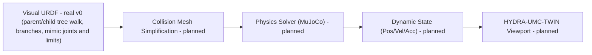

<p align="center">
  
</p>

# 🏗️ HYDRA-UMC-PHYSICS-REPLICA

<p align="center"><a href="README.md">🇺🇸 English</a> | <a href="README_spa.md">🇪🇸 Español</a> | <a href="README_fra.md">🇫🇷 Français</a> | <a href="README_ita.md">🇮🇹 Italiano</a> | <a href="README_deu.md">🇩🇪 Deutsch</a> | <a href="README_zho.md">🇨🇳 简体中文</a> | <a href="README_jpn.md">🇯🇵 日本語</a> | 🇵🇹 <b>Português</b></p>

### 📐 Cinemática direta URDF e validação de limites das juntas

<p align="center">
  
  
  
  
</p>

---

> **Estado de segurança (safety e security):** este ecossistema não é um sistema de segurança certificado. Ainda não existe um caminho de E-STOP por hardware, nem limites ou interlocks impostos pelo firmware, nem um comando de movimento verificado; as imagens de firmware são verificadas com CRC32 e um HMAC-SHA256 de chave partilhada, não com uma assinatura assimétrica; TLS e TLS mútuo são opcionais e estão desativados por defeito; nenhuma placa própria foi ainda montada ou testada. Leia a [base de segurança](https://github.com/JuanenRac/HYDRA-UMC-DOCS/blob/main/docs/SECURITY_BASELINE.md) e o [modelo de ameaças](https://github.com/JuanenRac/HYDRA-UMC-DOCS/blob/main/docs/THREAT_MODEL.md) antes de confiar em qualquer afirmação aqui para a segurança de uma pessoa.

## 📋 Num relance

| | |
|---|---|
| Versão | `0.0.9` |
| Maturidade | Funcional |
| Tecnologia | Rust / roxmltree / URDF forward kinematics |
| Em hardware real | Ainda não: não há registo de execução em hardware real para esta versão |

## 🚦 Estado do projeto

Cada linha é uma parte deste repositório e a luz diz até onde chega hoje. É escrita com o que o repositório consegue demonstrar (testes, compilações, execuções), não com o que está previsto.

🟢 Feito e verificado · 🟡 Funciona, com limites conhecidos · 🟠 Feito a meio ou ainda por verificar · 🔴 Por fazer ou a não funcionar

| Área | Estado | O que significa aqui |
|---|---|---|
| Software | 🟡 | Funciona para o seu propósito principal; a verificação de honestidade acima lista o que ainda falta |
| Testes | 🟠 | Ainda não há registo do número de testes deste repositório |
| Hardware real | 🔴 | Ainda não: não há registo de execução em hardware real para esta versão |
| Documentação | 🟢 | README em oito idiomas, verificado contra o manifesto a cada alteração |

## 1. 🛠️ VISÃO TÉCNICA GERAL

**HYDRA-UMC-PHYSICS-REPLICA** é o módulo de cinemática do Gémeo Digital: lê uma árvore cinemática URDF (braços em série e ramificados como uma pinça), calcula a pose de cada junta (cinemática direta) e verifica as posições das juntas face aos seus limites. Não simula dinâmica: não há modelo de corpo rígido, contacto ou atrito, nem MuJoCo nem PhysX; isso é o roteiro.

As unidades são as do URDF (metros e radianos). O `fk` imprime a posição de cada junta; com `--json` imprime a posição e a rotação como quaternião unitário.

### Funcionalidades principais:
* 📐 **Validação cinemática (v0):** cinemática direta real e verificação de limites de juntas sobre um subconjunto (documentado como parcial) de URDF - ver a «Verificação de honestidade» abaixo para saber exatamente o que funciona hoje.
* 🔒 **v0 real - FK ciente dos limites:** o `fk-checked` recusa calcular uma pose no referencial do mundo para uma posição de junta fora do seu limite URDF declarado, apoiado num corpus reutilizável e real de limites de juntas e em testes de regressão para ambos os extremos e para entradas muito fora de gama - fechando a lacuna em que o `fk` simples reportaria em silêncio uma pose fisicamente inalcançável.
* 🏗️ **URDF para física (v0, parcial):** lê elementos `<joint>` reais (tipo/origem/eixo/limite) e percorre os nomes reais de link `parent`/`child` de cada junta a partir do link raiz real do próprio documento até formar uma cadeia, em genuína ordem da raiz às folhas, independentemente da ordem dos elementos `<joint>` no ficheiro. *Ainda não é real:* a geração de malhas de colisão - essa continua a ser a metade «física» desta funcionalidade.
* ⚡ **Desempenho em tempo real (planeado):** resolução paralelizada para espaços de trabalho multirrobô - depende de existir primeiro uma integração real com um motor de física.
* 🌡️ **Simulação térmica (planeada):** suporte experimental para emular a dissipação de calor nas cabeças de ferramenta (T12/Laser).
* 📋 **O que o leitor de URDF faz e não faz (real hoje):** só são lidos os elementos `<joint>` diretamente sob `<robot>` (os de `<transmission>` são ignorados), pelo que os ficheiros ros_control se leem; uma junta revolute ou prismatic precisa de um `<axis>` de comprimento não nulo e de um `<limit>` (sem ele, `fk-checked` e `validate-limits` recusam verificá-la); o `<limit>` de uma continuous dá só esforço e velocidade, e uma fixed não tem; nomes de junta duplicados, um elo com dois pais e elos que nenhum `<link>` declara são erros; `<mimic>`, `<safety_controller>` e juntas floating ou planar não são suportados; um nome em `--joints` que o URDF não tem, ou dado duas vezes, é um erro, e `validate-limits` precisa de uma posição para cada junta com limite, salvo se for dado `--allow-partial` (uma verificação que não foi feita nunca é reportada como "No limit violations").

**Verificação de honestidade - o que realmente funciona hoje:** o `fk --urdf PATH --joints "j1=0.5,..."` calcula posições reais de cada junta no referencial do mundo encadeando as transformações de juntas do URDF, quer a posição esteja ou não dentro do seu limite declarado; o `fk-checked` executa o mesmo cálculo mas verifica PRIMEIRO cada posição com a verificação real de limites do `validate-limits`, recusando-se a calcular (ou reportar) qualquer pose se algo estiver fora de gama; o `validate-limits --urdf PATH --joints "..."` reporta por si só as juntas reais fora de gama. Os três são cinemática pura - não há dinâmica de corpos rígidos, nem forças de contacto, nem nenhum solver MuJoCo/PhysX ligado ainda, e o leitor de URDF percorre a árvore real de links `parent`/`child`, ramos incluídos (cada junta é posta a partir da junta que leva o seu link pai), calcula as juntas que seguem outra (`<mimic>`) e, quando pedido, verifica também os limites suaves de um `<safety_controller>` e os limites de velocidade e de esforço (`validate-limits --soft --velocities ... --efforts ...`). Consulte o [`CHANGELOG.md`](CHANGELOG.md) para saber exatamente o que foi entregue e o Roteiro abaixo para o que falta.

---

## 2. 🔄 PIPELINE DE FÍSICA

O `URDF` (leitura) e um passo de cinemática real e autónomo (`fk`/`validate-limits`, não mostrado como caixa própria abaixo porque substitui o papel do `SOLVE` na v0) são reais hoje. A `MESH`, o passo `SOLVE` real (um solver MuJoCo/PhysX a sério), o `DYN` e o `TWIN` continuam a ser trabalho futuro.



---

## 3. 🧱 ARQUITETURA E DECISÕES DE DESIGN

* **Porque é que esta simulação não tem pastas `hardware/`/`firmware/`/`os/`.** Software puro - sem placa própria, pelo que essas pastas foram retiradas em vez de deixadas vazias.
* **Porque é que é um irmão, e não um submódulo, do HYDRA-UMC-TWIN.** O solver de física corre ao seu próprio ritmo de ticks, independente da renderização - mantê-lo como processo separado significa que um passo de física lento não bloqueia a taxa de fotogramas do próprio HYDRA-UMC-TWIN, e qualquer um dos dois pode ser trocado/atualizado (por exemplo, MuJoCo ou PhysX) sem tocar no outro.
* **Como isto se encaixa no resto do ecossistema.** Filho do HYDRA-UMC-TWIN por desenho. Hoje o HYDRA-UMC-TWIN não o chama: a verificação de plausibilidade física por detrás de "se funciona no Twin, funciona no chão de fábrica" está planeada, não construída.
* **Porque é que um URDF ramificado se lê como `Model` e o `parse_urdf` continua a recusá-lo.** A v0 costumava ler os elementos `<joint>` pela ordem bruta do documento e tratar essa ordem como a cadeia, o que está errado para qualquer URDF válido que declare as juntas fora da ordem da árvore; os nomes reais de link `parent`/`child` de cada junta são agora percorridos a partir do link raiz real do documento. O `parse_urdf_model` guarda a árvore toda: as juntas por ordem pai antes de filho, o índice da junta pai de cada uma (os dois dedos de uma pinça são ambos postos a partir da palma, não um a seguir ao outro), as seguidoras de `<mimic>` (`multiplier * mestre + offset`; uma posição dada a uma seguidora é recusada, tal como um círculo de seguidoras) e os limites de esforço, velocidade e suaves. O `parse_urdf` mantém o contrato original, uma `Chain` série plana, e recusa um ramo com um erro real em vez de manter em silêncio um ramo e descartar o outro. Não feito: Jacobiano, cinemática inversa (ver `urdf.rs`).
* **Porque é que o `roxmltree` é a única dependência e não um binding completo de motor de física.** A cinemática direta real e a verificação de limites não precisam de nada além de ler atributos XML e fazer matemática de matrizes à mão (`transform.rs`) - acrescentar um binding FFI do MuJoCo/PhysX para isso seria peso em dependências sem benefício real até se estar a construir simulação verdadeira de corpos rígidos/contacto.
* **Porque é que o `fk-checked` é um subcomando novo em vez de alterar o `fk` no lugar.** O `fk` é o utilitário matemático puro de baixo nível já existente - alguns chamadores (por exemplo, quem ajusta um limite) querem genuinamente a pose sem verificação para um valor fora de gama. O `fk-checked` acrescenta o ponto de entrada seguro, condicionado pelos limites, que os chamadores reais devem usar, sem mudar em silêncio o que o `fk` sempre significou.
* **Porque é que o corpus de limites de juntas (`corpus.rs`) é só para testes.** Existe unicamente para dar aos testes de regressão do `limits.rs` e do `kinematics.rs` um conjunto único e real de fixtures em vez de literais ad hoc duplicados - não tem razão para ir no binário de lançamento, pelo que está atrás de `#[cfg(test)]`.

---

## 📂 ESTRUTURA DE DIRETORIAS

Motor de simulação de software puro, sem desenho de hardware próprio; as pastas de código só se incluem quando a sua implementação as exige, pelo que este projeto não tem pastas `hardware/`, `firmware/` nem `os/`.

```text
HYDRA-UMC-PHYSICS-REPLICA/
├── src/
│   ├── transform.rs      # Matemática real de Vec3/Mat4 (translação, rotação eixo-ângulo, rpy)
│   ├── urdf.rs           # Leitor real e parcial de URDF (percurso da árvore parent/child, ramos, mimic e limites)
│   ├── kinematics.rs     # forward_kinematics() + forward_kinematics_checked() reais
│   ├── limits.rs         # validate_limits() real
│   ├── corpus.rs         # Só para testes: corpus reutilizável de fixtures de limites de juntas
│   └── main.rs           # Ponto de entrada + subcomandos reais `fk`/`fk-checked`/`validate-limits`
├── docs/
│   └── CLI_REFERENCE.md # Referência completa da linha de comandos, cada código de saída e caso de erro
├── build/               # Notas/artefactos de compilação (a saída do cargo vive em target/, ignorada pelo git)
├── images/              # Multimédia e diagramas
├── tools/
│   ├── build_test.py    # Verificação de compilação sem alterar versões
│   └── ci_validate.py   # Validação de manifesto/CHANGELOG/docs usada pelo CI
├── Cargo.toml           # Metadados do pacote, dependências (roxmltree), versão em odómetro
├── bump_version.py      # Subida de versão ao estilo conta-quilómetros (executada só pelo comando `bump` explícito)
├── bump_manifest_version.py # Sincroniza a versão do hydra-umc.project.json com a nativa (--sync)
├── build.sh / build.bat # Valida e compila (compilar nunca altera a versão)
├── build-test.sh / build-test.bat # Verificação de compilação sem subir versão (sem CHANGELOG/versão)
└── run.sh / run.bat     # Executa o binário de lançamento compilado (reencaminha os argumentos)
```

---

## 🏗️ GUIA DE COMPILAÇÃO E EXECUÇÃO

Requer a cadeia de ferramentas Rust (`cargo`/`rustc`, instalada via [rustup](https://rustup.rs)) e Python 3.10+ (apenas para o `bump_version.py`).

```bash
# Linux / macOS
./build.sh   # `cargo test` (64 testes) e depois `cargo build --release`
./run.sh     # executa target/release/hydra-umc-physics-replica, imprime nome + versão + papel
```

```bat
:: Windows
build.bat
run.bat
```

`build.sh`/`build.bat` nunca alteram a versão (só `python tools/hydra_project_tool.py bump` a sobe), executam a suíte de testes real e depois compilam um binário de lançamento.

Os subcomandos reais `fk` e `validate-limits` precisam de um ficheiro URDF:

```bash
./run.sh fk --urdf arm.urdf --joints "shoulder=0,elbow=0"
# shoulder: x=0.000000 y=0.000000 z=0.200000
# elbow: x=0.300000 y=0.000000 z=0.200000

./run.sh validate-limits --urdf arm.urdf --joints "shoulder=3.0,elbow=0.2"
# LIMIT VIOLATION: joint 'shoulder' = 3.000000 (allowed [-1.570000, 1.570000])
```

O subcomando real `fk-checked` recusa-se a calcular qualquer pose quando uma junta está fora de gama - ao contrário do `fk` simples, que a calcula na mesma:

```bash
./run.sh fk-checked --urdf arm.urdf --joints "shoulder=0.5,elbow=0.2"
# shoulder: x=0.000000 y=0.000000 z=0.200000
# elbow: x=0.263275 y=0.143828 z=0.200000

./run.sh fk-checked --urdf arm.urdf --joints "shoulder=0.5,elbow=5.0"
# LIMIT VIOLATION: joint 'elbow' = 5.000000 (allowed [-2.000000, 2.000000]) - refusing to compute an unreachable pose

./run.sh fk --urdf arm.urdf --joints "shoulder=0.5,elbow=5.0"
# elbow: x=0.263275 y=0.143828 z=0.200000   <- computed anyway; this is the gap fk-checked closes
```

O `fk` termina com `0` em caso de êxito e com `2` perante um valor inválido de `--urdf`/`--joints`. O `fk-checked` termina com `0` (pose real), `1` (violação de limite) ou `2` (entrada inválida). O `validate-limits` termina com `0` (sem violações), `1` (violações encontradas) ou `2` (entrada inválida).

Consulte o [`docs/CLI_REFERENCE.md`](docs/CLI_REFERENCE.md) para a referência completa dos comandos, incluindo cada caso de erro real (argumentos em falta/malformados, um ficheiro URDF ilegível) capturado de uma execução real do binário de lançamento.

---

## 🚀 ROTEIRO
* **Fase 1:** Sincronização do Digital Twin com telemetria de hardware em tempo real e latência abaixo de 10 ms.
* **Fase 2:** Integração da Physics Replica com simuladores de nível industrial (Isaac Sim) e suporte a corpos deformáveis.
* **Fase 3:** Padrões de recuperação automatizada do Node Healing para failover descentralizado e deteção precoce da degradação de sensores.
* **Fase 4:** Suporte à simulação de corpos deformáveis (cabos e tubos de vácuo) e geração fotorrealista de dados sintéticos.

---

## 🔗 Projetos relacionados

Este projeto faz parte do ecossistema de robótica HYDRA-UMC do mesmo autor (JuanenRac / Electro Hobby 3D). Vale a pena conhecê-los, porque um pedido pode ser, na verdade, sobre um destes e não sobre este repositório.

**Projeto-mãe**
- **[HYDRA-UMC-TWIN](https://github.com/JuanenRac/HYDRA-UMC-TWIN)** — hub de integração do motor de gémeo digital, com um contrato real de sincronização por compatibilidade de versões; o pai de que este repositório é um serviço de simulação específico, dentro do seu próprio motor de gémeo digital.

**Projetos irmãos** — os outros serviços de simulação do próprio motor de gémeo digital do HYDRA-UMC-TWIN
- **[HYDRA-UMC-HIL-BRIDGE](https://github.com/JuanenRac/HYDRA-UMC-HIL-BRIDGE)** — encaminhador hardware-in-the-loop com um interlock de software de colisão entre a simulação e o hardware real (testado sem hardware real).
- **[HYDRA-UMC-SYNTHETIC-DATA-GEN](https://github.com/JuanenRac/HYDRA-UMC-SYNTHETIC-DATA-GEN)** — gerador procedural real de cenas 2D com exportação de anotações YOLO/COCO.

**Diretamente relacionados**
- **[HYDRA-UMC-EDITOR-URDF](https://github.com/JuanenRac/HYDRA-UMC-EDITOR-URDF)** — criador/editor gráfico de URDF para desktop que envia os modelos concluídos para o catálogo do STUDIO — a ferramenta com que são criados os modelos URDF que este projeto lê (`fk`/`validate-limits`).
- **[HYDRA-UMC-EDITOR-STL](https://github.com/JuanenRac/HYDRA-UMC-EDITOR-STL)** — editor de modelos STL para desktop que transforma/substitui/remove/adiciona peças reais no mesmo catálogo de modelos que o HYDRA-UMC-EDITOR-URDF também edita.

**Também fazem parte do ecossistema**

*Hardware e plataforma centrais*
- **[HYDRA-UMC](https://github.com/JuanenRac/HYDRA-UMC)** — o desenho da placa-mãe do braço robótico: anfitrião CM5 + STM32H745 de dois núcleos, pensado para orquestrar até 8 braços de ferramenta por CAN-OTA/SPI-OTA (firmware numa fase inicial; ainda sem placa montada).
- **[HYDRA-UMC-OS](https://github.com/JuanenRac/HYDRA-UMC-OS)** — camada de produto reproduzível do Raspberry Pi OS para o CM5: agente só de leitura, configuração/perfis validados, aprovisionamento Wi-Fi de primeiro contacto.
- **[HYDRA-UMC-SDK](https://github.com/JuanenRac/HYDRA-UMC-SDK)** — o contrato JSON-Schema partilhado e a fronteira de software de controlo de trabalhos contra a qual cada bridge valida os seus comandos (não é uma função de segurança certificada).
- **[HYDRA-UMC-CONNECTOR-HUB](https://github.com/JuanenRac/HYDRA-UMC-CONNECTOR-HUB)** — registo declarativo de manifestos de adaptador e validador para conectores de máquinas externas; estende a ideia de contrato do SDK a máquinas externas sem substituir os projetos de gateway industrial.

*Backend central e clientes*
- **[HYDRA-UMC-SERVER](https://github.com/JuanenRac/HYDRA-UMC-SERVER)** — o back-end headless real (REST/WebSocket) com que todos os clientes de controlo realmente comunicam.
- **[HYDRA-UMC-STUDIO](https://github.com/JuanenRac/HYDRA-UMC-STUDIO)** — painel web de controlo com visualização 3D em tempo real de vários robôs.
- **[HYDRA-UMC-SUITE](https://github.com/JuanenRac/HYDRA-UMC-SUITE)** — centro de comando de enxame para desktop (PySide6) para vários servidores ao mesmo tempo, empacotado como executável independente.
- **[HYDRA-UMC-ANDROID-CONTROL](https://github.com/JuanenRac/HYDRA-UMC-ANDROID-CONTROL)** — aplicação Android nativa de controlo, com início de sessão biométrico e um companheiro Wear OS emparelhado.
- **[HYDRA-UMC-IOS-CONTROL](https://github.com/JuanenRac/HYDRA-UMC-IOS-CONTROL)** — aplicação de controlo para iOS/iPadOS (Flutter) com sincronização WebSocket em tempo real.
- **[HYDRA-UMC-DSI](https://github.com/JuanenRac/HYDRA-UMC-DSI)** — interface tátil nativa para o ecrã tátil DSI de 7" integrado, executada no próprio CM5.
- **[HYDRA-UMC-BRIDGE-AMR](https://github.com/JuanenRac/HYDRA-UMC-BRIDGE-AMR)** — fronteira de coordenação para frotas AGV/AMR através de um publicador MQTT VDA 5050 (testado apenas contra uma frota emulada).
- **[HYDRA-UMC-BRIDGE-CNC](https://github.com/JuanenRac/HYDRA-UMC-BRIDGE-CNC)** — coordenador de células CNC de alto nível com acesso ao estado GRBL e aos bytes de controlo (testado apenas contra um emulador).
- **[HYDRA-UMC-BRIDGE-DROIDS](https://github.com/JuanenRac/HYDRA-UMC-BRIDGE-DROIDS)** — fronteira de coordenação para droides com patas/humanoides, com um emissor de comandos para o Boston Dynamics Spot (testado apenas contra um emulador).
- **[HYDRA-UMC-BRIDGE-LASER](https://github.com/JuanenRac/HYDRA-UMC-BRIDGE-LASER)** — coordenador de células laser que lê 3 sinais GPIO (chave, caixa e interlock) (testado apenas contra um chip simulado; não pode armar nem disparar um laser).
- **[HYDRA-UMC-BRIDGE-OPENPNP](https://github.com/JuanenRac/HYDRA-UMC-BRIDGE-OPENPNP)** — coordenador seguro de fluxo de placa de alto nível para pick-and-place com OpenPnP.
- **[HYDRA-UMC-BRIDGE-PRINTER3D](https://github.com/JuanenRac/HYDRA-UMC-BRIDGE-PRINTER3D)** — fronteira de coordenação segura para impressoras 3D Moonraker/Klipper, com comandos de trabalho reais protegidos por portas.
- **[HYDRA-UMC-BRIDGE-ROS2](https://github.com/JuanenRac/HYDRA-UMC-BRIDGE-ROS2)** — coordenador com um transporte ROS 2 baseado em rclpy importado sob demanda (ainda não executado contra uma instalação ROS 2).
- **[HYDRA-UMC-BRIDGE-UAV](https://github.com/JuanenRac/HYDRA-UMC-BRIDGE-UAV)** — fronteira de coordenação para UAV com câmara, com um emissor de comandos MAVLink (testado apenas contra um emulador).

*Plataforma de ferramentas URTC*
- **[URTC](https://github.com/JuanenRac/URTC)** — firmware da placa física Universal Robot Tool Controller, mais de 25 perfis de ferramenta por barramento CAN.
- **[URTC-FLASHER](https://github.com/JuanenRac/URTC-FLASHER)** — ferramenta gráfica de gravação para desktop das placas URTC, por CAN-OTA e também SWD/JTAG de chip completo.
- **[URTC-TESTER](https://github.com/JuanenRac/URTC-TESTER)** — ferramenta de diagnóstico CAN em tempo real para desktop das placas URTC, com um painel por perfil de ferramenta.
- **[URTC-WEB-STUDIO](https://github.com/JuanenRac/URTC-WEB-STUDIO)** — alternativa no navegador ao URTC-TESTER através da Web Serial API, sem instalação local.
- **[URTC-GATEWAY](https://github.com/JuanenRac/URTC-GATEWAY)** — gateway à frente do barramento CAN do URTC: lista de identificadores permitidos, limite de taxa e chave de sessão; software testado num computador, ainda não num barramento real.

*Nó de IA de visão (Hailo-8)*
- **[HYDRA-UMC-VISION-NODE](https://github.com/JuanenRac/HYDRA-UMC-VISION-NODE)** — centro de integração do pipeline de visão Hailo-8, com uma verificação real de prontidão de hardware por fase.
- **[HYDRA-UMC-DETECTION-HEF](https://github.com/JuanenRac/HYDRA-UMC-DETECTION-HEF)** — registo real de modelos compilados com verificação segura de carga por arquitetura Hailo e soma de verificação.
- **[HYDRA-UMC-VISION-STREAMER](https://github.com/JuanenRac/HYDRA-UMC-VISION-STREAMER)** — pipeline GStreamer real e gerador de configuração MediaMTX com uma fronteira de integração HailoRT real.
- **[HYDRA-UMC-VISUAL-SERVOING-API](https://github.com/JuanenRac/HYDRA-UMC-VISUAL-SERVOING-API)** — lei de correção de servovisão baseada em posição com autorização condicionada ao estado da zona; ainda sem estimativa de pose por câmara.
- **[HYDRA-UMC-SAFETY-ZONES](https://github.com/JuanenRac/HYDRA-UMC-SAFETY-ZONES)** — lógica v0 de violação de zonas, atualidade da calibração e pedido de E-STOP que lê as posições dos objetos de um ficheiro; nenhum detetor a alimenta e ainda não há E-STOP físico ligado.

*Nó de IA cognitiva (Hailo-10)*
- **[HYDRA-UMC-COGNITIVE-NODE](https://github.com/JuanenRac/HYDRA-UMC-COGNITIVE-NODE)** — centro de integração do pipeline cognitivo do Hailo-10 (orquestração de LLM/VLA/voz).
- **[HYDRA-UMC-VLA-ENGINE](https://github.com/JuanenRac/HYDRA-UMC-VLA-ENGINE)** — codificação/descodificação real de tokens de ação e geração de trajetórias para um modelo Visão-Linguagem-Ação.
- **[HYDRA-UMC-VOICE-UI](https://github.com/JuanenRac/HYDRA-UMC-VOICE-UI)** — front-end de voz real (VAD + analisador de intenções) com um relé para o relógio limitado e protegido por confirmação.
- **[HYDRA-UMC-SEMANTIC-PLANNER](https://github.com/JuanenRac/HYDRA-UMC-SEMANTIC-PLANNER)** — decomposição real de tarefas baseada em regras e recuperação semântica de erros sobre os códigos de erro do MCU.
- **[HYDRA-UMC-DOCS-QA](https://github.com/JuanenRac/HYDRA-UMC-DOCS-QA)** — pesquisa real de documentos TF-IDF só com a biblioteca padrão sobre a documentação Markdown deste ecossistema.
- **[HYDRA-UMC-LOCAL-TECHNICIAN](https://github.com/JuanenRac/HYDRA-UMC-LOCAL-TECHNICIAN)** — técnico de manutenção de IA local, protegido por políticas, para o próprio ecossistema: observa, diagnostica e propõe correções; os dois níveis de maior risco não estão implementados de propósito.

*Orquestração e enxame*
- **[HYDRA-UMC-ORCHESTRATOR](https://github.com/JuanenRac/HYDRA-UMC-ORCHESTRATOR)** — centro de integração com um contrato real de relatório de saúde gRPC/Protobuf e uma máquina de estados de missões.
- **[HYDRA-UMC-JOB-DISPATCHER](https://github.com/JuanenRac/HYDRA-UMC-JOB-DISPATCHER)** — fila real de trabalhos por prioridade com deduplicação, sobre uma API HTTP real.
- **[HYDRA-UMC-NODE-HEALING](https://github.com/JuanenRac/HYDRA-UMC-NODE-HEALING)** — vigilante real de saúde da frota por gRPC com repetição/recuo e deteção de identidade incoerente.
- **[HYDRA-UMC-PATH-PLANNER-3D](https://github.com/JuanenRac/HYDRA-UMC-PATH-PLANNER-3D)** — planeador real de trajetórias 3D baseado em RRT com validação real de colisões com obstáculos e espaço de trabalho.
- **[HYDRA-UMC-SWARM-SYNC](https://github.com/JuanenRac/HYDRA-UMC-SWARM-SYNC)** — sincronização real de estado CRDT LWW-Element-Map, testada por propriedades para a convergência de várias células.

*Dados e análise*
- **[HYDRA-UMC-DATALAKE](https://github.com/JuanenRac/HYDRA-UMC-DATALAKE)** — armazém real de séries temporais sobre sqlite3 com uma API HTTP real de ingestão/consulta.
- **[HYDRA-UMC-ANOMALY-DETECTOR](https://github.com/JuanenRac/HYDRA-UMC-ANOMALY-DETECTOR)** — detetor real de anomalias por FFT e linha de base estatística, com monitorização de deriva.
- **[HYDRA-UMC-PRODUCTION-REPORTS](https://github.com/JuanenRac/HYDRA-UMC-PRODUCTION-REPORTS)** — cálculo real de OEE/disponibilidade sobre o histórico do DATALAKE, com exportação CSV reprodutível.
- **[HYDRA-UMC-TELEMETRY-COLLECTOR](https://github.com/JuanenRac/HYDRA-UMC-TELEMETRY-COLLECTOR)** — pipeline real de ingestão CAN/WebSocket para o DATALAKE, com deduplicação por sequência.

*Gateway industrial*
- **[HYDRA-UMC-GATEWAY-INDUSTRIAL](https://github.com/JuanenRac/HYDRA-UMC-GATEWAY-INDUSTRIAL)** — centro de integração que retransmite para protocolos industriais, com uma camada real de lista de comandos permitidos e contrapressão.
- **[HYDRA-UMC-OPCUA-SERVER](https://github.com/JuanenRac/HYDRA-UMC-OPCUA-SERVER)** — espaço de endereços OPC-UA real, verificado com uma sessão de cliente real do protocolo binário.
- **[HYDRA-UMC-MQTT-BROKER](https://github.com/JuanenRac/HYDRA-UMC-MQTT-BROKER)** — broker MQTT real com autenticação opcional por cliente e ACL de tópicos.
- **[HYDRA-UMC-MTCONNECT-ADAPTER](https://github.com/JuanenRac/HYDRA-UMC-MTCONNECT-ADAPTER)** — endpoints XML MTConnect `/probe` e `/current` reais com saída em modo degradado.

*Ferramentas complementares e operações do ecossistema*
- **[HYDRA-UMC-DASHBOARD-AI](https://github.com/JuanenRac/HYDRA-UMC-DASHBOARD-AI)** — painéis de Resumos Inteligentes e Realce de Anomalias sobre o DATALAKE/ANOMALY-DETECTOR, com um recurso estatístico honesto.
- **[HYDRA-UMC-TOOL-CLI](https://github.com/JuanenRac/HYDRA-UMC-TOOL-CLI)** — CLI da frota com um contrato de códigos de saída real e estável, um cliente vivo genuíno da API do HYDRA-UMC-SERVER.
- **[HYDRA-UMC-WATCH](https://github.com/JuanenRac/HYDRA-UMC-WATCH)** — aplicação companheira WearOS com padrões de alerta tátil e um relé de voz para o telemóvel emparelhado (ainda não executada num relógio físico).
- **[URTC-SMART-RACK](https://github.com/JuanenRac/URTC-SMART-RACK)** — firmware de um rack de montagem de placas com descodificação real do ID da ferramenta e lógica de pré-aquecimento Smart Idle.
- **[URTC-VISION-TOOL](https://github.com/JuanenRac/URTC-VISION-TOOL)** — firmware mais um companheiro de visão em Python real para uma cabeça de ferramenta de inspeção térmica/RGB.
- **[HYDRA-UMC-UPDATER](https://github.com/JuanenRac/HYDRA-UMC-UPDATER)** — ferramenta administrativa de desktop que descobre, clona e atualiza todos os repositórios deste ecossistema.
- **[HYDRA-UMC-OS-REBUILDER](https://github.com/JuanenRac/HYDRA-UMC-OS-REBUILDER)** — ferramenta de desktop para Windows/Linux que constrói uma imagem do CM5 pronta a gravar com as versões mais recentes do ecossistema, com configuração de primeiro arranque de Wi-Fi/utilizador/SSH ao estilo do Raspberry Pi Imager.
- **[HYDRA-UMC-OPS-AGENT](https://github.com/JuanenRac/HYDRA-UMC-OPS-AGENT)** — coordenador de incidentes de manutenção: um papel de borda de poucos privilégios recolhe um inventário/estado higienizado, um papel de plano de controlo mostra-o só de leitura e pede a um fornecedor de IA que sugira um diagnóstico; nunca aplica um patch nem implanta nada.
- **[HYDRA-UMC-DEV-SERVER](https://github.com/JuanenRac/HYDRA-UMC-DEV-SERVER)** — anfitrião de desenvolvimento reproduzível (Raspberry Pi 5 / CM5) que guarda o código-fonte do ecossistema e executa tarefas limitadas de compilação/teste numa fila durável; um papel de desenvolvimento dedicado, explicitamente não um CM5 operacional.

---

## 📚 Documentação e comunidade

- **[CONTRIBUTING.md](CONTRIBUTING.md)** — pilha tecnológica e diretrizes de código para um pull request.
- **[CODE_OF_CONDUCT.md](CODE_OF_CONDUCT.md)** — as normas de comportamento esperadas nesta comunidade.
- **[SECURITY.md](SECURITY.md)** — como comunicar uma vulnerabilidade e as áreas de segurança em que este projeto se concentra.
- **[SUPPORT.md](SUPPORT.md)** — onde fazer perguntas e comunicar erros.
- **[LICENSE.md](LICENSE.md)** — a licença deste projeto.

## 👤 AUTOR
**JuanenRac** (Electro Hobby 3D)
📧 electrohobby3d@gmail.com
📺 [youtube.com/@electrohobby3d](https://youtube.com/@electrohobby3d)

## 📜 LICENÇA
GPL-3.0 - consulte LICENSE para mais detalhes.

