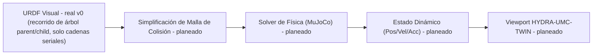

<p align="center">
  
</p>

# 🏗️ HYDRA-UMC-PHYSICS-REPLICA

<p align="center"><a href="README.md">🇺🇸 English</a> | 🇪🇸 <b>Español</b> | <a href="README_fra.md">🇫🇷 Français</a> | <a href="README_ita.md">🇮🇹 Italiano</a> | <a href="README_deu.md">🇩🇪 Deutsch</a> | <a href="README_zho.md">🇨🇳 简体中文</a> | <a href="README_jpn.md">🇯🇵 日本語</a> | <a href="README_por.md">🇵🇹 Português</a></p>

### 📐 Cinemática directa de URDF y validación de límites de articulación

<p align="center">
  
  
  
  
</p>

---

> **Estado de seguridad física y de ciberseguridad:** este ecosistema no es un sistema de seguridad certificado. Todavía no existe una ruta de E-STOP por hardware, ni límites ni enclavamientos aplicados por el firmware, ni un comando de movimiento verificado; las imágenes de firmware se comprueban con CRC32 y un HMAC-SHA256 de clave compartida, no con una firma asimétrica; TLS y TLS mutuo son opcionales y están desactivados por defecto; aún no se ha poblado ni probado ninguna placa propia. Lee la [línea base de seguridad](https://github.com/JuanenRac/HYDRA-UMC-DOCS/blob/main/docs/SECURITY_BASELINE.md) y el [modelo de amenazas](https://github.com/JuanenRac/HYDRA-UMC-DOCS/blob/main/docs/THREAT_MODEL.md) antes de fiarte de cualquier afirmación de aquí para la seguridad de una persona.

## 📋 De un vistazo

| | |
|---|---|
| Versión | `0.0.8` |
| Madurez | Funcional |
| Tecnología | Rust / roxmltree / URDF forward kinematics |
| En hardware real | Todavía no: no consta ninguna ejecución en hardware real para esta versión |

## 1. 🛠️ VISIÓN GENERAL TÉCNICA

**HYDRA-UMC-PHYSICS-REPLICA** es el módulo de cinemática del Gemelo Digital: lee una cadena serie URDF, calcula la pose de cada articulación (cinemática directa) y comprueba las posiciones de las articulaciones frente a sus límites. No simula dinámica: no hay modelo de cuerpo rígido, contacto ni fricción, ni MuJoCo ni PhysX; eso es la hoja de ruta.

Las unidades son las de URDF (metros y radianes). `fk` imprime la posición de cada articulación; con `--json` imprime la posición y la rotación como cuaternión unitario.

### Características Clave:
* 📐 **Validación Cinemática (v0):** cinemática directa real y comprobación real de límites de articulación sobre un subconjunto de URDF (documentado y parcial) - ver "Comprobación de honestidad" abajo para lo que funciona hoy exactamente.
* 🔒 **Real v0 - FK con Verja de Límites:** `fk-checked` se niega a calcular una pose en el mundo para una posición de articulación fuera de su límite declarado en el URDF, respaldado por un corpus real y reutilizable de límites de articulación y tests de regresión para ambos límites y entradas muy fuera de rango - cerrando el hueco donde `fk` normal reportaría en silencio una pose físicamente inalcanzable.
* 🏗️ **URDF a Física (v0, parcial):** lee elementos `<joint>` reales (tipo/origen/eje/límite) de un fichero URDF en una cadena. *Todavía no real:* la generación de mallas de colisión - esa sigue siendo la mitad "física" de esta característica.
* ⚡ **Rendimiento en Tiempo Real (planeado):** resolución paralelizada para espacios de trabajo multi-robot - depende de que exista antes una integración real de motor de física.
* 🌡️ **Simulación Térmica (planeado):** soporte experimental para emular la disipación de calor en cabezales de herramientas (T12/Láser).
* 📋 **Qué hace y qué no hace el lector de URDF (real hoy):** solo se leen los elementos `<joint>` directamente bajo `<robot>` (los de `<transmission>` se ignoran), así que los ficheros de ros_control se leen; una articulación revolute o prismatic necesita un `<axis>` de longitud no nula y un `<limit>` (sin él, `fk-checked` y `validate-limits` se niegan a comprobarla); el `<limit>` de una continuous da solo esfuerzo y velocidad, y una fixed no tiene; nombres de articulación duplicados, un enlace con dos padres y enlaces que ningún `<link>` declara son errores; `<mimic>`, `<safety_controller>` y articulaciones floating o planar no están soportados; un nombre en `--joints` que el URDF no tiene, o dado dos veces, es un error, y `validate-limits` necesita una posición para cada articulación con límite salvo que se pase `--allow-partial` (una comprobación que no se hizo nunca se informa como "No limit violations").

**Comprobación de honestidad - qué funciona hoy de verdad:** `fk --urdf RUTA --joints "j1=0.5,..."` calcula posiciones reales en el mundo por articulación encadenando las transformaciones de las articulaciones del URDF, sin importar si una posición está dentro de su límite declarado; `fk-checked` ejecuta el mismo cálculo pero comprueba primero cada posición contra la verificación real de `validate-limits`, negándose a calcular (o reportar) ninguna pose si algo está fuera de rango; `validate-limits --urdf RUTA --joints "..."` reporta articulaciones reales fuera de rango por su cuenta. Los tres son cinemática pura - sin dinámica de cuerpo rígido, sin fuerzas de contacto, sin ningún solver MuJoCo/PhysX conectado todavía, y el lector de URDF recorre un árbol real de enlaces `parent`/`child` hacia una única cadena serial, rechazando (sin aplanarlo) un árbol genuinamente ramificado (ver la documentación propia del módulo `urdf.rs` para el porqué). Ver [`CHANGELOG.md`](CHANGELOG.md) para lo entregado exactamente, y la Hoja de Ruta abajo para lo que sigue por delante.

---

## 2. 🔄 PIPELINE DE FÍSICA

`URDF` (parseo) y un paso real e independiente de cinemática (`fk`/
`validate-limits`, no mostrado como caja propia abajo ya que sustituye el
rol de `SOLVE` en v0) son reales hoy. `MESH`, el paso `SOLVE` real (un
solver MuJoCo/PhysX de verdad), `DYN` y `TWIN` siguen siendo trabajo
futuro.



---

## 3. 🧱 ARQUITECTURA Y DECISIONES DE DISEÑO

* **Por qué esta simulación no tiene carpetas `hardware/`/`firmware/`/`os/`.** Software puro - sin placa propia, así que esas carpetas se podaron en vez de dejarlas vacías.
* **Por qué es hermana, no un submódulo, de HYDRA-UMC-TWIN.** El solucionador de física corre a su propia frecuencia de tick, independiente del renderizado - mantenerlo como proceso separado significa que un paso de física lento no bloquea la propia tasa de fotogramas de HYDRA-UMC-TWIN, y cualquiera de los dos puede sustituirse/actualizarse (ej. MuJoCo frente a PhysX) sin tocar el otro.
* **Cómo encaja en el resto del ecosistema.** Hijo de HYDRA-UMC-TWIN por diseño. Hoy HYDRA-UMC-TWIN no lo llama: la comprobación de plausibilidad física detrás de "si funciona en el Twin, funciona en planta" está prevista, no construida.
* **Por qué v0 rechaza un URDF con ramificación real en vez de aplanarlo.** Encontrado al auditar el código: v0 antes analizaba los elementos `<joint>` en el orden bruto del documento y trataba ese orden como la cadena, lo cual es incorrecto para cualquier URDF válido según la especificación que declare sus articulaciones fuera del orden del árbol. Arreglado: los nombres de enlace `parent`/`child` reales de cada articulación ahora se recorren desde el enlace raíz real del documento en un orden real de raíz a hoja. `Chain` en sí sigue siendo un `Vec<Joint>` plano, así que una ramificación real (un enlace con más de una articulación hija) no tiene un único orden en el que aplanarla - se rechaza con un error real en vez de quedarse silenciosamente con una rama y descartar la otra. Honesto para el propio catálogo de `HYDRA-UMC-EDITOR-URDF`, que hoy son enteramente brazos seriales únicos (ver `urdf.rs`).
* **Por qué `roxmltree` es la única dependencia, todavía no un binding completo de motor de física.** La cinemática directa y la comprobación de límites reales no necesitan nada más que leer atributos XML y hacer álgebra matricial a mano (`transform.rs`) - añadir un binding FFI de MuJoCo/PhysX para eso sería peso de dependencia sin beneficio real hasta que se esté construyendo simulación real de cuerpo rígido/contactos.
* **Por qué `fk-checked` es un subcomando nuevo en vez de cambiar `fk` in situ.** `fk` es la utilidad de bajo nivel existente, matemática pura - algunos llamadores (ej. ajustar un límite en sí mismo) genuinamente quieren la pose sin verificar para un valor fuera de rango. `fk-checked` añade el punto de entrada a prueba de fallos, con verja de límites, que los llamadores reales deberían usar, sin cambiar en silencio lo que `fk` siempre ha significado.
* **Por qué el corpus de límites de articulación (`corpus.rs`) es solo para tests.** Existe puramente para darle a los tests de regresión de `limits.rs` y `kinematics.rs` un único conjunto de fixtures real y compartido en vez de literales ad hoc duplicados - no tiene razón para incluirse en el binario de release, así que está protegido tras `#[cfg(test)]`.

---

## 📂 ESTRUCTURA DE DIRECTORIOS

Motor de simulación puramente software, sin diseño de hardware propio; las
carpetas de código solo se incluyen cuando su implementación las requiere,
por lo que este proyecto no lleva `hardware/`, `firmware/` ni `os/`.

```text
HYDRA-UMC-PHYSICS-REPLICA/
├── src/
│   ├── transform.rs      # Vec3/Mat4 reales (traslación, rotación eje-ángulo, rpy)
│   ├── urdf.rs           # Lector real y parcial de URDF (recorrido de árbol parent/child, solo cadenas seriales)
│   ├── kinematics.rs     # forward_kinematics() real + forward_kinematics_checked()
│   ├── limits.rs         # validate_limits() real
│   ├── corpus.rs         # Corpus de fixtures de limites, solo para tests
│   └── main.rs           # Entry point + subcomandos reales `fk`/`fk-checked`/`validate-limits`
├── docs/
│   └── CLI_REFERENCE.md # Referencia completa de línea de comandos, cada código de salida y caso de error
├── build/               # Notas/artefactos de build (la salida real de cargo vive en target/, en .gitignore)
├── images/              # Medios y diagramas
├── tools/
│   ├── build_test.py    # Comprobación de compilación sin versionado
│   └── ci_validate.py   # Validación de manifiesto/CHANGELOG/docs usada por CI
├── Cargo.toml           # Metadatos del paquete, dependencias (roxmltree), version cuentakilometros
├── bump_version.py      # Incremento de versión tipo cuentakilómetros (solo lo ejecuta el comando `bump` explícito)
├── bump_manifest_version.py # Sincroniza la versión de hydra-umc.project.json con la nativa (--sync)
├── build.sh / build.bat # Valida y compila (compilar nunca cambia la versión)
├── build-test.sh / build-test.bat # Comprobación de compilación sin versionado
└── run.sh / run.bat     # Ejecuta el binario release compilado (reenvía argumentos)
```

---

## 🏗️ BUILD Y RUN

Requiere el toolchain de Rust (`cargo`/`rustc`, instalar vía [rustup](https://rustup.rs)) y Python 3.10+ (solo para `bump_version.py`).

```bash
# Linux / macOS
./build.sh   # `cargo test` (64 tests), luego `cargo build --release`
./run.sh     # ejecuta target/release/hydra-umc-physics-replica, imprime nombre + version + rol
```

```bat
:: Windows
build.bat
run.bat
```

`build.sh`/`build.bat` nunca cambian la versión (solo `python tools/hydra_project_tool.py bump` la sube), ejecutan la suite de tests real, y luego construyen un binario release.

Los subcomandos reales `fk` y `validate-limits` necesitan un fichero URDF:

```bash
./run.sh fk --urdf arm.urdf --joints "shoulder=0,elbow=0"
# shoulder: x=0.000000 y=0.000000 z=0.200000
# elbow: x=0.300000 y=0.000000 z=0.200000

./run.sh validate-limits --urdf arm.urdf --joints "shoulder=3.0,elbow=0.2"
# LIMIT VIOLATION: joint 'shoulder' = 3.000000 (allowed [-1.570000, 1.570000])
```

El subcomando real `fk-checked` se niega a calcular una pose cuando una articulación está fuera de rango - a diferencia de `fk` normal, que la calcula de todos modos:

```bash
./run.sh fk-checked --urdf arm.urdf --joints "shoulder=0.5,elbow=0.2"
# shoulder: x=0.000000 y=0.000000 z=0.200000
# elbow: x=0.263275 y=0.143828 z=0.200000

./run.sh fk-checked --urdf arm.urdf --joints "shoulder=0.5,elbow=5.0"
# LIMIT VIOLATION: joint 'elbow' = 5.000000 (allowed [-2.000000, 2.000000]) - refusing to compute an unreachable pose

./run.sh fk --urdf arm.urdf --joints "shoulder=0.5,elbow=5.0"
# elbow: x=0.263275 y=0.143828 z=0.200000   <- se calcula de todos modos; este es el hueco que cierra fk-checked
```

`fk` sale con `0` en éxito, `2` si `--urdf`/`--joints` es inválido. `fk-checked` sale con `0` (pose real), `1` (violación de límite), o `2` (entrada inválida). `validate-limits` sale con `0` (sin violaciones), `1` (violaciones encontradas), o `2` (entrada inválida).

Ver [`docs/CLI_REFERENCE.md`](docs/CLI_REFERENCE.md) para la referencia completa de línea de comandos, con cada caso de error real (argumentos faltantes/mal formados, un archivo URDF ilegible) capturado de una ejecución real del binario de release.

---

## 🚀 HOJA DE RUTA
* **Fase 1:** Sincronización de Digital Twin con telemetría de hardware en tiempo real y latencia sub-10ms.
* **Fase 2:** Integración de Physics Replica con simuladores de grado industrial (Isaac Sim) y soporte para cuerpos deformables.
* **Fase 3:** Patrones de recuperación automatizados de Node Healing para failover descentralizado y detección temprana de degradación de sensores.
* **Fase 4:** Soporte para simulación de cuerpos deformables (cables y tubos de vacío) y generación de datos sintéticos fotorrealistas.

---

## 🔗 Proyectos Relacionados

Este proyecto es parte del ecosistema de robótica HYDRA-UMC del mismo autor (JuanenRac / Electro Hobby 3D). Vale la pena conocerlo, ya que una petición podría en realidad ser sobre alguno de estos en vez de sobre este repositorio.

**Proyecto Padre**
- **[HYDRA-UMC-TWIN](https://github.com/JuanenRac/HYDRA-UMC-TWIN)** — nodo de integración para el motor de gemelo digital, con un contrato real de sincronización por compatibilidad de versión; el padre del que este repositorio es un servicio de simulación específico, dentro de su propio motor de gemelo digital.

**Proyectos Hermanos** — los demás servicios de simulación del propio motor de gemelo digital de HYDRA-UMC-TWIN
- **[HYDRA-UMC-HIL-BRIDGE](https://github.com/JuanenRac/HYDRA-UMC-HIL-BRIDGE)** — enrutador hardware-in-the-loop con un enclavamiento de software por colisión entre simulación y hardware real (probado sin hardware real).
- **[HYDRA-UMC-SYNTHETIC-DATA-GEN](https://github.com/JuanenRac/HYDRA-UMC-SYNTHETIC-DATA-GEN)** — generador real de escenas 2D procedurales con exportación de anotaciones YOLO/COCO.

**Directamente Relacionados**
- **[HYDRA-UMC-EDITOR-URDF](https://github.com/JuanenRac/HYDRA-UMC-EDITOR-URDF)** — creador/editor gráfico de URDF de escritorio que envía los modelos terminados al propio catálogo de STUDIO — la herramienta con la que se crean los modelos URDF que este proyecto lee (`fk`/`validate-limits`).
- **[HYDRA-UMC-EDITOR-STL](https://github.com/JuanenRac/HYDRA-UMC-EDITOR-STL)** — editor de escritorio de modelos STL, que transforma/reemplaza/quita/añade piezas reales en el mismo catálogo de modelos que también edita HYDRA-UMC-EDITOR-URDF.

**También Forma Parte del Ecosistema**

*Hardware y Plataforma Base*
- **[HYDRA-UMC](https://github.com/JuanenRac/HYDRA-UMC)** — el diseño de la placa madre del brazo robótico: host CM5 + coprocesador STM32H745 de doble núcleo, pensado para coordinar hasta 8 brazos herramienta por CAN-OTA/SPI-OTA (firmware en fase temprana; todavía no hay ninguna placa poblada).
- **[HYDRA-UMC-OS](https://github.com/JuanenRac/HYDRA-UMC-OS)** — capa de producto reproducible sobre Raspberry Pi OS para el CM5: agente de solo lectura, config/perfiles validados, aprovisionamiento WiFi de primer contacto.
- **[HYDRA-UMC-SDK](https://github.com/JuanenRac/HYDRA-UMC-SDK)** — el contrato JSON-Schema compartido y la barrera de software de puerta de trabajos contra la que cada bridge valida sus comandos (no es una función de seguridad certificada).
- **[HYDRA-UMC-CONNECTOR-HUB](https://github.com/JuanenRac/HYDRA-UMC-CONNECTOR-HUB)** — registro declarativo y validador de manifiestos de adaptador para conectores de máquinas externas; extiende la propia idea de contrato del SDK a máquinas externas sin sustituir a los proyectos de pasarela industrial.

*Backend Central y Clientes*
- **[HYDRA-UMC-SERVER](https://github.com/JuanenRac/HYDRA-UMC-SERVER)** — el backend headless real (REST/WebSocket) con el que habla de verdad cada cliente de control.
- **[HYDRA-UMC-STUDIO](https://github.com/JuanenRac/HYDRA-UMC-STUDIO)** — panel de control web con visualización 3D multi-robot en tiempo real.
- **[HYDRA-UMC-SUITE](https://github.com/JuanenRac/HYDRA-UMC-SUITE)** — centro de mando de enjambre de escritorio (PySide6) para varios servidores a la vez, empaquetado como ejecutable independiente.
- **[HYDRA-UMC-ANDROID-CONTROL](https://github.com/JuanenRac/HYDRA-UMC-ANDROID-CONTROL)** — app nativa de control para Android con inicio de sesión biométrico y un compañero Wear OS emparejado.
- **[HYDRA-UMC-IOS-CONTROL](https://github.com/JuanenRac/HYDRA-UMC-IOS-CONTROL)** — app de control para iOS/iPadOS (Flutter) con sincronización en tiempo real por WebSocket.
- **[HYDRA-UMC-DSI](https://github.com/JuanenRac/HYDRA-UMC-DSI)** — interfaz táctil nativa para la pantalla táctil DSI de 7" a bordo, embebida en el propio CM5.
- **[HYDRA-UMC-BRIDGE-AMR](https://github.com/JuanenRac/HYDRA-UMC-BRIDGE-AMR)** — barrera de coordinación para flotas AGV/AMR mediante un publicador MQTT VDA 5050 (probado solo contra una flota emulada).
- **[HYDRA-UMC-BRIDGE-CNC](https://github.com/JuanenRac/HYDRA-UMC-BRIDGE-CNC)** — coordinador de alto nivel para celdas CNC con acceso a estado/bytes de control GRBL (probado solo contra un emulador).
- **[HYDRA-UMC-BRIDGE-DROIDS](https://github.com/JuanenRac/HYDRA-UMC-BRIDGE-DROIDS)** — barrera de coordinación para droides con patas/humanoides, con un emisor de comandos para Boston Dynamics Spot (probado solo contra un emulador).
- **[HYDRA-UMC-BRIDGE-LASER](https://github.com/JuanenRac/HYDRA-UMC-BRIDGE-LASER)** — coordinador de celdas láser que lee 3 señales GPIO de llave/carcasa/enclavamiento (probado solo contra un chip simulado; no puede armar ni disparar un láser).
- **[HYDRA-UMC-BRIDGE-OPENPNP](https://github.com/JuanenRac/HYDRA-UMC-BRIDGE-OPENPNP)** — coordinador de alto nivel seguro para el flujo de placas de pick-and-place OpenPnP.
- **[HYDRA-UMC-BRIDGE-PRINTER3D](https://github.com/JuanenRac/HYDRA-UMC-BRIDGE-PRINTER3D)** — barrera de coordinación segura para impresoras 3D Moonraker/Klipper, con comandos de trabajo reales y controlados.
- **[HYDRA-UMC-BRIDGE-ROS2](https://github.com/JuanenRac/HYDRA-UMC-BRIDGE-ROS2)** — coordinador con un transporte ROS 2 rclpy importado de forma perezosa (todavía no ejecutado contra una instalación de ROS 2).
- **[HYDRA-UMC-BRIDGE-UAV](https://github.com/JuanenRac/HYDRA-UMC-BRIDGE-UAV)** — barrera de coordinación para UAV equipados con cámara, con un emisor de comandos MAVLink (probado solo contra un emulador).

*Plataforma de Herramientas URTC*
- **[URTC](https://github.com/JuanenRac/URTC)** — firmware para la placa física del Universal Robot Tool Controller, más de 25 perfiles de herramienta por bus CAN.
- **[URTC-FLASHER](https://github.com/JuanenRac/URTC-FLASHER)** — herramienta de escritorio con GUI para flashear placas URTC, CAN-OTA más SWD/JTAG de chip completo.
- **[URTC-TESTER](https://github.com/JuanenRac/URTC-TESTER)** — herramienta de escritorio de diagnóstico CAN-bus en vivo para placas URTC, un panel por perfil de herramienta.
- **[URTC-WEB-STUDIO](https://github.com/JuanenRac/URTC-WEB-STUDIO)** — alternativa basada en navegador a URTC-TESTER mediante la Web Serial API, sin instalación local.

*Nodo IA de Visión (Hailo-8)*
- **[HYDRA-UMC-VISION-NODE](https://github.com/JuanenRac/HYDRA-UMC-VISION-NODE)** — nodo de integración para el pipeline de visión Hailo-8, con una comprobación real de disponibilidad de hardware por etapa.
- **[HYDRA-UMC-DETECTION-HEF](https://github.com/JuanenRac/HYDRA-UMC-DETECTION-HEF)** — registro real de modelos compilados con verificación de carga segura por arquitectura Hailo/checksum.
- **[HYDRA-UMC-VISION-STREAMER](https://github.com/JuanenRac/HYDRA-UMC-VISION-STREAMER)** — generador real de pipeline GStreamer + config MediaMTX, con una frontera de integración HailoRT real.
- **[HYDRA-UMC-VISUAL-SERVOING-API](https://github.com/JuanenRac/HYDRA-UMC-VISUAL-SERVOING-API)** — ley de corrección Position-Based Visual Servoing con autorización condicionada al estado de zona; todavía sin estimación de pose por cámara.
- **[HYDRA-UMC-SAFETY-ZONES](https://github.com/JuanenRac/HYDRA-UMC-SAFETY-ZONES)** — lógica v0 de invasión de zona, vigencia de calibración y solicitud de E-STOP que toma las posiciones de los objetos de un fichero; ningún detector la alimenta y todavía no hay un E-STOP físico conectado.

*Nodo IA Cognitivo (Hailo-10)*
- **[HYDRA-UMC-COGNITIVE-NODE](https://github.com/JuanenRac/HYDRA-UMC-COGNITIVE-NODE)** — nodo de integración para el pipeline cognitivo Hailo-10 (orquestación de LLM/VLA/voz).
- **[HYDRA-UMC-VLA-ENGINE](https://github.com/JuanenRac/HYDRA-UMC-VLA-ENGINE)** — codificación/decodificación real de tokens de acción y generación de trayectoria para un modelo Vision-Language-Action.
- **[HYDRA-UMC-VOICE-UI](https://github.com/JuanenRac/HYDRA-UMC-VOICE-UI)** — front-end de voz real (VAD + analizador de intención) con un relé a Watch acotado y con confirmación.
- **[HYDRA-UMC-SEMANTIC-PLANNER](https://github.com/JuanenRac/HYDRA-UMC-SEMANTIC-PLANNER)** — descomposición real de tareas basada en reglas y recuperación semántica de errores sobre códigos de error del MCU.
- **[HYDRA-UMC-DOCS-QA](https://github.com/JuanenRac/HYDRA-UMC-DOCS-QA)** — búsqueda real de documentos TF-IDF (solo librería estándar) sobre los propios documentos Markdown de este ecosistema.
- **[HYDRA-UMC-LOCAL-TECHNICIAN](https://github.com/JuanenRac/HYDRA-UMC-LOCAL-TECHNICIAN)** — técnico de mantenimiento con IA local y con puertas de política para el propio ecosistema - observa, diagnostica y propone arreglos; los dos niveles de riesgo más altos están deliberadamente sin implementar todavía.

*Orquestación y Enjambre*
- **[HYDRA-UMC-ORCHESTRATOR](https://github.com/JuanenRac/HYDRA-UMC-ORCHESTRATOR)** — nodo de integración con un contrato real de informe de salud gRPC/Protobuf y una máquina de estados de misión.
- **[HYDRA-UMC-JOB-DISPATCHER](https://github.com/JuanenRac/HYDRA-UMC-JOB-DISPATCHER)** — cola de trabajos real basada en prioridad con deduplicación, sobre una API HTTP real.
- **[HYDRA-UMC-NODE-HEALING](https://github.com/JuanenRac/HYDRA-UMC-NODE-HEALING)** — watchdog de salud de flota real basado en gRPC, con reintento/backoff y detección de discrepancia de identidad.
- **[HYDRA-UMC-PATH-PLANNER-3D](https://github.com/JuanenRac/HYDRA-UMC-PATH-PLANNER-3D)** — planificador de rutas 3D real basado en RRT, con validación real de colisión de obstáculos/espacio de trabajo.
- **[HYDRA-UMC-SWARM-SYNC](https://github.com/JuanenRac/HYDRA-UMC-SWARM-SYNC)** — sincronización de estado real mediante CRDT LWW-Element-Map, con pruebas de propiedades para convergencia multi-celda.

*Datos y Analítica*
- **[HYDRA-UMC-DATALAKE](https://github.com/JuanenRac/HYDRA-UMC-DATALAKE)** — almacén de series temporales real respaldado por sqlite3, con una API HTTP real de ingesta/consulta.
- **[HYDRA-UMC-ANOMALY-DETECTOR](https://github.com/JuanenRac/HYDRA-UMC-ANOMALY-DETECTOR)** — detector de anomalías real basado en FFT + línea base estadística, con monitorización de deriva.
- **[HYDRA-UMC-PRODUCTION-REPORTS](https://github.com/JuanenRac/HYDRA-UMC-PRODUCTION-REPORTS)** — cálculo real de OEE/disponibilidad sobre el histórico de DATALAKE, con exportación CSV reproducible.
- **[HYDRA-UMC-TELEMETRY-COLLECTOR](https://github.com/JuanenRac/HYDRA-UMC-TELEMETRY-COLLECTOR)** — pipeline real de ingesta CAN/WebSocket hacia DATALAKE, con deduplicación por secuencia.

*Pasarela Industrial*
- **[HYDRA-UMC-GATEWAY-INDUSTRIAL](https://github.com/JuanenRac/HYDRA-UMC-GATEWAY-INDUSTRIAL)** — nodo de integración que retransmite a protocolos industriales, con una capa real de lista blanca de comandos/contrapresión.
- **[HYDRA-UMC-OPCUA-SERVER](https://github.com/JuanenRac/HYDRA-UMC-OPCUA-SERVER)** — espacio de direcciones OPC-UA real, verificado con una sesión de cliente real del protocolo binario.
- **[HYDRA-UMC-MQTT-BROKER](https://github.com/JuanenRac/HYDRA-UMC-MQTT-BROKER)** — broker MQTT real con autenticación por cliente opcional y ACL de tópicos.
- **[HYDRA-UMC-MTCONNECT-ADAPTER](https://github.com/JuanenRac/HYDRA-UMC-MTCONNECT-ADAPTER)** — endpoints XML reales `/probe` y `/current` de MTConnect, con salida en modo degradado.

*Herramientas Complementarias y Operaciones del Ecosistema*
- **[HYDRA-UMC-DASHBOARD-AI](https://github.com/JuanenRac/HYDRA-UMC-DASHBOARD-AI)** — paneles de Resúmenes Inteligentes y Resaltado de Anomalías sobre DATALAKE/ANOMALY-DETECTOR, con un respaldo estadístico honesto.
- **[HYDRA-UMC-TOOL-CLI](https://github.com/JuanenRac/HYDRA-UMC-TOOL-CLI)** — CLI de flota con un contrato real y estable de códigos de salida, cliente real y en vivo de la propia API de HYDRA-UMC-SERVER.
- **[HYDRA-UMC-WATCH](https://github.com/JuanenRac/HYDRA-UMC-WATCH)** — app compañera de WearOS con patrones de alerta háptica y un relé de voz al teléfono emparejado (todavía no ejecutada en un reloj físico).
- **[URTC-SMART-RACK](https://github.com/JuanenRac/URTC-SMART-RACK)** — firmware para un rack de montaje de placas con decodificación real de ID de herramienta y lógica de precalentamiento Smart Idle.
- **[URTC-VISION-TOOL](https://github.com/JuanenRac/URTC-VISION-TOOL)** — firmware más un compañero de visión real en Python para un cabezal de inspección térmica/RGB.
- **[HYDRA-UMC-UPDATER](https://github.com/JuanenRac/HYDRA-UMC-UPDATER)** — herramienta administrativa de escritorio que descubre, clona y actualiza cada repositorio de este ecosistema.
- **[HYDRA-UMC-OS-REBUILDER](https://github.com/JuanenRac/HYDRA-UMC-OS-REBUILDER)** — herramienta de escritorio Windows/Linux que construye una imagen de la CM5 lista para grabar, precargada con las versiones más actuales del ecosistema, con configuración de primer arranque de Wi-Fi/usuario/SSH al estilo de Raspberry Pi Imager.
- **[HYDRA-UMC-OPS-AGENT](https://github.com/JuanenRac/HYDRA-UMC-OPS-AGENT)** — coordinador de incidencias de mantenimiento: un rol edge de bajo privilegio recopila un snapshot de inventario/salud saneado, un rol control-plane lo renderiza de solo lectura y pide a un proveedor de IA que sugiera un diagnóstico - nunca aplica un parche ni despliega nada.
- **[HYDRA-UMC-DEV-SERVER](https://github.com/JuanenRac/HYDRA-UMC-DEV-SERVER)** — host de desarrollo reproducible (Raspberry Pi 5 / CM5) que almacena el código del ecosistema y ejecuta tareas acotadas de compilación/pruebas bajo una cola duradera; un rol de desarrollo dedicado, explícitamente distinto de un CM5 operativo.


---

## 📚 Documentación y Comunidad

- **[CONTRIBUTING.md](CONTRIBUTING.md)** — stack tecnológico y pautas de codificación para un pull request.
- **[CODE_OF_CONDUCT.md](CODE_OF_CONDUCT.md)** — los estándares de comportamiento esperados en esta comunidad.
- **[SECURITY.md](SECURITY.md)** — cómo reportar una vulnerabilidad, y las áreas reales de enfoque en seguridad de este proyecto.
- **[SUPPORT.md](SUPPORT.md)** — dónde hacer preguntas y reportar errores.
- **[LICENSE.md](LICENSE.md)** — la licencia propia de este proyecto.

## 👤 AUTOR
**JuanenRac** (Electro Hobby 3D)
📧 electrohobby3d@gmail.com
📺 [youtube.com/@electrohobby3d](https://youtube.com/@electrohobby3d)

## 📜 LICENCIA
GPL-3.0 - Ver archivo LICENSE para más detalles.
