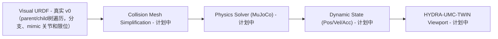

<!-- =============================================================================
HYDRA-UMC-PHYSICS-REPLICA - Digital twin module
Copyright (C) JuanenRac (Electro Hobby 3D) <electrohobby3d@gmail.com>
GPL-3.0-or-later - see LICENSE
============================================================================= -->

<p align="center">
  
</p>

# 📐 HYDRA-UMC-PHYSICS-REPLICA

<p align="center"><a href="README.md">🇺🇸 English</a> | <a href="README_spa.md">🇪🇸 Español</a> | <a href="README_fra.md">🇫🇷 Français</a> | <a href="README_ita.md">🇮🇹 Italiano</a> | <a href="README_deu.md">🇩🇪 Deutsch</a> | 🇨🇳 <b>简体中文</b> | <a href="README_jpn.md">🇯🇵 日本語</a> | <a href="README_por.md">🇵🇹 Português</a></p>

### 📐 URDF 正向运动学与关节限位验证

<p align="center">
  
  
  
  
  
  
  
</p>

---

> **安全与安防现状:**本生态系统不是经认证的安全系统。目前尚无硬件 E-STOP 通路,没有由固件强制执行的限位或联锁,也没有经过验证的运动指令;固件映像使用 CRC-32 和 Ed25519 签名校验,发布构建会拒绝已公开的开发密钥(中继之后的工具头和扩展板仍运行 URTC 的引导程序,它们使用共享密钥的 HMAC-SHA256 而不是签名);TLS 与双向 TLS 均为可选项,默认关闭;自制电路板尚未组装或测试。在依赖此处任何说法来保障人身安全之前,请先阅读[安全基线](https://github.com/JuanenRac/HYDRA-UMC-DOCS/blob/main/docs/SECURITY_BASELINE.md)和[威胁模型](https://github.com/JuanenRac/HYDRA-UMC-DOCS/blob/main/docs/THREAT_MODEL.md)。

---

## 📋 速览

| | |
|---|---|
| 版本 | `0.0.9` |
| 成熟度 | 可用 |
| 测试 | 86 (`cargo test`) |
| 技术栈 | Rust / roxmltree / URDF forward kinematics |
| 真实硬件 | 尚未：此版本没有在真实硬件上运行的记录 |

**跳转：** [概述](#-概述) · [架构](#-架构) · [快速开始](#-快速开始) · [测试](#-测试) · [仓库结构](#-仓库结构) · [相关项目](#-相关项目)

## 🚦 项目状态

每一行是本仓库的一个部分，灯号表示它今天做到了哪一步。内容依据仓库能够展示的证据（测试、构建、运行），而不是计划。

🟢 已完成并验证 · 🟡 可用，有已知限制 · 🟠 部分完成或尚未验证 · 🔴 未完成或不可用

| 领域 | 状态 | 在这里的含义 |
|---|---|---|
| 软件 | 🟡 | 主要用途可用；上面的诚实性检查列出了仍然缺少的内容 |
| 测试 | 🟢 | 86 项自动测试，每次变更都会运行 |
| 真实硬件 | 🔴 | 尚未：此版本没有在真实硬件上运行的记录 |
| 文档 | 🟢 | 八种语言的 README，每次变更都会与清单核对 |

## 🎯 概述

**HYDRA-UMC-PHYSICS-REPLICA** 是数字孪生的运动学模块：它读取 URDF 运动学树（串联臂以及夹爪这类分叉结构），计算每个关节的位姿（正向运动学），并对照关节限位检查关节位置。它不模拟动力学：没有刚体、接触或摩擦模型，也没有 MuJoCo 或 PhysX，这些属于路线图。

单位遵循 URDF（米和弧度）。`fk` 输出每个关节的位置；加上 `--json` 则输出位置和单位四元数形式的旋转。

### 关键特性：
* 📐 **运动学验证（v0）：** 在一个（已文档说明、部分支持的）URDF 子集上实现真实的正向运动学和真实的关节限位检查——下方"诚实说明"给出了今天到底能跑什么。
* 🔒 **真实 v0 —— 带限位检查的 FK：** `fk-checked` 会拒绝为超出 URDF 声明限位的关节位置计算世界坐标位姿，背后有一份真实、可复用的关节限位语料库和针对两侧边界及严重超限输入的回归测试作为支撑——填补了普通 `fk` 会默默报告一个物理上不可达位姿的漏洞。
* 🏗️ **URDF 转物理模型（v0，部分）：** 读取真实的 `<joint>` 元素（类型/原点/轴/限位），并从文档自身真实的根连杆开始，沿着每个关节真实的 `parent`/`child` 连杆名称遍历成一条链，得到真正的从根到叶的顺序，而不管文件中 `<joint>` 元素本身的排列顺序。*尚未真实：* 碰撞网格生成——那仍是这项特性中「物理」的那一半。
* ⚡ **实时性能（计划中）：** 面向多机器人工作空间的并行化求解——依赖于先有一个真实的物理引擎集成。
* 🌡️ **热仿真（计划中）：** 用于模拟刀头（T12/激光）散热的实验性支持。
* 📋 **URDF 读取器能做什么、不能做什么（今天已实现）：** 只读取直接位于 `<robot>` 下的 `<joint>` 元素（`<transmission>` 内的关节会被忽略，因此 ros_control 文件可以解析）；revolute 或 prismatic 关节需要长度非零的 `<axis>` 和 `<limit>`（没有 `<limit>` 时，`fk-checked` 和 `validate-limits` 拒绝检查）；continuous 关节的 `<limit>` 只给出力和速度，fixed 关节没有；重复的关节名、有两个父级的连杆以及没有任何 `<link>` 声明的连杆都是错误；不支持 `<mimic>`、`<safety_controller>` 以及 floating 或 planar 关节；`--joints` 中 URDF 没有的名称或重复给出的名称都是错误，除非给出 `--allow-partial`，否则 `validate-limits` 需要为每个有限位的关节提供位置（未执行的检查绝不会被报告为 "No limit violations"）。

**诚实说明——今天实际运行的内容：** `fk --urdf 路径 --joints "j1=0.5,..."` 通过串联 URDF 关节变换，计算每个关节真实的世界坐标位置，而不管某个位置是否在其声明的限位之内；`fk-checked` 执行同样的计算，但会先针对每个位置调用 `validate-limits` 的真实限位检查，只要有任何一项超出范围就拒绝计算（或报告）任何位姿；`validate-limits --urdf 路径 --joints "..."` 则单独报告真实的超限关节。三者都是纯运动学——没有刚体动力学，没有接触力，尚未接入任何 MuJoCo/PhysX 求解器，并且 URDF 读取器会遍历真实的 `parent`/`child` 连杆树，包括分支（每个关节都从携带其父连杆的关节开始放置），计算跟随另一个关节的关节（`<mimic>`），并且在需要时还会检查 `<safety_controller>` 的软限位以及速度和力的限位（`validate-limits --soft --velocities ... --efforts ...`）。具体已交付内容请参见 [`CHANGELOG.md`](CHANGELOG.md)，尚待完成的内容请参见下方路线图。

## 🧩 在 HYDRA-UMC 中的角色

**HYDRA-UMC-PHYSICS-REPLICA** 是数字孪生的运动学模块：读取 URDF 树，计算每个关节的位姿（正向运动学），并对照限位检查关节位置。它不模拟动力学：没有接触、摩擦或刚体模型。

## 🏛️ 架构

<p align="center">
  
</p>

<details>
<summary>图表的文本版本（Mermaid）</summary>



</details>

### 物理流水线

`URDF`（解析）以及一个真实、独立的运动学步骤（`fk`/`validate-limits`，
由于它在 v0 中承担了 `SOLVE` 的角色，下面没有把它单独画成一个方框）今天
已是真实的。`MESH`、真正的 `SOLVE` 步骤（一个真实的 MuJoCo/PhysX 求解
器）、`DYN` 以及 `TWIN` 仍是未来工作。

### 架构与设计决策

* **为何本仿真模块没有 `hardware/`/`firmware/`/`os/` 文件夹。** 纯软件——没有自己的板卡，因此这些文件夹被直接省略而非留空。
* **为何它是 HYDRA-UMC-TWIN 的兄弟项目，而非子模块。** 物理求解器以自己的节拍运行，独立于渲染——将其保持为独立进程意味着一次缓慢的物理步进不会拖慢 HYDRA-UMC-TWIN 自身的帧率，并且两者中的任何一个都可以被替换/升级（例如 MuJoCo 与 PhysX 之间切换）而不影响另一个。
* **这如何融入生态系统的其余部分。** 设计上是 HYDRA-UMC-TWIN 的子项目。目前 HYDRA-UMC-TWIN 并不调用它：“在孪生体中能运行，在现场就能运行”背后的物理合理性检查仅为计划，尚未构建。
* **为何分叉的 URDF 被读成 `Model`，而 `parse_urdf` 仍然拒绝它。** v0 之前按文档的原始顺序解析 `<joint>` 元素，并把这个顺序当作链条本身，这对任何按规范声明关节顺序不按树形排列的 URDF 都是错误的；现在会从文档自身真实的根连杆开始遍历每个关节真实的 `parent`/`child` 连杆名称。`parse_urdf_model` 保留整棵树：父关节在子关节之前的关节顺序、每个关节的父关节下标（夹爪的两根手指都从手掌开始放置，而不是一根接一根）、`<mimic>` 的跟随关节（`multiplier * 主关节 + offset`；给跟随关节指定位置会被拒绝，跟随关节成环也会被拒绝）以及力、速度和软限位。`parse_urdf` 保持原有约定，即扁平的串联 `Chain`，遇到分支时用真实错误拒绝，而不是悄悄保留一个分支、丢弃另一个。尚未完成：雅可比矩阵、逆运动学（详见 `urdf.rs`）。
* **为何 `roxmltree` 是唯一的依赖，还不是完整的物理引擎绑定。** 真实的正向运动学和真实的限位检查所需要的，仅仅是读取 XML 属性和手写的矩阵运算（`transform.rs`）——在真正开始构建刚体/接触仿真之前，为此添加一个 MuJoCo/PhysX 的 FFI 绑定只会增加依赖负担而没有真实收益。
* **为何 `fk-checked` 是一个新子命令，而不是就地修改 `fk`。** `fk` 是已有的底层纯数学工具——有些调用方（例如调整限位本身）确实想要针对超限值获得未经检查的位姿。`fk-checked` 增加了那个真正的调用方应该使用的、带限位检查、故障安全的入口点，而不会悄悄改变 `fk` 一直以来的含义。
* **为何关节限位语料库（`corpus.rs`）仅用于测试。** 它存在的唯一目的，就是给 `limits.rs` 和 `kinematics.rs` 的回归测试提供一份共享的真实 fixture 集合，而不是每个测试模块各自重复的临时字面量——它没有理由被打进 release 二进制文件，因此被置于 `#[cfg(test)]` 之后。

**用两款真实机械臂测试。** 测试根据厂商公布的 Denavit-Hartenberg 参数生成 UR5e 和 Franka Emika Panda 的 URDF（不复制他们的任何文件），并把二进制程序算出的工具位置，与直接连乘 4x4 矩阵得到的 DH 链结果、厂商文档记载的零位姿位置、连杆长度决定的可达范围上限以及公布的关节限位进行比较。

## 🚀 快速开始

需要稳定版 Rust 工具链（2021 版）及 `cargo`。

```bash
./build.sh  # Linux, macOS (build.bat on Windows)
./run.sh fk --urdf arm.urdf --joints "shoulder=0,elbow=0"
./run.sh validate-limits --urdf arm.urdf --joints "shoulder=3.0,elbow=0.2"
cargo test
```

## 🧪 测试

运行 `cargo test` 会执行 86 个自动测试。 不需要硬件，也不需要这台机器以外的任何东西。

CI 运行 `HYDRA_UMC_CI=1 python tools/ci_validate.py`，检查清单、文档、八个 README 和图片。

## 🏗️ 构建与发布

需要 Rust 工具链（`cargo`/`rustc`，通过 [rustup](https://rustup.rs) 安装）
以及 Python 3.10+（仅供 `bump_version.py` 使用）。

```bash
# Linux / macOS
./build.sh   # 、`cargo test`（86 个测试），然后执行 `cargo build --release`
./run.sh     # 运行 target/release/hydra-umc-physics-replica，打印名称 + 版本 + 角色
```

```bat
:: Windows
build.bat
run.bat
```

`build.sh`/`build.bat` 不会更改版本号（只有 `python tools/hydra_project_tool.py bump` 才会提升），运行真实的测试
套件，然后构建一个 release 二进制文件。

真实的 `fk` 和 `validate-limits` 子命令需要一个 URDF 文件：

```bash
./run.sh fk --urdf arm.urdf --joints "shoulder=0,elbow=0"
# shoulder: x=0.000000 y=0.000000 z=0.200000
# elbow: x=0.300000 y=0.000000 z=0.200000

./run.sh validate-limits --urdf arm.urdf --joints "shoulder=3.0,elbow=0.2"
# LIMIT VIOLATION: joint 'shoulder' = 3.000000 (allowed [-1.570000, 1.570000])
```

真实的 `fk-checked` 子命令会在关节超限时拒绝计算位姿——而普通 `fk`
则仍会照常计算：

```bash
./run.sh fk-checked --urdf arm.urdf --joints "shoulder=0.5,elbow=0.2"
# shoulder: x=0.000000 y=0.000000 z=0.200000
# elbow: x=0.263275 y=0.143828 z=0.200000

./run.sh fk-checked --urdf arm.urdf --joints "shoulder=0.5,elbow=5.0"
# LIMIT VIOLATION: joint 'elbow' = 5.000000 (allowed [-2.000000, 2.000000]) - refusing to compute an unreachable pose

./run.sh fk --urdf arm.urdf --joints "shoulder=0.5,elbow=5.0"
# elbow: x=0.263275 y=0.143828 z=0.200000   <- 仍会照常计算；这正是 fk-checked 所填补的漏洞
```

`fk` 成功时退出码为 `0`，`--urdf`/`--joints` 值无效时为 `2`。`fk-checked`
返回真实位姿时为 `0`，出现限位违规时为 `1`，输入无效时为 `2`。
`validate-limits` 无违规时退出码为 `0`，发现违规时为 `1`，输入无效时
为 `2`。

完整命令行参考——包含从真实发布二进制文件运行中采集到的每一种真实错误情形（缺失/格式错误的参数、无法读取的 URDF 文件）——见 [`docs/CLI_REFERENCE.md`](docs/CLI_REFERENCE.md)。

## 📂 仓库结构

<p align="center">
  
</p>

<details>
<summary>目录树的文本版本</summary>

```text
HYDRA-UMC-PHYSICS-REPLICA/
├── src/                             源代码
│   ├── transform.rs                 真实的 Vec3/Mat4（平移、轴角旋转、rpy）
│   ├── urdf.rs                      真实的、部分支持的 URDF 读取器（parent/child树遍历，分支、mimic 和限位）
│   ├── kinematics.rs                真实的 forward_kinematics() + forward_kinematics_checked()
│   ├── limits.rs                    真实的 validate_limits()
│   ├── corpus.rs                    仅用于测试的限位 fixture 语料库
│   └── main.rs                      入口点 + 真实的 `fk`/`fk-checked`/`validate-limits` 子命令
├── tests/                           cli_contract.rs 和 tree_contract.rs: 命令行错误 (关节拼写错误、重复或缺失) 以及分支与 mimic 关节的放置
├── docs/                            项目文档
├── images/                          媒体与图表
├── tools/                           项目工具和 CI 检查
├── .github/                         CI 工作流和 Issue 模板
├── Cargo.toml                       crate 元数据
├── bump_version.py                  显式提升版本
├── bump_manifest_version.py         将 hydra-umc.project.json 的版本与原生版本同步(--sync)
├── build.sh / build.bat             验证并构建（构建不会更改版本）
├── build-test.sh / build-test.bat   不递增版本号的构建检查
├── run.sh / run.bat                 运行编译后的 release 二进制文件（转发参数）
├── CHANGELOG.md                     每个版本的变更
├── hydra-umc.project.json           清单：版本、成熟度、系列
└── test.sh                          运行测试
```

</details>

## 🗺️ 路线图与已知限制

**当前已知限制**

* **第一阶段：** 数字孪生与实时硬件遥测的同步，延迟低于 10ms。
* **第二阶段：** 物理复制品与工业级仿真器（Isaac Sim）的集成，以及可变形体支持。
* **第三阶段：** 用于去中心化故障转移和早期传感器退化检测的节点自愈自动化恢复模式。
* **第四阶段：** 支持可变形体仿真（线缆和真空管）以及照片级真实合成数据生成。

## 🌍 语言

本 README 和仓库文档提供八种语言：英语、西班牙语、德语、法语、意大利语、日语、中文和葡萄牙语（葡萄牙）。它们同时编写，并由 CI 检查八个文件拥有相同的章节和相同的链接。 本仓库没有自己的界面或消息目录，因此没有需要翻译的界面文字。

## 🔗 相关项目

本项目是同一作者(JuanenRac / Electro Hobby 3D)打造的 HYDRA-UMC 机器人生态系统的一部分。值得了解,因为某个请求实际上可能是关于这些项目之一,而非本仓库本身。

**父项目**
- **[HYDRA-UMC-TWIN](https://github.com/JuanenRac/HYDRA-UMC-TWIN)** — 面向数字孪生引擎的集成中枢,具备真实的版本兼容性同步契约;本仓库是其自身数字孪生引擎中一个具体仿真服务所属的父项目。

**兄弟项目** —— HYDRA-UMC-TWIN 自身数字孪生引擎中的其他仿真服务
- **[HYDRA-UMC-HIL-BRIDGE](https://github.com/JuanenRac/HYDRA-UMC-HIL-BRIDGE)** — 在仿真与真实硬件之间带有软件碰撞联锁的硬件在环路由器(未在真实硬件上测试)。
- **[HYDRA-UMC-SYNTHETIC-DATA-GEN](https://github.com/JuanenRac/HYDRA-UMC-SYNTHETIC-DATA-GEN)** — 具备 YOLO/COCO 标注导出功能的真实程序化 2D 场景生成器。

**直接相关**
- **[HYDRA-UMC-EDITOR-URDF](https://github.com/JuanenRac/HYDRA-UMC-EDITOR-URDF)** — 将完成的模型推送到 STUDIO 自身目录的桌面版图形化 URDF 创建/编辑工具 —— 本项目读取的 URDF 模型(`fk`/`validate-limits`)正是用该工具创作的。
- **[HYDRA-UMC-EDITOR-STL](https://github.com/JuanenRac/HYDRA-UMC-EDITOR-STL)** — 桌面 STL 模型编辑器，在 HYDRA-UMC-EDITOR-URDF 编辑的同一模型目录中变换/替换/移除/添加真实部件。

**生态系统中的其他项目**

*核心硬件与平台*
- **[HYDRA-UMC](https://github.com/JuanenRac/HYDRA-UMC)** — 机器人手臂主板设计——CM5 主机 + 双核 STM32H745,目标是通过 CAN-OTA/SPI-OTA 协调最多 8 条工具臂(固件处于早期阶段,尚无已组装的电路板)。
- **[HYDRA-UMC-OS](https://github.com/JuanenRac/HYDRA-UMC-OS)** — 面向 CM5 的可复现 Raspberry Pi OS 产品层——只读代理、经过验证的配置/配置文件、WiFi 首次配网。
- **[HYDRA-UMC-SDK](https://github.com/JuanenRac/HYDRA-UMC-SDK)** — 每个桥接都据此校验自身指令的共享 JSON-Schema 契约与软件作业门限边界(并非经认证的安全功能)。
- **[HYDRA-UMC-CONNECTOR-HUB](https://github.com/JuanenRac/HYDRA-UMC-CONNECTOR-HUB)** — 面向外部机器连接器的声明式适配器清单注册与校验工具；把 SDK 自身的契约理念扩展到外部机器，而不取代工业网关类项目。

*核心后端与客户端*
- **[HYDRA-UMC-SERVER](https://github.com/JuanenRac/HYDRA-UMC-SERVER)** — 每个控制客户端真正通信的真实无头后端(REST/WebSocket)。
- **[HYDRA-UMC-STUDIO](https://github.com/JuanenRac/HYDRA-UMC-STUDIO)** — 具有实时多机器人 3D 可视化的网页控制面板。
- **[HYDRA-UMC-SUITE](https://github.com/JuanenRac/HYDRA-UMC-SUITE)** — 面向多台服务器的桌面(PySide6)集群指挥中心，打包为独立可执行文件。
- **[HYDRA-UMC-ANDROID-CONTROL](https://github.com/JuanenRac/HYDRA-UMC-ANDROID-CONTROL)** — 具有生物识别登录和配对 Wear OS 伴侣应用的原生 Android 控制应用。
- **[HYDRA-UMC-IOS-CONTROL](https://github.com/JuanenRac/HYDRA-UMC-IOS-CONTROL)** — 具有实时 WebSocket 同步的 iOS/iPadOS 控制应用(Flutter)。
- **[HYDRA-UMC-DSI](https://github.com/JuanenRac/HYDRA-UMC-DSI)** — 面向机载 7 英寸 DSI 触摸屏的原生触控界面，直接嵌入 CM5 本体。
- **[HYDRA-UMC-BRIDGE-AMR](https://github.com/JuanenRac/HYDRA-UMC-BRIDGE-AMR)** — 通过 VDA 5050 MQTT 发布者为 AGV/AMR 车队提供的协调边界(仅针对仿真车队测试)。
- **[HYDRA-UMC-BRIDGE-CNC](https://github.com/JuanenRac/HYDRA-UMC-BRIDGE-CNC)** — 具备 GRBL 状态/控制字节访问能力的高层 CNC 单元协调器(仅针对模拟器测试)。
- **[HYDRA-UMC-BRIDGE-DROIDS](https://github.com/JuanenRac/HYDRA-UMC-BRIDGE-DROIDS)** — 面向足式/人形机器人的协调边界,带有 Boston Dynamics Spot 指令发送器(仅针对模拟器测试)。
- **[HYDRA-UMC-BRIDGE-LASER](https://github.com/JuanenRac/HYDRA-UMC-BRIDGE-LASER)** — 读取 3 路钥匙/外壳/联锁 GPIO 信号的激光单元协调器(仅针对模拟芯片测试;无法使激光器上膛或发射)。
- **[HYDRA-UMC-BRIDGE-OPENPNP](https://github.com/JuanenRac/HYDRA-UMC-BRIDGE-OPENPNP)** — 面向 OpenPnP 贴片机板级流程的安全高层协调器。
- **[HYDRA-UMC-BRIDGE-PRINTER3D](https://github.com/JuanenRac/HYDRA-UMC-BRIDGE-PRINTER3D)** — 面向 Moonraker/Klipper 3D 打印机的安全协调边界，具备真实的受控作业指令。
- **[HYDRA-UMC-BRIDGE-ROS2](https://github.com/JuanenRac/HYDRA-UMC-BRIDGE-ROS2)** — 带有惰性导入 rclpy ROS 2 传输层的协调器(尚未在 ROS 2 环境中运行)。
- **[HYDRA-UMC-BRIDGE-UAV](https://github.com/JuanenRac/HYDRA-UMC-BRIDGE-UAV)** — 面向搭载摄像头的无人机的协调边界,带有 MAVLink 指令发送器(仅针对模拟器测试)。

*URTC 工具平台*
- **[URTC](https://github.com/JuanenRac/URTC)** — 面向实体 Universal Robot Tool Controller 板卡的固件，通过 CAN 总线支持 25 种以上工具配置。
- **[URTC-FLASHER](https://github.com/JuanenRac/URTC-FLASHER)** — 面向 URTC 板卡的桌面图形烧录工具，支持 CAN-OTA 以及全芯片 SWD/JTAG。
- **[URTC-TESTER](https://github.com/JuanenRac/URTC-TESTER)** — 面向 URTC 板卡的桌面实时 CAN 总线诊断工具，每种工具配置对应一个面板。
- **[URTC-WEB-STUDIO](https://github.com/JuanenRac/URTC-WEB-STUDIO)** — 通过 Web Serial API 实现的浏览器版 URTC-TESTER 替代方案，无需本地安装。
- **[URTC-GATEWAY](https://github.com/JuanenRac/URTC-GATEWAY)** — URTC CAN 总线前的网关：允许的标识符列表、速率限制和会话密钥；软件已在计算机上测试，尚未在真实总线上测试。

*视觉 AI 节点(Hailo-8)*
- **[HYDRA-UMC-VISION-NODE](https://github.com/JuanenRac/HYDRA-UMC-VISION-NODE)** — 面向 Hailo-8 视觉流水线的集成中枢，具备逐阶段的真实硬件就绪检测。
- **[HYDRA-UMC-DETECTION-HEF](https://github.com/JuanenRac/HYDRA-UMC-DETECTION-HEF)** — 具备 Hailo 架构/校验和安全加载验证的真实编译模型注册表。
- **[HYDRA-UMC-VISION-STREAMER](https://github.com/JuanenRac/HYDRA-UMC-VISION-STREAMER)** — 具备真实 HailoRT 集成边界的真实 GStreamer 流水线 + MediaMTX 配置生成器。
- **[HYDRA-UMC-VISUAL-SERVOING-API](https://github.com/JuanenRac/HYDRA-UMC-VISUAL-SERVOING-API)** — 以区域状态为授权条件的 Position-Based Visual Servoing 修正律;尚无摄像头位姿估计。
- **[HYDRA-UMC-SAFETY-ZONES](https://github.com/JuanenRac/HYDRA-UMC-SAFETY-ZONES)** — 从文件读取物体位置的 v0 区域入侵、校准新鲜度与 E-STOP 请求逻辑;没有检测器为其供数,也尚未连接任何物理 E-STOP。

*认知 AI 节点(Hailo-10)*
- **[HYDRA-UMC-COGNITIVE-NODE](https://github.com/JuanenRac/HYDRA-UMC-COGNITIVE-NODE)** — 面向 Hailo-10 认知流水线(LLM/VLA/语音编排)的集成中枢。
- **[HYDRA-UMC-VLA-ENGINE](https://github.com/JuanenRac/HYDRA-UMC-VLA-ENGINE)** — 面向 Vision-Language-Action 模型的真实动作 token 编解码与轨迹生成。
- **[HYDRA-UMC-VOICE-UI](https://github.com/JuanenRac/HYDRA-UMC-VOICE-UI)** — 具备受限、需确认的 Watch 中继的真实语音前端(VAD + 意图解析)。
- **[HYDRA-UMC-SEMANTIC-PLANNER](https://github.com/JuanenRac/HYDRA-UMC-SEMANTIC-PLANNER)** — 基于真实规则的任务分解，以及针对 MCU 错误码的语义化错误恢复。
- **[HYDRA-UMC-DOCS-QA](https://github.com/JuanenRac/HYDRA-UMC-DOCS-QA)** — 面向本生态系统自身 Markdown 文档的真实纯标准库 TF-IDF 文档检索。
- **[HYDRA-UMC-LOCAL-TECHNICIAN](https://github.com/JuanenRac/HYDRA-UMC-LOCAL-TECHNICIAN)** — 面向生态系统自身的本地、按策略门控的 AI 维护技师——观察、诊断并提出修复建议;两个最高风险等级目前特意尚未实现。

*编排与集群*
- **[HYDRA-UMC-ORCHESTRATOR](https://github.com/JuanenRac/HYDRA-UMC-ORCHESTRATOR)** — 具备真实 gRPC/Protobuf 健康报告契约与任务状态机的集成中枢。
- **[HYDRA-UMC-JOB-DISPATCHER](https://github.com/JuanenRac/HYDRA-UMC-JOB-DISPATCHER)** — 基于真实 HTTP API 的真实优先级任务队列，支持去重。
- **[HYDRA-UMC-NODE-HEALING](https://github.com/JuanenRac/HYDRA-UMC-NODE-HEALING)** — 具备重试/退避与身份不匹配检测的真实基于 gRPC 的车队健康看门狗。
- **[HYDRA-UMC-PATH-PLANNER-3D](https://github.com/JuanenRac/HYDRA-UMC-PATH-PLANNER-3D)** — 具备真实障碍物/工作空间碰撞校验的真实基于 RRT 的三维路径规划器。
- **[HYDRA-UMC-SWARM-SYNC](https://github.com/JuanenRac/HYDRA-UMC-SWARM-SYNC)** — 经过多单元收敛属性测试的真实 CRDT LWW-Element-Map 状态同步。

*数据与分析*
- **[HYDRA-UMC-DATALAKE](https://github.com/JuanenRac/HYDRA-UMC-DATALAKE)** — 具备真实数据摄入/查询 HTTP API 的真实 sqlite3 时序数据存储。
- **[HYDRA-UMC-ANOMALY-DETECTOR](https://github.com/JuanenRac/HYDRA-UMC-ANOMALY-DETECTOR)** — 具备漂移监测能力的真实 FFT + 统计基线异常检测器。
- **[HYDRA-UMC-PRODUCTION-REPORTS](https://github.com/JuanenRac/HYDRA-UMC-PRODUCTION-REPORTS)** — 基于 DATALAKE 历史数据的真实 OEE/可用率计算，支持可复现的 CSV 导出。
- **[HYDRA-UMC-TELEMETRY-COLLECTOR](https://github.com/JuanenRac/HYDRA-UMC-TELEMETRY-COLLECTOR)** — 面向 DATALAKE 的真实 CAN/WebSocket 数据摄入管道，支持序列去重。

*工业网关*
- **[HYDRA-UMC-GATEWAY-INDUSTRIAL](https://github.com/JuanenRac/HYDRA-UMC-GATEWAY-INDUSTRIAL)** — 中继至工业协议的集成中枢，具备真实的指令白名单/背压控制层。
- **[HYDRA-UMC-OPCUA-SERVER](https://github.com/JuanenRac/HYDRA-UMC-OPCUA-SERVER)** — 经真实二进制协议客户端会话验证的真实 OPC-UA 地址空间。
- **[HYDRA-UMC-MQTT-BROKER](https://github.com/JuanenRac/HYDRA-UMC-MQTT-BROKER)** — 具备可选按客户端认证与主题 ACL 的真实 MQTT 代理。
- **[HYDRA-UMC-MTCONNECT-ADAPTER](https://github.com/JuanenRac/HYDRA-UMC-MTCONNECT-ADAPTER)** — 具备降级模式输出的真实 MTConnect `/probe` 与 `/current` XML 端点。

*辅助工具与生态系统运维*
- **[HYDRA-UMC-DASHBOARD-AI](https://github.com/JuanenRac/HYDRA-UMC-DASHBOARD-AI)** — 基于 DATALAKE/ANOMALY-DETECTOR 的智能摘要与异常高亮面板，具备诚实的统计回退机制。
- **[HYDRA-UMC-TOOL-CLI](https://github.com/JuanenRac/HYDRA-UMC-TOOL-CLI)** — 具备真实、稳定退出码契约的车队 CLI，是 HYDRA-UMC-SERVER 自身 API 的真实在线客户端。
- **[HYDRA-UMC-WATCH](https://github.com/JuanenRac/HYDRA-UMC-WATCH)** — 带有触觉提醒模式与配对手机语音中继的 WearOS 伴侣应用(尚未在实体手表上运行)。
- **[URTC-SMART-RACK](https://github.com/JuanenRac/URTC-SMART-RACK)** — 面向板卡安装机架的固件，具备真实的工具 ID 解码与 Smart Idle 预热逻辑。
- **[URTC-VISION-TOOL](https://github.com/JuanenRac/URTC-VISION-TOOL)** — 面向热成像/RGB 检测工具头的固件及真实 Python 视觉伴侣程序。
- **[HYDRA-UMC-UPDATER](https://github.com/JuanenRac/HYDRA-UMC-UPDATER)** — 发现、克隆并更新本生态系统中每个仓库的管理类桌面工具。
- **[HYDRA-UMC-OS-REBUILDER](https://github.com/JuanenRac/HYDRA-UMC-OS-REBUILDER)** —— 构建即刻可烧录、预装生态系统最新版本的 CM5 镜像的 Windows/Linux 桌面工具,具备类似 Raspberry Pi Imager 风格的首次启动 Wi-Fi/用户/SSH 配置。
- **[HYDRA-UMC-OPS-AGENT](https://github.com/JuanenRac/HYDRA-UMC-OPS-AGENT)** — 维护事件协调器：一个低权限的边缘角色采集经过脱敏的库存/健康快照，一个控制面角色以只读方式渲染它，并请求某个 AI 提供方给出诊断建议——从不应用补丁，也从不部署任何内容。
- **[HYDRA-UMC-DEV-SERVER](https://github.com/JuanenRac/HYDRA-UMC-DEV-SERVER)** — 可复现的开发主机（Raspberry Pi 5 / CM5），保存整个生态系统的源代码，并在持久队列下运行有界的构建/测试任务；这是专用的开发角色，明确区别于运行中的 CM5。

## 📚 文档

更多阅读：

* [生态系统的安全基线](https://github.com/JuanenRac/HYDRA-UMC-DOCS/blob/main/docs/SECURITY_BASELINE.md)
* [生态系统的威胁模型](https://github.com/JuanenRac/HYDRA-UMC-DOCS/blob/main/docs/THREAT_MODEL.md)
* [本仓库的更新日志](CHANGELOG.md)
* [本仓库的许可证](LICENSE.md)

## 🤝 参与贡献与社区

* 提交 pull request 之前，请运行 `HYDRA_UMC_CI=1 py -3 tools/ci_validate.py`（或 `HYDRA_UMC_CI=1 python3 tools/ci_validate.py`）：它必须输出 `CI_VALIDATION=PASS`。此检查不要运行 `build.sh` 或 `build.bat`；构建不是检查。
* 八个 README 由 HYDRA-UMC-DOCS 中的同一个源生成；请勿手工编辑。修改源文件，再用 `tools/make_readmes.py` 重新生成。
* 不要在 README 中声称尚未运行过的内容：属实时请写“仅模拟”或“尚未在硬件上试过”。
* 请参阅 [CONTRIBUTING.md](CONTRIBUTING.md)、[行为准则](CODE_OF_CONDUCT.md)、[SECURITY.md](SECURITY.md) 和 [SUPPORT.md](SUPPORT.md)。

## 👤 作者

**JuanenRac (Electro Hobby 3D)** · electrohobby3d@gmail.com

## 📜 许可证

GPL-3.0-or-later - [LICENSE](LICENSE).
